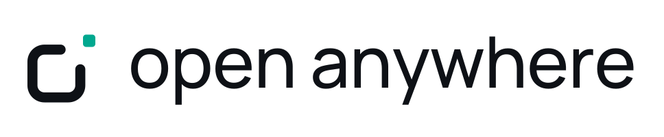

<p align="center">
  <picture>
    <source media="(prefers-color-scheme: dark)" srcset="assets/logo/open-anywhere-logo-dark.svg">
    
  </picture>
</p>

<p align="center">
  说出你的需要，让应用在身边的屏幕上诞生。
</p>

<p align="center">
  <a href="https://go.dev/"></a>
  <a href="https://codecov.io/gh/open-anywhere/open-anywhere"></a>
</p>

---

朋友聚会，接下来玩什么？对灵矽说：

> 我们三个人，做个五题的电影知识竞赛，你来主持，放到电视上。

AI 就围绕这次聚会创造游戏，邀请大家加入，通过语音互动，在大屏上呈现题目和比分。发起者也能成为玩家，大家一起抬头参与。

**有块屏幕，就能开场。**

用语音描述需求，让云端编码 Agent 生成可运行的 Web 应用，并在身边的屏幕上呈现和控制游玩。

聚会只是其中一种应用场景，更多场景与体验设计见[产品设计](docs/product.md)。

## 开发

基于 Go 语言开发。

```bash
go build ./...
go test ./... -race
go vet ./...
```

运行独立投屏服务：

```sh
go run ./cmd/casting -addr :8080 -interface en0
```

接口、目录组织和测试说明见 [Casting 服务](docs/casting.md)。
