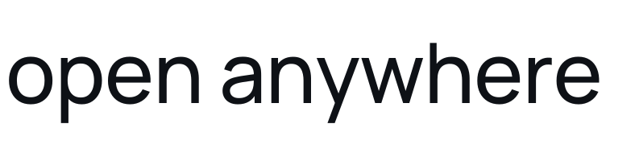

<p align="center">
  
  &nbsp;&nbsp;&nbsp;
  <picture>
    <source media="(prefers-color-scheme: dark)" srcset="docs/assets/open-anywhere-wordmark-dark.svg">
    
  </picture>
</p>

<p align="center">
  说出你的需要，让应用在身边的屏幕上诞生。
</p>

<p align="center">
  <a href="https://go.dev/"></a>
  <a href="https://codecov.io/gh/open-anywhere/open-anywhere"></a>
  <a href="https://codecov.io/gh/open-anywhere/open-anywhere"></a>
  <a href="https://codecov.io/gh/open-anywhere/open-anywhere"></a>
  <a href="https://codecov.io/gh/open-anywhere/open-anywhere"></a>
</p>

---

朋友聚会，接下来玩什么？对灵矽说：

> 我们三个人，做个五题的电影知识竞赛，你来主持，放到电视上。

AI 就围绕这次聚会创造游戏，邀请大家加入，通过语音互动，在大屏上呈现题目和比分。发起者也能成为玩家，大家一起抬头参与。

**有块屏幕，就能开场。**

用语音描述需求，让云端编码 Agent 生成可运行的 Web 应用，并在身边的屏幕上呈现和控制游玩。

聚会只是其中一种应用场景，更多场景与体验设计见[产品设计](docs/product.md)。

商业规划见[商业策略](docs/business-strategy.md)：市场背景、产品定位、收费模式（小玩具、百变积分、云端运行时长、运行盒子、社区版与端侧 AI 高端线）与验证路径。

## AI 是整个产品的主干

Open Anywhere 不是给现成应用加一层语音入口。产品最核心的几件事都发生在模型这一侧：应用不在菜单里，是被当场写出来的；玩法不在代码里，是被当场理解并驱动的。

| 环节 | 承担者 | 具体工作 |
| --- | --- | --- |
| 听懂需求 | 模型 | 语音转写后识别场景、人数、主题与目标屏幕，整理成可构建的需求 |
| 创造应用 | 模型 | 云端编码 Agent 在沙箱里写页面、写接口、写 OpenAPI，自测通过后产出可运行的应用包 |
| 理解应用 | 模型 | 每个应用都把操作声明成 API；模型读取操作表，自行判断该调哪一个、带什么参数 |
| 操作应用 | 模型 | “开始”“下一题”“查比分”被翻译成一次业务操作，经控制面校验后落到应用上 |
| 主持现场 | 模型 | 主持人提示词让智能体组织流程、判题计分，并用语音接住现场的变化 |
| 生成画面 | 确定性工程 | 端口分配、进程守护、页面采集、视频编码与投屏协议 |

**按用户旅程算，六个环节里有五个由模型完成**；只有最后一步“把画面送到屏幕上”交给确定性工程。投屏、编码、进程管理不用模型，是因为它们需要毫秒级的稳定与可预期的失败处理——把不确定性留给模型，把确定性留给链路。

AI 在这里不是点缀，而是三件非它不可的事：

- **长尾需求无法预置。** 一场只属于今晚三个人的聚会，不值得开发一款软件；模型把“为一次需求写一个应用”的边际成本降到接近零。
- **语义到操作需要翻译。** 一句随口的话要落到“某个接口的某组参数”，只有模型能完成这种映射，而且是面对它从未见过的应用。
- **千人千面是结果，不是概念。** 同一句“做个知识竞赛”，人数、主题、题量、主持风格随现场而变。服务端与运行端不含任何场景业务逻辑，场景只存在于生成出来的产物里。

所以 AI 在这款产品里的占比，不是某个功能模块的多少，而是**应用从哪里来、能力怎么被理解、现场怎么被驱动**——这三件事全部由模型完成。技术细节见[架构设计](docs/architecture.md)第 7 节“应用操作即 API”与[应用管理 MCP](docs/app-management-mcp.md)。

## 开发

基于 Go 语言开发。

```bash
go build ./...
go test ./... -race
go vet ./...
```

运行独立投屏服务：

```sh
go run ./cmd/casting -addr :8080 -interface en0
```

接口、目录组织和测试说明见 [Casting 服务](docs/casting.md)。

运行 Render（需 Node.js、Chromium、FFmpeg 和 lsof）：

```sh
go run ./cmd/render -addr :8090 -public-url http://192.168.1.20:8090
```

替换为本机可达地址。应用包、媒体流和真实视频 E2E 的用法见 [Render 运行说明](docs/render-runtime.md)。

运行控制面：

```sh
cp gateway.example.yaml gateway.yaml
go run ./cmd/gateway -config gateway.yaml
```

`gateway.example.yaml` 列出了全部配置项。配置优先级为命令行参数 > 环境变量 > YAML > 内置默认值；未指定 `-config` 时读取当前目录的 `gateway.yaml`。应用状态、构建进度和产物下载令牌保存在 SQLite（默认 `open-anywhere.gateway.db`），产物文件保存在 `artifacts/`。控制面重启后会恢复应用记录，并继续监听未完成的构建。表结构、持久化边界、恢复流程与已知缺口见 [控制面数据库设计](docs/gateway-database.md)。

MCP 端点为 `GET /mcp` 和 `POST /mcp/message`，健康检查为 `GET /healthz`。

运行用户门户（可选，多租户 SaaS 形态）：

门户前端是 React + Vite，构建产物由 Gateway 直接从磁盘提供：

```bash
cd portal
pnpm install
pnpm build
```

在 `gateway.yaml` 中启用 `portal.enabled`，设置管理员引导账号 `portal.username` / `portal.password`，并填写灵矽云可访问的 `linx.public_mcp_url` 与 `mcp_token`（Portal 模式下必填）。启动 Gateway 后打开 <http://127.0.0.1:8090/> 查看 Home，登录后：

- 管理员（配置的引导账号）默认进入 `/admin`，配置平台级 AgentAPI / Linx 密钥、默认 Render/Casting 与注册开关，并管理用户、智能体与全局应用；也可以进入 `/portal`。
- 普通用户在 `/register` 自助注册（需管理员打开注册开关），系统自动创建一台虚拟智能体和对应 Linx 设备；登录后进入 `/portal`，可查看应用、屏幕、活动，绑定 Render/Casting 服务并发起浏览器语音通话。

`linx.api_key` 与 AgentAPI 配置（Base URL、API Key、Agent ID、Environment ID）可以留空，由管理员在后台配置；`gateway.yaml` 中的值只在对应设置尚无值时 seed，已有设置不会被覆盖。平台 API Key 和用户服务 token 使用 AES-256-GCM 加密后入库，主密钥来自环境变量 `GATEWAY_SECRET_KEY`（base64 32 字节），否则自动生成 `portal-data/secret.key`（`0600`）。**丢失 `secret.key` / `GATEWAY_SECRET_KEY` 会导致已有密钥和 token 无法解密，必须与数据库一起备份。** 默认拒绝用户填写内网地址；本地调试需要填写 `127.0.0.1` 或局域网地址时，设置 `services.allow_private_targets: true`，仅限本地调试使用。设计、接口与安全边界见 [多租户用户 Portal 设计](docs/user-portal.md)。浏览器麦克风需要 HTTPS 或 `localhost`；局域网 IP 直接访问时只能接收字幕。

运行现场语音入口（接入灵矽并提供本地 Web 控制台）：

```sh
go run ./cmd/voiceentry -serve
```

然后打开 <http://127.0.0.1:8788/>。设计见 [现场语音入口](docs/voice-entry.md)，使用、接口和目录见 [实现与使用](internal/voiceentry/README.md)。

## 团队

| 成员 | 分工 |
| --- | --- |
| 张之阳 [@luoliwoshang](https://github.com/luoliwoshang) | 架构设计、产品设计、商业规划、视频剪辑、Render 技术实现、Cast 端技术实现。负责产品方向与整体架构的顶层设计，落地运行端与投屏端，并产出对外宣传素材 |
| 邓军辉 [@minorcell](https://github.com/minorcell) | 架构设计、Gateway 技术、控制面业务架构、Portal 设计、质量保障。负责控制面从语音接口、构建编排到运行调度的服务实现，以及管理端设计 |
| 韩鲁鹏 [@LUPENGHAN](https://github.com/LUPENGHAN) | 灵矽技术实现、架构设计、质量保障。负责语音设备侧接入与现场语音入口，协同灵矽云打通端到端语音链路 |
