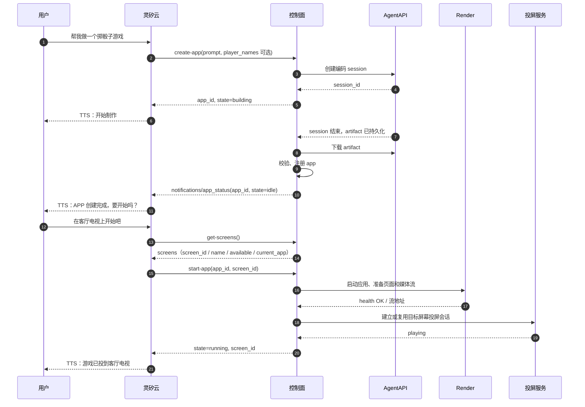

# 应用管理 MCP

> 状态：Proposal（供 PR 评审）
> 版本：v0.1
> 日期：2026-10-24

## 1. 范围

本文定义灵矽云（Linx）与控制面（gateway）之间的应用管理 MCP 契约：灵矽通过控制面发现屏幕，并管理应用从构建到运行的生命周期。

- 灵矽只看见 MCP Tool，不直接接触 AgentAPI、Render 或投屏服务。
- 应用运行后的能力调用仍走 OpenAPI / HTTP 契约，不在本文展开。
- 控制面与 Render 的接口见[控制面与 Render 接口设计](gateway-render-interface.md)，应用产物见[应用包设计](app-artifact.md)，系统整体架构与投屏服务的 Target/Endpoint 见[architecture.md](architecture.md)。

### 1.1 角色与调用方向

| 组件 | 本文中的职责 | 调用方 |
| --- | --- | --- |
| 灵矽云（Linx） | 理解用户意图、选择并调用 MCP Tool、组织播报话术 | 用户 |
| 控制面（gateway） | MCP Server、工具路由、应用注册表、构建与启动编排、屏幕映射 | 灵矽 |
| AgentAPI | 异步构建应用 artifact | 控制面 |
| Render | 启动应用、提供应用 HTTP 与媒体流 | 控制面 |
| 投屏服务 | 把媒体流投放到物理屏幕 | 控制面 |

灵矽是唯一的 MCP 调用方。`app_id` 在 `create-app` 时分配，`get-app-status`、`start-app` 和 `stop-app` 都用它定位应用。AgentAPI 的 session id、Render 的 `instance_id`、应用端口、Casting 的 `endpoint_id` 和投屏会话 id 只在控制面内部使用，不通过 MCP 返回。

### 1.2 契约原则

- 工具名按灵矽侧约定使用 kebab-case。
- 只暴露稳定、与运行时无关的业务标识（`app_id`、`screen_id`），不暴露端口、运行目录或 Render 标识。
- `app_id` 必须属于当前 device/session，控制面拒绝跨会话访问。
- 构建是长任务：`create-app` 立即返回，状态通过 `get-app-status` 查询，构建完成通过 MCP 通知告知。
- 写操作按业务键幂等，不重复创建构建 session、应用进程或投屏会话。

## 2. 工具与状态

### 2.1 工具集

| Tool | 作用 | 输入 | 输出 |
| --- | --- | --- | --- |
| `get-screens` | 查询当前可用屏幕及占用情况 | 无 | `screens` 数组，见第 5 章 |
| `create-app` | 创建应用并启动 AgentAPI 构建 | `prompt`、可选 `player_names` | `app_id`, `state: building` |
| `get-app-status` | 查询应用状态 | `app_id` | 随状态变化，见第 4 章 |
| `start-app` | 在指定屏幕上启动已构建的应用 | `app_id`, `screen_id` | `app_id`, `screen_id`, `state: running` |
| `stop-app` | 停止运行中的应用 | `app_id` | `app_id`, `state: idle` |

### 2.2 应用状态

应用状态表示应用在指定屏幕上的整体可用性。`running` 要求应用健康检查通过且投屏服务报告正在播放；只启动应用进程不算成功。不向灵矽暴露独立的 `display.state`。

| state | 含义 |
| --- | --- |
| `building` | AgentAPI 正在构建，应用还不可启动 |
| `idle` | 构建完成并注册，进程未启动 |
| `running` | 应用健康检查通过，指定屏幕的投屏会话处于播放状态 |
| `error` | 构建、启动或运行失败，包含投屏失败 |

`error.stage` 区分失败阶段，取 `building`、`starting` 或 `running`；构建失败不会产生可启动的 `idle` 应用。错误结构与错误码见第 9 章。

## 3. `create-app`

输入是灵矽整理后的用户诉求，不是原始 ASR 文本：

```json
{
  "prompt": "做一个掷骰子游戏，点击按钮掷出两个骰子，显示点数和最近几次结果"
}
```

多人游戏同时传入已确认的初始玩家名称。名单使用独立字段，不只写在自由文本里：

```json
{
  "prompt": "做一个三人五题知识竞赛，依次确认玩家准备后开始答题",
  "player_names": ["韩鲁鹏", "邓军辉", "张之阳"]
}
```

`create-app` 的输入 schema：

```json
{
  "type": "object",
  "properties": {
    "prompt": {"type": "string", "minLength": 1},
    "player_names": {
      "type": "array",
      "items": {"type": "string", "minLength": 1},
      "uniqueItems": true,
      "description": "用户已确认的初始玩家名称，按加入或点名顺序填写；未知时不要编造"
    }
  },
  "required": ["prompt"],
  "additionalProperties": false
}
```

名单规则：

* 非游戏应用或尚未确定名单时可省略 `player_names`；空数组与省略均表示没有提供初始名单，不代表零人游戏。可先构建支持后续加入的应用。
* 灵矽只传已确认的参与者名称。当前说话人的声纹名字不代表所有玩家，也不表示其他人已加入。用户只说人数时不得补造姓名；应用必须预置完整名单时先询问。
* 控制面去除名称首尾空白，拒绝空白名称、非字符串和规范化后的重复名称，返回 `INVALID_PLAYER_NAMES`。保持输入顺序，不做模糊匹配或同音替换。重名时先请用户选择可区分的称呼。
* `prompt` 中明确指定的人数或名单与非空 `player_names` 冲突时，灵矽在调用前向用户确认，不能静默增删玩家。控制面对自然语言不再做第二次语义推断。
* 控制面将规范化后的 `player_names` 与 `prompt` 一起保存为构建输入，并通过构建消息交给 AgentAPI。生成应用据此建立初始玩家，直接使用 `user_name` 作为本局唯一标识和展示名称，不另行生成用户 ID 或维护名字到 ID 的映射；见 [应用包约定](app-artifact.md#32-openapi-和业务响应)。
* 名单中的名字表示参与者，不表示已准备好；准备状态由运行时的加入/确认操作更新。后续增减玩家走应用 OpenAPI，不通过再次 `create-app` 修改构建输入。
* 一期直接以用户名标识玩家。运行时灵矽把声纹 `speaker_name` 作为业务接口的 `user_name` 传入，例如 `{"user_name":"韩鲁鹏"}`。应用去除首尾空白后与本局名单精确匹配，不生成额外 ID，不要求声纹 `speaker_id`。未知名字不能直接参与答题或计分，应先确认或通过应用加入操作登记。本局内名字保持不变，改名流程不在一期范围内。

建议工具 description 包含："创建应用。多人游戏请在 player_names 中传入用户已确认的初始玩家姓名，保留顺序。未知姓名不要猜测；名单不完整且需要预置全部玩家时先询问。名单只定义初始玩家，不代表已准备好。"

控制面创建 AgentAPI session 后立即返回，不等待构建完成：

```json
{
  "app_id": "app_01J...",
  "state": "building"
}
```

同一 device/session 已有 `building` 中的应用时，重复 `create-app` 返回现有 `app_id`，不重复创建 session，也不覆盖原构建的 `prompt` 或 `player_names`。调用方不能把该返回解释为新名单已生效。

## 4. `get-app-status`

输入：

```json
{
  "app_id": "app_01J..."
}
```

不同状态返回不同字段：

| state | 含义 | 字段 |
| --- | --- | --- |
| `building` | AgentAPI 正在构建，应用还不可启动 | `app_id`, `state`, `elapsed_seconds`, `message` |
| `idle` | 构建完成并注册，进程未启动 | `app_id`, `state`, `name`, `build_duration_seconds` |
| `running` | 应用健康检查通过，指定屏幕的投屏会话处于播放状态 | `app_id`, `state`, `screen_id`, `name`, `started_at`, `uptime_seconds` |
| `error` | 构建、启动或运行失败，包含投屏失败 | `app_id`, `state`, `error`；已指定屏幕时带 `screen_id` |

`building`：

```json
{
  "app_id": "app_01J...",
  "state": "building",
  "elapsed_seconds": 42,
  "message": "正在写页面"
}
```

`idle`：

```json
{
  "app_id": "app_01J...",
  "state": "idle",
  "name": "掷骰子游戏",
  "build_duration_seconds": 95
}
```

`running`：

```json
{
  "app_id": "app_01J...",
  "state": "running",
  "screen_id": "tv-living-room",
  "name": "掷骰子游戏",
  "started_at": "2026-10-24T08:30:00Z",
  "uptime_seconds": 12
}
```

`error`：

```json
{
  "app_id": "app_01J...",
  "state": "error",
  "error": {
    "stage": "building",
    "code": "BUILD_FAILED",
    "message": "构建完成，但产物校验失败",
    "last_agent_message": "代码已经写完，但启动检查报错"
  }
}
```

`building` 的 `message` 取 AgentAPI Session Event 中最近一次 agent 消息；`idle` 完成后由控制面发送“APP 创建完成”通知，通知里的 `message` 才是给灵矽播报的文案。`name` 是应用的展示名称，由控制面在注册应用时确定。

`error.stage` 取 `building`、`starting` 或 `running`；`error.last_agent_message` 保留最近一次 agent 消息。构建失败时进入 `error`，不会进入 `idle`。

## 5. `get-screens`

输入为空对象：

```json
{}
```

控制面返回当前 device/session 可访问的物理屏幕。`screen_id` 是灵矽侧使用的物理屏幕标识，而非 Endpoint 或 Render 标识。控制面将 `screen_id` 映射到投屏服务的 `target_id`，再选择该目标支持的 Endpoint；灵矽通过 `screen_id` 指定启动屏幕，`get-app-status(app_id)` 在结果中返回该标识。控制面负责将投屏服务的发现结果、Render 可达性和当前应用占用情况汇总为屏幕列表。

```json
{
  "screens": [
    {
      "screen_id": "tv-living-room",
      "name": "客厅电视",
      "available": true,
      "current_app": null
    },
    {
      "screen_id": "tv-study",
      "name": "书房电视",
      "available": true,
      "current_app": {
        "app_id": "app-dice",
        "name": "掷骰子"
      }
    }
  ]
}
```

- `available` 表示当前有 Render 可通过支持的协议向该屏幕投送画面，不等于空闲；`current_app` 为 `null` 才表示未被应用占用。
- 没有发现可用目标时允许返回空数组；已知但离线或不可达的目标可以返回 `available: false`。
- 返回结构化字段，不生成描述屏幕列表的顶层 `message`；由灵矽组织话术。`start-app` 的成功响应也不额外生成顶层 `message`，既有构建进度、通知和错误的消息字段保留原约定。
- 用户明确指定屏幕时，灵矽匹配其 `screen_id`；未指定时可沿用当前会话的选择，或在只有一个可用且空闲的屏幕时直接选择；无法唯一确定时询问用户。调用 `start-app` 时始终传入明确的 `screen_id`。
- MVP 中一个应用同时绑定一个屏幕，一个屏幕同时展示一个应用。列表是查询时快照，启动时控制面仍需重新校验可达性与占用，避免并发冲突。

## 6. `start-app`

输入：

```json
{
  "app_id": "app_01J...",
  "screen_id": "tv-living-room"
}
```

`screen_id` 必填，来自 `get-screens` 返回的屏幕列表。控制面选择能够访问目标屏幕的 Render 和兼容的 Endpoint，启动应用、准备页面和媒体流，再建立或复用投屏会话。只有应用健康检查通过且投屏服务报告 `playing` 后，才返回 `running`：

```json
{
  "app_id": "app_01J...",
  "state": "running",
  "screen_id": "tv-living-room",
  "name": "掷骰子游戏",
  "started_at": "2026-10-24T08:30:00Z",
  "uptime_seconds": 0
}
```

应用端口、Render 的 `instance_id`、Casting 的 `endpoint_id` 和投屏会话 id 只在控制面内部使用，不通过 MCP 返回给灵矽；应用访问由控制面按 `app_id` 路由，灵矽不需要知道端口。

只允许从 `idle` 启动。已经在同一屏幕上 `running` 时幂等返回当前状态；若指定不同屏幕，返回 `APP_ALREADY_RUNNING`，由调用方先停止再启动。`building` 时返回 `APP_BUILDING`；`error` 时返回 `APP_IN_ERROR`。目标屏幕被其他应用占用时返回 `TARGET_BUSY`，不自动替换已有应用。

启动流程有时限，由控制面配置超时。连接过程中请求等待最终结果，不返回 `running + connecting`；超时或失败时进入 `error`，工具返回 `isError: true`。同一应用的并发启动请求不得重复创建进程或投屏会话。输入或占用校验不通过时拒绝操作，不改变已有应用状态。

失败时进入 `error`，`error.stage` 不新增 `projection` 阶段；具体错误码见第 9 章。控制面内部维护应用进程和投屏会话的对应关系，跟踪投屏状态；运行中一旦确认投屏断开，整体状态进入 `error`，即使应用进程仍在运行。`screen_id` 保留用于定位失败目标。失败后的资源清理由控制面负责；只有确认进程和投屏资源已释放后才能释放屏幕占用。

启动成功后，后续应用操作仍通过既有的 OpenAPI / HTTP 契约完成。

## 7. `stop-app`

输入：

```json
{
  "app_id": "app_01J..."
}
```

停止应用进程，解除它与屏幕的展示绑定并释放占用后回到 `idle`。控制面先停止该屏幕的投屏会话，再停止 Render 实例，避免电视继续拉取已关闭的流。`idle` 响应不再携带 `screen_id`：

```json
{
  "app_id": "app_01J...",
  "state": "idle",
  "stopped_at": "2026-10-24T08:45:00Z"
}
```

已经在 `idle` 时幂等返回；`building` 时返回 `APP_BUILDING`；`error` 时幂等返回当前 `error`；停止失败返回 `STOP_FAILED`。用户主动停止后回到 `idle`；应用进程异常退出则进入 `error`（`stage=running`，`code=APP_EXITED`），由后续 `get-app-status` 反映。

## 8. 创建到启动



构建完成后，控制面通过已有的 MCP SSE 连接发送通知：

```json
{
  "jsonrpc": "2.0",
  "method": "notifications/app_status",
  "params": {
    "app_id": "app_01J...",
    "state": "idle",
    "message": "APP 创建完成"
  }
}
```

构建失败时发送同一方法，`state` 为 `error`，`error` 结构与 `get-app-status` 一致。

灵矽收到通知后决定是否播报并等待用户指令；控制面不直接推 TTS。通知是 best-effort，断线或丢失时以 `get-app-status` 为准。

## 9. 错误模型

应用进入 `error` 时，`get-app-status` 返回的错误结构与 `notifications/app_status` 的 `params` 一致：

```json
{
  "app_id": "app_01J...",
  "state": "error",
  "screen_id": "tv-living-room",
  "error": {
    "stage": "starting",
    "code": "TARGET_UNREACHABLE"
  }
}
```

`error.stage` 与 `error.code`：

| 场景 | `error.stage` | `error.code` 示例 |
| --- | --- | --- |
| 构建或产物校验失败 | `building` | `BUILD_FAILED` |
| 应用启动或健康检查失败 | `starting` | `START_FAILED` |
| 启动过程中屏幕不可达 | `starting` | `TARGET_UNREACHABLE` |
| 启动过程中投屏超时 | `starting` | `PROJECTION_TIMEOUT` |
| 应用运行后进程异常退出 | `running` | `APP_EXITED` |
| 应用运行后投屏断开 | `running` | `PROJECTION_DISCONNECTED` |

`error.message` 可选，用于补充失败原因；`error.last_agent_message` 保留最近一次 agent 消息。

以下错误由工具直接返回，不改变应用状态：

| `code` | 工具 | 场景 |
| --- | --- | --- |
| `INVALID_PLAYER_NAMES` | `create-app` | 名称为空白、类型错误或去除首尾空白后重名 |
| `APP_BUILDING` | `start-app`, `stop-app` | 应用仍在构建 |
| `APP_IN_ERROR` | `start-app` | 应用处于 `error` |
| `APP_ALREADY_RUNNING` | `start-app` | 应用已在其他屏幕运行 |
| `TARGET_BUSY` | `start-app` | 目标屏幕被其他应用占用 |
| `STOP_FAILED` | `stop-app` | 停止进程或释放屏幕占用失败 |
