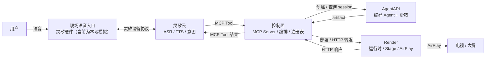

# Open Anywhere 架构设计

> 状态：Proposal（供 PR 评审）
> 版本：v0.1
> 日期：2026-10-23

## 1. 摘要

Open Anywhere 让用户通过语音描述需求，由云端编码 Agent 生成一个可运行的 Web 应用，并在身边的屏幕上通过 AirPlay 呈现和控制。

系统由四个组件和一个现场语音入口构成：

| 组件 | 角色 |
| --- | --- |
| 灵矽云（Linx） | 语音入口：ASR、TTS、意图识别、MCP Client |
| 控制面（Control Plane） | MCP Server、任务编排、应用注册表、OpenAPI 到 HTTP 的适配 |
| AgentAPI | 异步应用工厂：编码 Agent + 沙箱，产出应用 artifact |
| Render | 应用运行时与舞台：启动应用、转发 HTTP、AirPlay 投屏 |
| 现场语音入口 | 用户面前的语音设备。真实形态是灵矽硬件，目前由本地程序模拟；以设备身份接入灵矽云，收发语音、回应设备端 MCP（详见 [现场语音入口](voice-entry.md)） |

系统只有两条契约：

1. **MCP**：灵矽云与控制面之间。灵矽只看见 MCP Tool，不直接接触 AgentAPI 或 Render。应用管理 Tool 见[应用管理 MCP](app-management-mcp.md)。
2. **OpenAPI + launch.json + HTTP**：控制面、Render 与应用之间。应用只暴露 HTTP，不感知 MCP。产物结构、启动约定和构建提示见[应用包设计](app-artifact.md)。

应用包下载、进程运行、Chromium 渲染与媒体流输出的接口约定见 [控制面与 Render 接口设计](gateway-render-interface.md)。

现场语音入口与灵矽云之间使用灵矽自己的设备协议（WebSocket），不是 Open Anywhere 定义的契约，见 [现场语音入口](voice-entry.md)。

核心原则：**MCP 面稳定，应用能力动态；构建慢而异步，控制快而同步；投屏是会话级通道，应用是通道里的内容。**

## 2. 目标与非目标

### 2.1 目标

- 用户用自然语言创建应用，不需要知道代码、构建或部署。
- 灵矽只依赖一组稳定的 MCP Tool；新应用不需要在灵矽侧重新注册工具。
- 构建是长任务，可以异步执行、按需查询状态和已用时间，不阻塞语音对话。
- 应用生成后可以在 Render 上稳定启动，并通过 OpenAPI 被控制面调用。
- 应用画面通过 AirPlay 常驻在屏幕上；切换应用不重新建立投屏。
- Agent 产出的应用必须经过模板和检查脚本的硬约束，保证“Render 能跑、控制面能调”。

### 2.2 非目标

- 多租户、计费、应用市场、任意第三方应用托管。
- 为每个 OpenAPI 操作动态注册一个 MCP Tool；MVP 使用通用的 `send_request`。
- 服务端主动 TTS 推送；MVP 由灵矽在用户询问时轮询任务状态。
- 应用状态跨重启持久化；MVP 允许内存态，重启后状态丢失。
- 在 macOS 上程序化发起 AirPlay 系统镜像；MVP 手动连接，浏览器或 HDMI 兜底。
- 把 AgentAPI 的沙箱当作应用运行时；AgentAPI 只负责构建。

## 3. 术语

| 术语 | 含义 |
| --- | --- |
| 灵矽（Linx） | 七牛云的 AI 智能硬件平台，负责语音入口、ASR、TTS 和意图识别 |
| 控制面（Control Plane） | 对灵矽暴露 MCP、对 AgentAPI 编排构建、对 Render 转发请求的服务 |
| AgentAPI | 托管智能体框架，运行编码 Agent 和沙箱，产出持久化文件 |
| Render | 现场的应用运行时，负责启动应用、提供 HTTP、维持 AirPlay |
| Task | 一次 `create-app` 构建任务；构建结果注册为应用并使用 `app_id` 标识 |
| App | AgentAPI 产出的、已经在 Render 上运行的应用 |
| Artifact | 应用产物目录，包含 `app/`、OpenAPI 文档和 `launch.json` |
| Stage | Render 上常驻的展示页面；AirPlay 镜像的就是它 |
| 现场语音入口 | 用户面前、接入灵矽云的语音设备的统称。真实形态是灵矽硬件，目前用本地程序模拟 |
| 灵矽硬件 | 真实的语音设备，由固件通过 OTA 和 WebSocket 接入灵矽云 |
| 模拟硬件 | 本地程序，按同一套设备协议扮演灵矽硬件，并用 Web 控制台代替麦克风、扬声器和控制入口 |
| 设备身份 | 设备在灵矽平台上的标识，由 MAC、Client-Id 和 token 组成；真实硬件由固件持有，模拟硬件由程序生成 |
| 激活码 | 设备在 OTA 上报后获得的 6 位码，用来把设备绑定到智能体 |
| OpenAPI | 应用能力的 HTTP 契约，控制面据此校验和转发请求 |
| launch.json | 应用启动契约，描述可执行文件和参数；端口由部署环境通过 `PORT` 注入 |

## 4. 系统上下文



### 4.1 组件职责

| 组件 | 负责 | 不负责 |
| --- | --- | --- |
| 现场语音入口 | 保持与灵矽云的设备会话、收发语音与文字、回应设备端 MCP、设备注册与重连；真实形态是灵矽硬件，当前由模拟硬件代替（另提供本地 Web 控制台） | 声纹、ASR、TTS，构建与运行应用，投屏 |
| 灵矽云 | ASR、TTS、意图识别、选择并调用 MCP Tool | 构建应用、运行应用、投屏 |
| 控制面 | MCP Server、工具路由、任务编排、应用注册表、OpenAPI 校验与 HTTP 转发、artifact 下载与二次校验 | 写代码、运行应用、理解应用的业务语义 |
| AgentAPI | 运行编码 Agent、在沙箱中写代码和自测、持久化 artifact | 承载应用运行时、直接面对灵矽 |
| Render | 解压 artifact、按 `launch.json` 启动、健康检查、进程保活、接收控制面 HTTP 转发、Stage 与 AirPlay | 理解应用业务、决定应用能力 |
| 应用 | 提供 UI 和 `/api/*` HTTP 接口、维护自己的状态 | 感知 MCP、直接面对灵矽 |

## 5. 投屏服务开放 API

投屏服务是一个独立的局域网投屏端，对外开放 HTTP API。Client 可以使用它把自己的实时媒体流投放到局域网中的电视或其他显示设备。

投屏服务负责探测局域网设备、维护可用的投屏目标，并通过目标支持的协议建立和停止投屏会话。Client 负责准备实时媒体流，并提供目标设备可以访问的流地址。

### 5.1 Client 调用流程

```text
Client → 查询投屏服务有哪些 Target
Client → 选择 Target 上的 Endpoint
Client → 创建投屏 Session，并提供自己的实时流 URL
投屏服务 → 调用 DLNA / AirPlay 等协议开始播放
Client → 查询 Session 状态
Client → 停止 Session
```

第一版只支持 Client 提供实时 MPEG-TS 流。投屏服务不负责生成 Client 的媒体内容，只负责协议控制和会话生命周期。

### 5.2 Target 和 Endpoint

`Target` 表示一个物理投屏设备；`Endpoint` 表示该设备上的一种投屏入口。同一台电视可以同时拥有 DLNA 和 AirPlay 两个 Endpoint。

```json
{
  "id": "tv-9c1221d09d00",
  "name": "客厅电视",
  "state": "online",
  "endpoints": [
    {
      "id": "dlna-renderer",
      "protocol": "dlna",
      "capabilities": {
        "formats": ["mpegts"],
        "video_codecs": ["h264"],
        "audio_codecs": ["aac"],
        "streaming": true
      }
    },
    {
      "id": "airplay-mirror",
      "protocol": "airplay",
      "capabilities": {
        "formats": ["airplay-mirror"],
        "video_codecs": ["h264"],
        "audio_codecs": ["aac"],
        "streaming": true
      }
    }
  ]
}
```

Client 根据 Endpoint 的 `capabilities` 选择协议、封装格式和编码方式。

### 5.3 开放 API

| 方法 | 路径 | 作用 |
| --- | --- | --- |
| `GET` | `/v1/targets` | 获取已发现的投屏目标 |
| `GET` | `/v1/targets/{target_id}` | 获取目标详情和能力 |
| `POST` | `/v1/projection-sessions` | 创建并开始投屏 |
| `GET` | `/v1/projection-sessions/{session_id}` | 查询投屏状态 |
| `DELETE` | `/v1/projection-sessions/{session_id}` | 停止投屏 |
| `GET` | `/healthz` | 服务健康检查 |

创建投屏会话：

```http
POST /v1/projection-sessions
Content-Type: application/json
```

```json
{
  "target_id": "tv-9c1221d09d00",
  "endpoint_id": "dlna-renderer",
  "source": {
    "type": "stream",
    "url": "http://192.168.31.203:8765/live.ts",
    "format": "mpegts",
    "video_codec": "h264",
    "audio_codec": "aac"
  }
}
```

服务端校验目标能力后，使用 DLNA 的 `SetAVTransportURI` 和 `Play` 操作，让电视开始拉取 `source.url`。返回投屏会话：

```json
{
  "session_id": "projection-session-001",
  "state": "playing",
  "target_id": "tv-9c1221d09d00",
  "endpoint_id": "dlna-renderer"
}
```

`source.url` 必须是目标设备可以访问的地址。Client 负责启动流服务并持续输出符合声明的 MPEG-TS、H.264 和 AAC 数据。

查询会话：

```http
GET /v1/projection-sessions/{session_id}
```

停止会话：

```http
DELETE /v1/projection-sessions/{session_id}
```

服务端停止目标设备的播放并释放投屏会话；该操作不负责停止 Client 自己的流服务。

## 6. 应用管理 MCP

灵矽通过控制面发现屏幕，并创建、查询、启动和停止应用（`get-screens`、`create-app`、`get-app-status`、`start-app`、`stop-app`）。工具集、状态模型、通知和错误约定见[应用管理 MCP](app-management-mcp.md)。

## 7. Gateway MCP 服务

Gateway 是单进程 Go 控制层服务，MCP 是协议入口，应用管理、持久注册表、OpenAPI 执行和下游客户端按模块隔离。它实现第 6 章引用的应用管理工具，并通过 `get_openapi(app_id)`、`send_request(app_id, operationId, parameters, requestBody)` 控制应用。

应用规范来自构建产物注册记录，运行地址来自 Render。`services.json` 只作为独立静态联调模式保留。构建、Render 与 Casting 的 HTTP 链路已用测试替身验证；真实下游部署与主动通知的完成情况见 [Gateway 服务](gateway.md)。
