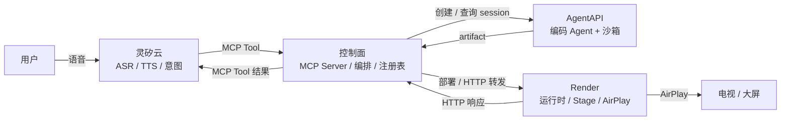
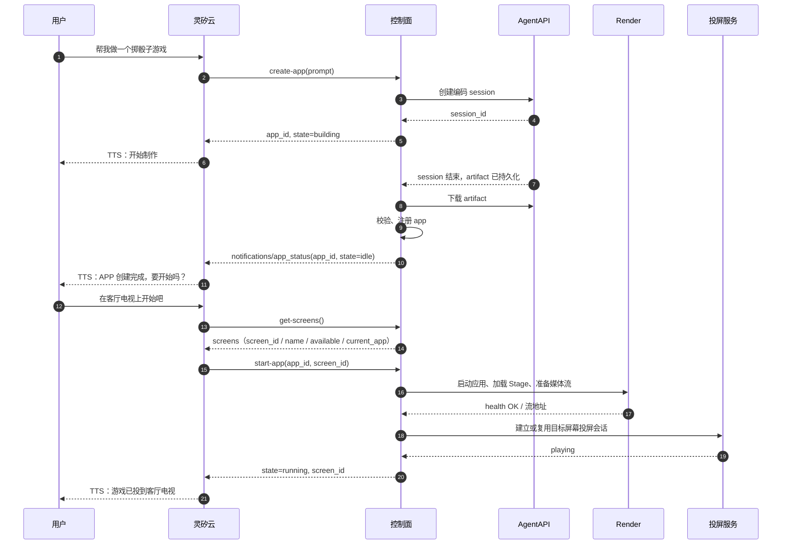

# Open Anywhere 架构设计

> 状态：Proposal（供 PR 评审）
> 版本：v0.1
> 日期：2026-10-23

## 1. 摘要

Open Anywhere 让用户通过语音描述需求，由云端编码 Agent 生成一个可运行的 Web 应用，并在身边的屏幕上通过 AirPlay 呈现和控制。

系统由四个组件构成：

| 组件 | 角色 |
| --- | --- |
| 灵矽云（Linx） | 语音入口：ASR、TTS、意图识别、MCP Client |
| 控制面（Control Plane） | MCP Server、任务编排、应用注册表、OpenAPI 到 HTTP 的适配 |
| AgentAPI | 异步应用工厂：编码 Agent + 沙箱，产出应用 artifact |
| Render | 应用运行时与舞台：启动应用、转发 HTTP、AirPlay 投屏 |

系统只有两条契约：

1. **MCP**：灵矽云与控制面之间。灵矽只看见 MCP Tool，不直接接触 AgentAPI 或 Render。
2. **OpenAPI + launch.json + HTTP**：控制面、Render 与应用之间。应用只暴露 HTTP，不感知 MCP。

核心原则：**MCP 面稳定，应用能力动态；构建慢而异步，控制快而同步；投屏是会话级通道，应用是通道里的内容。**

## 2. 目标与非目标

### 2.1 目标

- 用户用自然语言创建应用，不需要知道代码、构建或部署。
- 灵矽只依赖一组稳定的 MCP Tool；新应用不需要在灵矽侧重新注册工具。
- 构建是长任务，可以异步执行、按需查询状态和已用时间，不阻塞语音对话。
- 应用生成后可以在 Render 上稳定启动，并通过 OpenAPI 被控制面调用。
- 应用画面通过 AirPlay 常驻在屏幕上；切换应用不重新建立投屏。
- Agent 产出的应用必须经过模板和检查脚本的硬约束，保证“Render 能跑、控制面能调”。

### 2.2 非目标

- 多租户、计费、应用市场、任意第三方应用托管。
- 为每个 OpenAPI 操作动态注册一个 MCP Tool；MVP 使用通用的 `send_request`。
- 服务端主动 TTS 推送；MVP 由灵矽在用户询问时轮询任务状态。
- 应用状态跨重启持久化；MVP 允许内存态，重启后状态丢失。
- 在 macOS 上程序化发起 AirPlay 系统镜像；MVP 手动连接，浏览器或 HDMI 兜底。
- 把 AgentAPI 的沙箱当作应用运行时；AgentAPI 只负责构建。

## 3. 术语

| 术语 | 含义 |
| --- | --- |
| 灵矽（Linx） | 七牛云的 AI 智能硬件平台，负责语音入口、ASR、TTS 和意图识别 |
| 控制面（Control Plane） | 对灵矽暴露 MCP、对 AgentAPI 编排构建、对 Render 转发请求的服务 |
| AgentAPI | 托管智能体框架，运行编码 Agent 和沙箱，产出持久化文件 |
| Render | 现场的应用运行时，负责启动应用、提供 HTTP、维持 AirPlay |
| Task | 一次 `create_app` 构建任务，对外用 `task_id` 标识 |
| App | AgentAPI 产出的、已经在 Render 上运行的应用 |
| Artifact | 应用产物目录，包含 `app/`、OpenAPI 文档、`launch.json` 和自检报告 |
| Stage | Render 上常驻的展示页面；AirPlay 镜像的就是它 |
| OpenAPI | 应用能力的 HTTP 契约，控制面据此校验和转发请求 |
| launch.json | 应用启动契约，描述可执行文件、参数和端口 |

## 4. 系统上下文



### 4.1 组件职责

| 组件 | 负责 | 不负责 |
| --- | --- | --- |
| 灵矽云 | ASR、TTS、意图识别、选择并调用 MCP Tool | 构建应用、运行应用、投屏 |
| 控制面 | MCP Server、工具路由、任务编排、应用注册表、OpenAPI 校验与 HTTP 转发、artifact 下载与二次校验 | 写代码、运行应用、理解应用的业务语义 |
| AgentAPI | 运行编码 Agent、在沙箱中写代码和自测、持久化 artifact | 承载应用运行时、直接面对灵矽 |
| Render | 解压 artifact、按 `launch.json` 启动、健康检查、进程保活、接收控制面 HTTP 转发、Stage 与 AirPlay | 理解应用业务、决定应用能力 |
| 应用 | 提供 UI 和 `/api/*` HTTP 接口、维护自己的状态 | 感知 MCP、直接面对灵矽 |

## 5. 投屏服务开放 API

投屏服务是一个独立的局域网投屏端，对外开放 HTTP API。Client 可以使用它把自己的实时媒体流投放到局域网中的电视或其他显示设备。

投屏服务负责探测局域网设备、维护可用的投屏目标，并通过目标支持的协议建立和停止投屏会话。Client 负责准备实时媒体流，并提供目标设备可以访问的流地址。

### 5.1 Client 调用流程

```text
Client → 查询投屏服务有哪些 Target
Client → 选择 Target 上的 Endpoint
Client → 创建投屏 Session，并提供自己的实时流 URL
投屏服务 → 调用 DLNA / AirPlay 等协议开始播放
Client → 查询 Session 状态
Client → 停止 Session
```

第一版只支持 Client 提供实时 MPEG-TS 流。投屏服务不负责生成 Client 的媒体内容，只负责协议控制和会话生命周期。

### 5.2 Target 和 Endpoint

`Target` 表示一个物理投屏设备；`Endpoint` 表示该设备上的一种投屏入口。同一台电视可以同时拥有 DLNA 和 AirPlay 两个 Endpoint。

```json
{
  "id": "tv-9c1221d09d00",
  "name": "客厅电视",
  "state": "online",
  "endpoints": [
    {
      "id": "dlna-renderer",
      "protocol": "dlna",
      "capabilities": {
        "formats": ["mpegts"],
        "video_codecs": ["h264"],
        "audio_codecs": ["aac"],
        "streaming": true
      }
    },
    {
      "id": "airplay-mirror",
      "protocol": "airplay",
      "capabilities": {
        "formats": ["airplay-mirror"],
        "video_codecs": ["h264"],
        "audio_codecs": ["aac"],
        "streaming": true
      }
    }
  ]
}
```

Client 根据 Endpoint 的 `capabilities` 选择协议、封装格式和编码方式。

### 5.3 开放 API

| 方法 | 路径 | 作用 |
| --- | --- | --- |
| `GET` | `/v1/targets` | 获取已发现的投屏目标 |
| `GET` | `/v1/targets/{target_id}` | 获取目标详情和能力 |
| `POST` | `/v1/projection-sessions` | 创建并开始投屏 |
| `GET` | `/v1/projection-sessions/{session_id}` | 查询投屏状态 |
| `DELETE` | `/v1/projection-sessions/{session_id}` | 停止投屏 |
| `GET` | `/healthz` | 服务健康检查 |

创建投屏会话：

```http
POST /v1/projection-sessions
Content-Type: application/json
```

```json
{
  "target_id": "tv-9c1221d09d00",
  "endpoint_id": "dlna-renderer",
  "source": {
    "type": "stream",
    "url": "http://192.168.31.203:8765/live.ts",
    "format": "mpegts",
    "video_codec": "h264",
    "audio_codec": "aac"
  }
}
```

服务端校验目标能力后，使用 DLNA 的 `SetAVTransportURI` 和 `Play` 操作，让电视开始拉取 `source.url`。返回投屏会话：

```json
{
  "session_id": "projection-session-001",
  "state": "playing",
  "target_id": "tv-9c1221d09d00",
  "endpoint_id": "dlna-renderer"
}
```

`source.url` 必须是目标设备可以访问的地址。Client 负责启动流服务并持续输出符合声明的 MPEG-TS、H.264 和 AAC 数据。

查询会话：

```http
GET /v1/projection-sessions/{session_id}
```

停止会话：

```http
DELETE /v1/projection-sessions/{session_id}
```

服务端停止目标设备的播放并释放投屏会话；该操作不负责停止 Client 自己的流服务。

## 6. 应用管理 MCP

本章定义灵矽通过控制面发现屏幕并管理应用生命周期的五个 MCP Tool。工具名按灵矽侧约定使用 kebab-case；应用运行后的能力调用仍走既有的 OpenAPI / HTTP 契约，不在本章展开。

### 6.1 工具集

| Tool | 作用 | 输入 | 输出 |
| --- | --- | --- | --- |
| `get-screens` | 查询当前可用屏幕及占用情况 | 无 | `screens` 数组，见 6.7 |
| `create-app` | 创建应用并启动 AgentAPI 构建 | `prompt` | `app_id`, `state: building` |
| `get-app-status` | 查询应用状态 | `app_id` | 随状态变化，见 6.3 |
| `start-app` | 在指定屏幕上启动已构建的应用 | `app_id`, `screen_id` | `app_id`, `screen_id`, `state: running` |
| `stop-app` | 停止运行中的应用 | `app_id` | `app_id`, `state: idle` |

应用状态表示应用在指定屏幕上的整体可用性。`running` 要求应用健康检查通过且投屏服务报告正在播放；只启动应用进程不算成功。不向灵矽暴露独立的 `display.state`。

应用状态有四种：`building`、`idle`、`running`、`error`。`error` 表示构建、启动或运行失败；`error.stage` 区分失败阶段，构建失败不会产生可启动的 `idle` 应用。

`app_id` 在 `create-app` 时分配，后续三个工具都用它定位应用；AgentAPI 的 session id 只在控制面内部使用。`app_id` 必须属于当前 device/session，控制面拒绝跨会话访问。

### 6.2 `create-app`

输入是灵矽整理后的用户诉求，不是原始 ASR 文本：

```json
{
  "prompt": "做一个掷骰子游戏，点击按钮掷出两个骰子，显示点数和最近几次结果"
}
```

控制面创建 AgentAPI session 后立即返回，不等待构建完成：

```json
{
  "app_id": "app_01J...",
  "state": "building"
}
```

同一 device/session 已有 `building` 中的应用时，重复 `create-app` 返回现有 `app_id`，不重复创建 session。

### 6.3 `get-app-status`

输入：

```json
{
  "app_id": "app_01J..."
}
```

不同状态返回不同字段：

| state | 含义 | 字段 |
| --- | --- | --- |
| `building` | AgentAPI 正在构建，应用还不可启动 | `app_id`, `state`, `elapsed_seconds`, `message` |
| `idle` | 构建完成并注册，进程未启动 | `app_id`, `state`, `name`, `build_duration_seconds` |
| `running` | 应用健康检查通过，指定屏幕的投屏会话处于播放状态 | `app_id`, `state`, `screen_id`, `name`, `started_at`, `uptime_seconds` |
| `error` | 构建、启动或运行失败，包含投屏失败 | `app_id`, `state`, `error`；已指定屏幕时带 `screen_id` |

`building`：

```json
{
  "app_id": "app_01J...",
  "state": "building",
  "elapsed_seconds": 42,
  "message": "正在写页面"
}
```

`idle`：

```json
{
  "app_id": "app_01J...",
  "state": "idle",
  "name": "掷骰子游戏",
  "build_duration_seconds": 95
}
```

`running`：

```json
{
  "app_id": "app_01J...",
  "state": "running",
  "screen_id": "tv-living-room",
  "name": "掷骰子游戏",
  "started_at": "2026-10-24T08:30:00Z",
  "uptime_seconds": 12
}
```

`error`：

```json
{
  "app_id": "app_01J...",
  "state": "error",
  "error": {
    "stage": "building",
    "code": "BUILD_FAILED",
    "message": "构建完成，但产物校验失败",
    "last_agent_message": "代码已经写完，但启动检查报错"
  }
}
```

`building` 的 `message` 取 AgentAPI Session Event 中最近一次 agent 消息；`idle` 完成后由控制面发送“APP 创建完成”通知，通知里的 `message` 才是给灵矽播报的文案。`name` 是应用的展示名称，由控制面在注册应用时确定。

`error.stage` 取 `building`、`starting` 或 `running`；`error.last_agent_message` 保留最近一次 agent 消息。构建失败时进入 `error`，不会进入 `idle`。

### 6.4 `start-app`

输入：

```json
{
  "app_id": "app_01J...",
  "screen_id": "tv-living-room"
}
```

`screen_id` 必填，来自 `get-screens` 返回的屏幕列表。控制面选择能够访问目标屏幕的 Render 和兼容的 Endpoint，启动应用、加载 Stage、准备媒体流，再建立或复用投屏会话。只有应用健康检查通过且投屏服务报告 `playing` 后，才返回 `running`：

```json
{
  "app_id": "app_01J...",
  "state": "running",
  "screen_id": "tv-living-room",
  "name": "掷骰子游戏",
  "started_at": "2026-10-24T08:30:00Z",
  "uptime_seconds": 0
}
```

应用端口、`render_id`、`endpoint_id` 和 `projection_session_id` 只在控制面和 Render 内部使用，不通过 MCP 返回给灵矽；应用访问由控制面按 `app_id` 路由，灵矽不需要知道端口。

只允许从 `idle` 启动。已经在同一屏幕上 `running` 时幂等返回当前状态；若指定不同屏幕，返回 `APP_ALREADY_RUNNING`，由调用方先停止再启动。`building` 时返回 `APP_BUILDING`；`error` 时返回 `APP_IN_ERROR`。目标屏幕被其他应用占用时返回 `TARGET_BUSY`，不自动替换已有应用。

启动流程有时限，由控制面配置超时。连接过程中请求等待最终结果，不返回 `running + connecting`；超时或失败时进入 `error`，工具返回 `isError: true`。同一应用的并发启动请求不得重复创建进程或投屏会话。输入或占用校验不通过时拒绝操作，不改变已有应用状态。

沿用现有 `error.stage`，不新增 `projection` 阶段：

| 场景 | `error.stage` | `error.code` 示例 |
| --- | --- | --- |
| 应用启动或健康检查失败 | `starting` | `START_FAILED` |
| 启动过程中屏幕不可达 | `starting` | `TARGET_UNREACHABLE` |
| 启动过程中投屏超时 | `starting` | `PROJECTION_TIMEOUT` |
| 应用运行后进程异常退出 | `running` | `APP_EXITED` |
| 应用运行后投屏断开 | `running` | `PROJECTION_DISCONNECTED` |

例如，屏幕连接失败时，`get-app-status` 返回：

```json
{
  "app_id": "app_01J...",
  "state": "error",
  "screen_id": "tv-living-room",
  "error": {
    "stage": "starting",
    "code": "TARGET_UNREACHABLE"
  }
}
```

控制面内部维护应用进程和投屏会话的对应关系，跟踪投屏状态；运行中一旦确认投屏断开，整体状态进入 `error`，即使应用进程仍在运行。`screen_id` 保留用于定位失败目标。失败后的资源清理由控制面负责；只有确认进程和投屏资源已释放后才能释放屏幕占用。

启动成功后，后续应用操作仍通过既有的 OpenAPI / HTTP 契约完成。

### 6.5 `stop-app`

输入：

```json
{
  "app_id": "app_01J..."
}
```

停止应用进程，解除它与屏幕的展示绑定并释放占用后回到 `idle`；常驻 Stage 的投屏通道可以保留，用于显示待机页或后续应用。`idle` 响应不再携带 `screen_id`：

```json
{
  "app_id": "app_01J...",
  "state": "idle",
  "stopped_at": "2026-10-24T08:45:00Z"
}
```

已经在 `idle` 时幂等返回；`building` 时返回 `APP_BUILDING`；`error` 时幂等返回当前 `error`；停止失败返回 `STOP_FAILED`。用户主动停止后回到 `idle`；应用进程异常退出则进入 `error`（`stage=running`，`code=APP_EXITED`），由后续 `get-app-status` 反映。

### 6.6 创建到启动



构建完成后，控制面通过已有的 MCP SSE 连接发送通知：

```json
{
  "jsonrpc": "2.0",
  "method": "notifications/app_status",
  "params": {
    "app_id": "app_01J...",
    "state": "idle",
    "message": "APP 创建完成"
  }
}
```

构建失败时发送同一方法，`state` 为 `error`，`error` 结构与 `get-app-status` 一致。

灵矽收到通知后决定是否播报并等待用户指令；控制面不直接推 TTS。通知是 best-effort，断线或丢失时以 `get-app-status` 为准。


### 6.7 `get-screens`

输入为空对象：

```json
{}
```

控制面返回当前 device/session 可访问的物理屏幕。`screen_id` 是灵矽侧使用的物理屏幕标识，而非 Endpoint 或 Render 标识。控制面将 `screen_id` 映射到投屏服务的 `target_id`，再选择该目标支持的 Endpoint；灵矽通过 `screen_id` 指定启动屏幕，`get-app-status(app_id)` 在结果中返回该标识。控制面负责将投屏服务的发现结果、Render 可达性和当前应用占用情况汇总为屏幕列表。

```json
{
  "screens": [
    {
      "screen_id": "tv-living-room",
      "name": "客厅电视",
      "available": true,
      "current_app": null
    },
    {
      "screen_id": "tv-study",
      "name": "书房电视",
      "available": true,
      "current_app": {
        "app_id": "app-dice",
        "name": "掷骰子"
      }
    }
  ]
}
```

- `available` 表示当前有 Render 可通过支持的协议向该屏幕投送画面，不等于空闲；`current_app` 为 `null` 才表示未被应用占用。
- 没有发现可用目标时允许返回空数组；已知但离线或不可达的目标可以返回 `available: false`。
- 返回结构化字段，不生成描述屏幕列表的顶层 `message`；由灵矽组织话术。`start-app` 的成功响应也不额外生成顶层 `message`，既有构建进度、通知和错误的消息字段保留原约定。
- 用户明确指定屏幕时，灵矽匹配其 `screen_id`；未指定时可沿用当前会话的选择，或在只有一个可用且空闲的屏幕时直接选择；无法唯一确定时询问用户。调用 `start-app` 时始终传入明确的 `screen_id`。
- MVP 中一个应用同时绑定一个屏幕，一个屏幕同时展示一个应用。列表是查询时快照，启动时控制面仍需重新校验可达性与占用，避免并发冲突。
