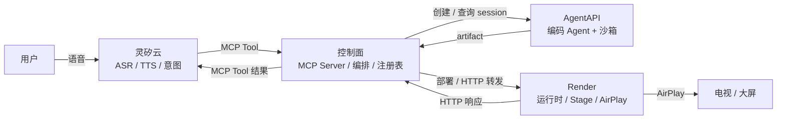
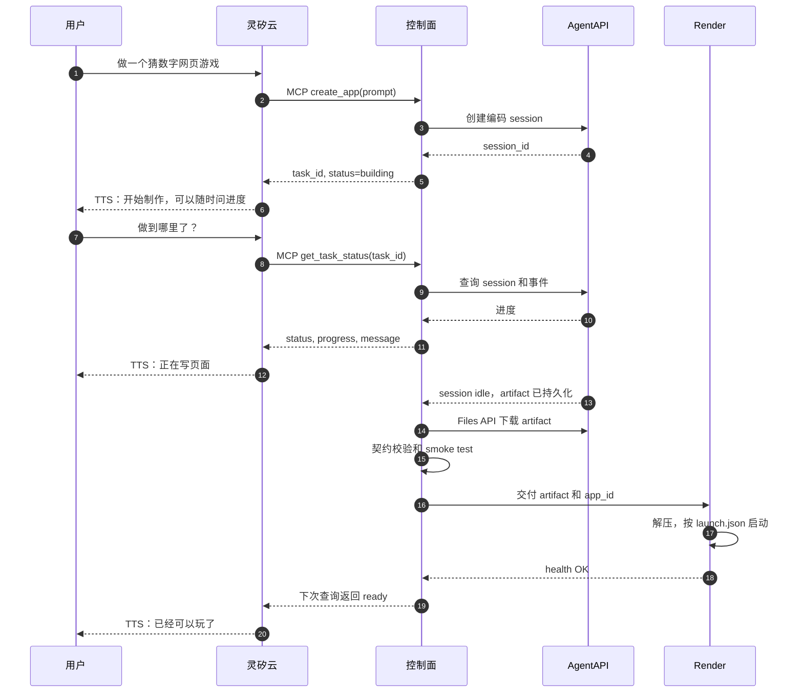
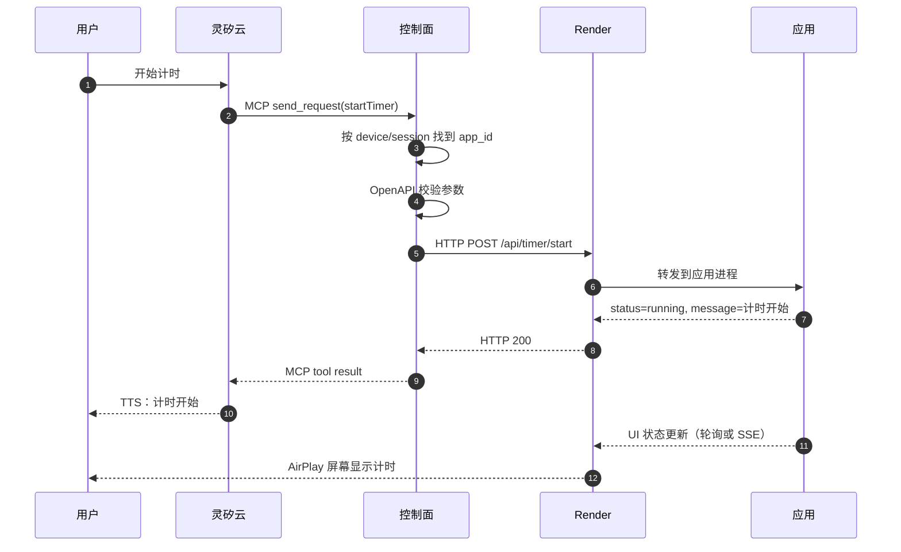
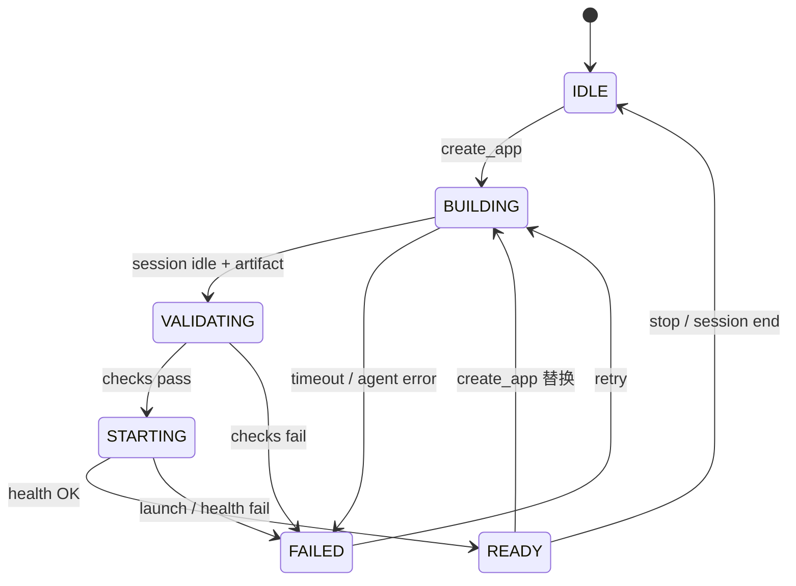
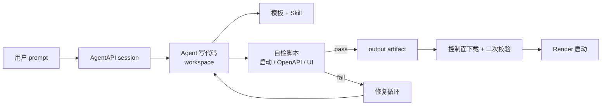
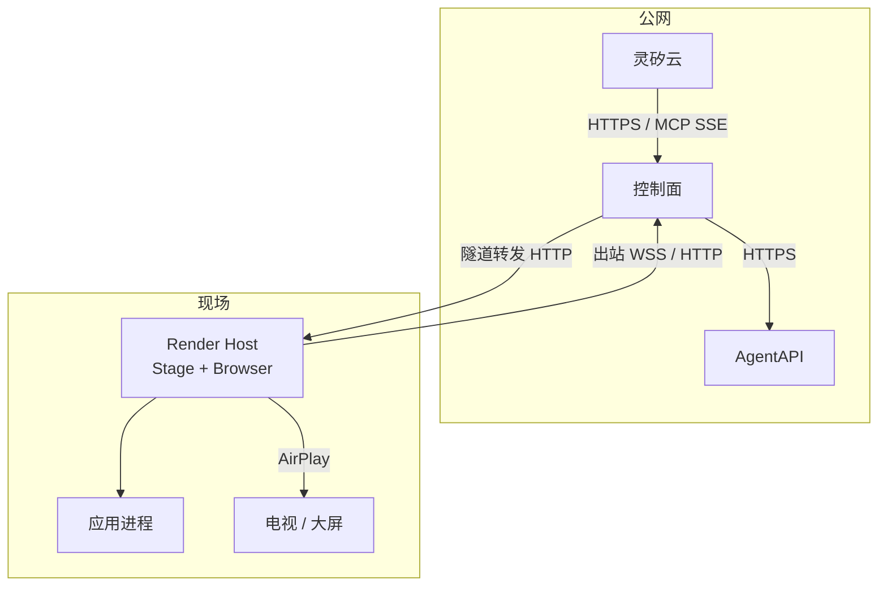

# Open Anywhere 架构设计

> 状态：Proposal（供 PR 评审）
> 版本：v0.1
> 日期：2026-10-23
> 说明：本文以四组件模型为准；issue #9 中的三平面描述作为历史讨论保留。

## 1. 摘要

Open Anywhere 让用户通过语音描述需求，由云端编码 Agent 生成一个可运行的 Web 应用，并在身边的屏幕上通过 AirPlay 呈现和控制。

系统由四个组件构成：

| 组件 | 角色 |
| --- | --- |
| 灵矽云（Linx） | 语音入口：ASR、TTS、意图识别、MCP Client |
| 控制面（Control Plane） | MCP Server、任务编排、应用注册表、OpenAPI 到 HTTP 的适配 |
| AgentAPI | 异步应用工厂：编码 Agent + 沙箱，产出应用 artifact |
| Render | 应用运行时与舞台：启动应用、转发 HTTP、AirPlay 投屏 |

系统只有两条契约：

1. **MCP**：灵矽云与控制面之间。灵矽只看见 MCP Tool，不直接接触 AgentAPI 或 Render。
2. **OpenAPI + launch.json + HTTP**：控制面、Render 与应用之间。应用只暴露 HTTP，不感知 MCP。

核心原则：**MCP 面稳定，应用能力动态；构建慢而异步，控制快而同步；投屏是会话级通道，应用是通道里的内容。**

## 2. 目标与非目标

### 2.1 目标

- 用户用自然语言创建应用，不需要知道代码、构建或部署。
- 灵矽只依赖一组稳定的 MCP Tool；新应用不需要在灵矽侧重新注册工具。
- 构建是长任务，可以异步执行、按需查询进度，不阻塞语音对话。
- 应用生成后可以在 Render 上稳定启动，并通过 OpenAPI 被控制面调用。
- 应用画面通过 AirPlay 常驻在屏幕上；切换应用不重新建立投屏。
- Agent 产出的应用必须经过模板和检查脚本的硬约束，保证“Render 能跑、控制面能调”。

### 2.2 非目标

- 多租户、计费、应用市场、任意第三方应用托管。
- 为每个 OpenAPI 操作动态注册一个 MCP Tool；MVP 使用通用的 `send_request`。
- 服务端主动 TTS 推送；MVP 由灵矽在用户询问时轮询任务状态。
- 应用状态跨重启持久化；MVP 允许内存态，重启后状态丢失。
- 在 macOS 上程序化发起 AirPlay 系统镜像；MVP 手动连接，浏览器或 HDMI 兜底。
- 把 AgentAPI 的沙箱当作应用运行时；AgentAPI 只负责构建。

## 3. 术语

| 术语 | 含义 |
| --- | --- |
| 灵矽（Linx） | 七牛云的 AI 智能硬件平台，负责语音入口、ASR、TTS 和意图识别 |
| 控制面（Control Plane） | 对灵矽暴露 MCP、对 AgentAPI 编排构建、对 Render 转发请求的服务 |
| AgentAPI | 托管智能体框架，运行编码 Agent 和沙箱，产出持久化文件 |
| Render | 现场的应用运行时，负责启动应用、提供 HTTP、维持 AirPlay |
| Task | 一次 `create_app` 构建任务，对外用 `task_id` 标识 |
| App | AgentAPI 产出的、已经在 Render 上运行的应用 |
| Artifact | 应用产物目录，包含程序、OpenAPI 文档、`launch.json` 和自检报告 |
| Stage | Render 上常驻的展示页面；AirPlay 镜像的就是它 |
| OpenAPI | 应用能力的 HTTP 契约，控制面据此校验和转发请求 |
| launch.json | 应用启动契约，描述可执行文件、参数和端口 |

## 4. 系统上下文



### 4.1 组件职责

| 组件 | 负责 | 不负责 |
| --- | --- | --- |
| 灵矽云 | ASR、TTS、意图识别、选择并调用 MCP Tool | 构建应用、运行应用、投屏 |
| 控制面 | MCP Server、工具路由、任务编排、应用注册表、OpenAPI 校验与 HTTP 转发、artifact 下载与二次校验 | 写代码、运行应用、理解应用的业务语义 |
| AgentAPI | 运行编码 Agent、在沙箱中写代码和自测、持久化 artifact | 承载应用运行时、直接面对灵矽 |
| Render | 解压 artifact、按 `launch.json` 启动、健康检查、进程保活、接收控制面 HTTP 转发、Stage 与 AirPlay | 理解应用业务、决定应用能力 |
| 应用 | 提供 UI 和 `/api/*` HTTP 接口、维护自己的状态 | 感知 MCP、直接面对灵矽 |

### 4.2 与旧三平面的关系

| 旧概念 | 新组件 | 变化 |
| --- | --- | --- |
| 构建面 | AgentAPI | 保留；只负责构建，不承载运行时 |
| 控制面 / Gateway | 控制面 | 从自定义语音适配改为 MCP Server + OpenAPI 适配 |
| 呈现面 | Render | 保留；应用变成普通 HTTP 服务，Render 负责运行和 AirPlay |
| 语音入口 | 灵矽云 | 升级为明确的组件；所有操作通过 MCP |

旧版的 `manifest` / `action` 协议由 **OpenAPI + HTTP** 取代；旧版的 Stage/AirPlay 常驻、构建与运行分离继续保留。

## 5. 契约一：灵矽与控制面（MCP）

### 5.1 传输

按灵矽现有的 MCP 能力，控制面实现 SSE 传输：

- `GET /mcp`：建立 SSE 连接。
- `POST /mcp/message`：接收 JSON-RPC 消息。
- 请求头携带上下文：
  - `X-Linx-Device-Id`
  - `X-Linx-Agent-Id`
  - `X-Linx-Session-Id`

控制面用这三个值建立会话绑定。一个灵矽会话对应一条 SSE 连接；断线重连后按同样的 header 恢复绑定。

工具结果同时返回：

- `content`：给灵矽的 LLM/TTS 读的短文本。
- `structuredContent`：给程序消费的结构化数据。
- 错误使用 `isError: true`，并带一句可播报的 `message`。

### 5.2 最小工具集

| Tool | 作用 | 背后动作 |
| --- | --- | --- |
| `create_app` | 创建一个应用构建任务 | 调 AgentAPI 创建编码 session，返回 `task_id` |
| `get_task_status` | 查询构建/部署进度 | 查 AgentAPI session 和事件，归一化状态 |
| `get_openapi` | 获取当前应用的操作说明 | 从 artifact 的 OpenAPI 生成灵矽友好摘要 |
| `send_request` | 调用应用的一个操作 | 按 OpenAPI 解析并转发 HTTP 到 Render |

应用的每个操作**不会**在灵矽里单独注册 MCP Tool。灵矽看到的是稳定的四个工具，具体能力由 OpenAPI 动态描述。这是本架构最关键的取舍：**MCP 面稳定，应用能力动态。**

### 5.3 Tool 输入输出

#### `create_app`

输入：

```json
{
  "prompt": "做一个猜数字的网页游戏"
}
```

输出：

```json
{
  "task_id": "task_01J...",
  "status": "building"
}
```

控制面立即返回，不等待构建完成。AgentAPI 的原始 session id 保存在控制面内部，不暴露给灵矽。

#### `get_task_status`

输入：

```json
{
  "task_id": "task_01J..."
}
```

输出：

```json
{
  "task_id": "task_01J...",
  "status": "building",
  "progress": 0.6,
  "message": "正在写页面，已经完成一半",
  "app_id": null
}
```

对灵矽暴露的状态收敛为三种：

- `building`：构建或校验中。
- `ready`：应用已启动，可以调用。
- `failed`：构建、校验或启动失败；`message` 说明原因。

控制面内部可以细分 `validating`、`starting`，但不要求灵矽理解。

#### `get_openapi`

输入：

```json
{
  "app_id": "app_01J..."
}
```

`app_id` 可选；不传时按 `(device_id, agent_id, session_id)` 解析当前应用。

输出是灵矽友好的操作摘要，不是整份 YAML：

```json
{
  "app_id": "app_01J...",
  "title": "计时器",
  "operations": [
    {
      "operationId": "startTimer",
      "method": "POST",
      "path": "/api/timer/start",
      "summary": "开始计时",
      "params": [
        {
          "name": "durationSec",
          "type": "integer",
          "required": false,
          "description": "计时时长，单位秒"
        }
      ],
      "response": {
        "message": "string",
        "status": "string"
      }
    }
  ]
}
```

#### `send_request`

输入：

```json
{
  "operationId": "startTimer",
  "params": {
    "durationSec": 60
  }
}
```

`app_id` 可选；不传时使用当前绑定应用。**不接受 URL、method、path 或任意 header。**

输出：

```json
{
  "ok": true,
  "status": 200,
  "data": {
    "status": "running"
  },
  "message": "计时开始"
}
```

错误：

```json
{
  "ok": false,
  "status": 400,
  "error": {
    "code": "INVALID_PARAMS",
    "message": "缺少参数 durationSec"
  },
  "message": "参数不对，需要提供一个时长"
}
```

### 5.4 调用规则

- `send_request` 只接受 `operationId` 和参数；控制面从 OpenAPI 解析出真正的 method、path 和参数位置。
- 参数按 OpenAPI schema 校验；未知字段拒绝，避免误调用。
- 默认不做非幂等操作的自动重试。`startTimer` 这类操作重试可能产生副作用，由灵矽决定是否再次调用。
- 每个 device/session 做限流；`send_request` 不允许跨应用访问。
- 当前没有 `ready` 应用时，`get_openapi` 和 `send_request` 返回 `NO_APP`；灵矽应提示用户先创建应用。
- 工具描述保持稳定、清晰；灵矽的 LLM 依赖这些描述选择工具。

### 5.5 设备、会话与应用绑定

控制面的注册表至少保存三类映射：

```text
(device_id, agent_id, session_id) -> current_app_id
app_id -> { task_id, render_id, port, status, openapi, launch }
task_id -> { agentapi_session_id, status, artifact_uri, app_id }
```

规则：

- 一个 device/session 同时只有一个 active app。
- 同一 device/session 在 `building` 中再次 `create_app`，默认返回现有 `task_id`，避免重复构建。
- 新应用 `ready` 后，控制面把绑定切到新应用，再停止旧应用，避免切换时黑屏。
- `app_id` 可选；显式传入时以传入为准，否则按 device/session 解析。
- 多设备共享一个灵矽 Agent 时，每个设备有自己的 `current_app_id`。

## 6. 契约二：控制面、Render 与应用

### 6.1 Artifact 结构

AgentAPI 的 agent 在 workspace 中写代码，最终把以下内容放到 `output/`：

```text
output/
  index.js            # 程序本体：Node.js 单文件；Go 时替换为可执行文件
  index.html          # UI（可选；也可以由 index.js 内联返回）
  openapi.yaml        # OpenAPI 3.1，只描述 /api/* 操作
  launch.json         # 启动契约
  report.json         # 自检报告（建议）
```

- 程序本体必须自包含；MVP 不允许在 Render 端执行 install 或 build。
- `launch.json` 里的相对路径以 artifact 根目录为 cwd；Render 解压后把工作目录设为该目录。
- `openapi.yaml` 必须合法；每个操作有稳定、语义化的 `operationId`；响应 schema 包含 `message` 字段。
- `report.json` 是 agent 自检的结果，供控制面参考，但不作为唯一准入依据。

### 6.2 launch.json

`launch.json` 的字段如下，**不使用 `command` / `args` / `params` 的旧写法**：

```json
{
  "name": "game",
  "runtimeExecutable": "node",
  "runtimeArgs": ["index.js", "--port", "3000"],
  "port": 3000
}
```

| 字段 | 必填 | 说明 |
| --- | --- | --- |
| `name` | 是 | 应用名，用于日志、注册表和展示 |
| `runtimeExecutable` | 是 | 可执行文件，例如 `node`、`./game`；必须命中允许列表 |
| `runtimeArgs` | 是 | 参数数组；如果包含 `--port`，必须与 `port` 一致 |
| `port` | 是 | 应用监听端口，也是 Render 健康检查和路由使用的端口 |
| `healthPath` | 否 | 建议 `/health`；默认 `/health` |
| `readyTimeoutMs` | 否 | 建议 `10000`；启动超时 |

端口规则：

- MVP 默认一个应用一个容器/实例，固定端口 `3000`；多应用共享主机时再引入端口分配。
- Render 启动前校验 `runtimeArgs` 里的端口与 `port` 一致。
- 后续需要多应用共享主机时，Render 分配端口，同时重写 `runtimeArgs` 和 `port`，或通过 `PORT` 环境变量注入；应用必须优先读取注入值。

其他语言示例：

```json
{
  "name": "timer",
  "runtimeExecutable": "./timer",
  "runtimeArgs": [],
  "port": 3000
}
```

Go 应用建议在 AgentAPI 沙箱中构建好二进制，Render 直接执行，避免运行时编译。

### 6.3 应用运行约定

- `/` 提供 UI；`/api/*` 是 OpenAPI 描述的操作；`/openapi.json` 提供运行时规范（推荐）。
- API 只返回 JSON，并包含 `message` 字段；控制面优先把 `message` 作为 TTS 文本。
- UI 和 API 共享同一份状态。语音触发的 HTTP 调用必须能在 AirPlay 屏幕上看到效果；MVP 允许轮询或 SSE。
- 应用以前台进程运行，绑定 `0.0.0.0:<port>`，收到 `SIGTERM` 时优雅退出。
- 禁止 watch/HMR、交互式命令、启动时构建、外部数据库和外部网络依赖；MVP 使用内存态。
- 健康检查返回 `200` 和 `{"status":"ok"}`。
- 日志写 stdout/stderr，由 Render 采集。

### 6.4 准入校验

控制面下载 artifact 后执行，Render 启动前再执行一次：

1. 解压并检查目录结构。
2. 校验 `openapi.yaml` 是合法 OpenAPI 3.1，`operationId` 唯一。
3. 校验 `launch.json` 字段、允许的可执行文件、端口一致性。
4. 在沙箱中按 `launch.json` 启动，等待健康检查。
5. 按 OpenAPI 逐个调用操作，校验状态码和响应 schema。
6. 可选：用 Chromium 打开 UI，调用一次操作，确认页面状态发生变化。
7. 任一步失败则拒绝该 artifact，任务标记 `failed`，并给出可播报的原因。

Agent 的 `report.json` 只是第一道自检；控制面和 Render 的独立校验才是准入依据。

### 6.5 OpenAPI 示例：计时器

```yaml
openapi: 3.1.0
info:
  title: Timer
  version: 1.0.0
paths:
  /api/timer/start:
    post:
      operationId: startTimer
      summary: 开始计时
      requestBody:
        required: false
        content:
          application/json:
            schema:
              type: object
              properties:
                durationSec:
                  type: integer
      responses:
        "200":
          description: 计时已开始
          content:
            application/json:
              schema:
                type: object
                required: [status, message]
                properties:
                  status:
                    type: string
                    enum: [running]
                  message:
                    type: string
  /api/timer/pause:
    post:
      operationId: pauseTimer
      summary: 暂停计时
      responses:
        "200":
          description: 计时已暂停
          content:
            application/json:
              schema:
                type: object
                required: [status, message]
                properties:
                  status:
                    type: string
                    enum: [paused]
                  message:
                    type: string
```

## 7. 关键流程

### 7.1 创建应用（猜数字）



步骤说明：

1. 灵矽只调用 `create_app`，不直接调 AgentAPI。
2. 控制面创建 AgentAPI session，立即返回 `task_id`，语音先给用户一个即时反馈。
3. 用户再次询问时，灵矽调 `get_task_status`；控制面查 AgentAPI 并把进度翻译成一句话。
4. session idle 或完成后，控制面用 Files API 下载 `output/`。
5. 控制面完成独立校验，把 artifact 和 `app_id` 交给 Render；Render 启动应用并回报健康状态。
6. 控制面更新注册表，后续 `get_task_status` 返回 `ready`。

### 7.2 控制应用（计时器）



步骤说明：

1. 灵矽如果不知道当前应用有哪些操作，先调 `get_openapi`。
2. `send_request` 只传 `operationId` 和参数；控制面按 device/session 找到 app，从 OpenAPI 解析 method 和 path。
3. 控制面校验参数后，通过内部通道把 HTTP 请求转发给 Render 中的应用。
4. 应用更新状态并返回 JSON；控制面把结果包成 MCP tool result，灵矽播报 `message`。
5. 应用的 UI 通过轮询或 SSE 同步状态，AirPlay 屏幕显示变化。

### 7.3 应用生命周期

控制面的构建/部署状态机：



注意：这是**控制面的应用生命周期**，不是应用内部状态。计时器的 `running` / `paused` 由应用自己维护，控制面不感知、不持久化。

## 8. Agent 构建与 Skill

### 8.1 AgentAPI session

- 控制面预配置一个编码 Agent，运行时使用 `claudecode` 或 `codex`，并安装 Open Anywhere 的 app-builder Skill。
- `create_app` 把用户 prompt 作为 session 输入；Agent 在 workspace 中写代码、自测、打包到 `output/`。
- AgentAPI 默认沙箱和命令上限为 1 小时；idle 后 90–150 秒暂停。控制面应在 session idle 或完成后尽快下载产物，避免产物随 session 丢失。
- AgentAPI 的 session id 只在控制面内部使用；灵矽只看到 `task_id`。

### 8.2 Skill 内容

Skill 是构建质量的核心，不是可选的提示词。至少包含：

```text
open-anywhere-app-builder/
  SKILL.md
  templates/
    node-single-file/
      index.js
      index.html
      openapi.yaml
      launch.json
    go-single-file/
      main.go
      openapi.yaml
      launch.json
  scripts/
    check.sh
    check-openapi.mjs
    check-ui.mjs
```

`SKILL.md` 必须写清楚：

- artifact 目录结构。
- `launch.json` 的字段和端口规则。
- 应用必须提供 `/` UI、`/api/*` 接口、`/openapi.json`。
- 所有 API 响应必须是 JSON，并包含 `message`。
- 禁止外部依赖、构建步骤、watch/HMR、交互式命令、外部数据库和外部网络。
- 必须运行检查脚本，并把结果写入 `report.json`。

检查脚本至少做：

1. 按 `launch.json` 启动应用，等待 `healthPath` 返回 200。
2. 拉取 `/openapi.json`，校验 OpenAPI 3.1。
3. 对每个 `operationId` 发一次样例请求，校验状态码和响应 schema。
4. 用 Chromium 打开 UI，调用一次会改变状态的操作，确认页面发生变化。
5. 检查端口、进程退出、日志和 `report.json`。

`report.json` 建议至少包含：

```json
{
  "passed": true,
  "checks": [
    { "name": "launch", "ok": true, "detail": "health 200 in 1.2s" },
    { "name": "openapi", "ok": true },
    { "name": "operations", "ok": true, "detail": "2/2 passed" },
    { "name": "ui", "ok": true, "detail": "state changed after startTimer" }
  ]
}
```

### 8.3 双重校验



Agent 的产出是不可信输入。Skill 的检查脚本负责第一道拦截，控制面和 Render 必须独立重跑启动、OpenAPI 和 smoke test，避免 agent 自检报告造假或遗漏。

## 9. 部署与网络



### 9.1 网络方向

- 灵矽到控制面：入站 HTTPS + SSE。控制面必须有公网可达地址。
- 控制面到 AgentAPI：出站 HTTPS。
- Render 到控制面：**出站** WSS/HTTP 隧道。Render 不需要公网入口。
- 控制面到 Render 中的应用：通过隧道转发到 `127.0.0.1:<port>`。
- Render 到电视：AirPlay；本地网络。

### 9.2 部署约束

- 大陆地域的 80/443 需要 ICP；MVP 可使用非大陆地域、非 80/443 端口或已有备案域名。
- Render 需要一台能运行浏览器并支持 AirPlay 的现场主机；macOS + Apple TV 是最直接的组合。
- macOS 没有公开的 CLI 可以程序化发起系统镜像；MVP 手动连接 AirPlay，Stage 页面保持全屏。浏览器直接打开或 HDMI 作为兜底。
- 一个 Render Host 对应一块屏幕；多屏幕后续再扩展。

## 10. 安全

- **唯一入口**：控制面是灵矽访问应用的唯一入口；应用不对公网暴露。
- **工具最小化**：`send_request` 只接受 `operationId`，不接受 URL、method、path 或任意 header；控制面只转发 OpenAPI 中登记的操作。
- **参数校验**：按 OpenAPI schema 校验参数；未知字段拒绝；请求体大小限制。
- **内部认证**：控制面到 Render 使用内部 token；每个 app 一个 token；token 不进入 artifact。
- **Artifact 沙箱**：解压和启动在隔离环境；`runtimeExecutable` 使用允许列表；不经过 shell；限制 CPU、内存、启动时间和网络。
- **不可信输入**：Agent 生成的代码和 `report.json` 都视为不可信；控制面和 Render 独立校验。
- **密钥管理**：AgentAPI、灵矽的密钥只放在控制面；不写入 artifact、日志或工具结果。
- **限流与审计**：按 device/session 限流；记录 `task_id`、`app_id`、`device_id`、`session_id`、工具调用和 HTTP 请求。

## 11. 可观测性与失败处理

### 11.1 日志与指标

- 控制面：MCP 工具调用、AgentAPI session 事件、artifact 校验结果、HTTP 转发耗时。
- Render：应用 stdout/stderr、启动耗时、健康检查、进程重启、AirPlay 状态。
- 指标：构建成功率、构建时长、校验失败率、启动失败率、请求延迟、活跃应用数。
- 关联 ID：`task_id`、`app_id`、`device_id`、`session_id`。

### 11.2 失败模式

| 失败 | 处理 | 用户听到 |
| --- | --- | --- |
| AgentAPI session 超时 | 任务 `failed`，可重试 | 这次构建超时了，我再试一次 |
| artifact 校验失败 | 拒绝，重试或结束 | 生成的程序没通过检查，我重新做一版 |
| Render 启动失败 | 任务 `failed`，保留旧应用 | 新应用没启动起来，旧的应用还在 |
| 应用进程崩溃 | Render 重启，状态丢失 | 应用重启了，我们重新开始 |
| 灵矽 SSE 断线 | 重连，按 header 恢复绑定 | — |
| AirPlay 断开 | Render 重连或提示手动连接 | 投屏断开了，我重新连一下 |
| OpenAPI 操作失败 | 返回 MCP 错误结果 | 应用返回的具体提示 |
| 重复 `create_app` | 短时间按 device/session 去重 | 已经在做了 |

## 12. 决策记录

| 编号 | 决策 | 理由 |
| --- | --- | --- |
| AD-01 | 采用灵矽、控制面、AgentAPI、Render 四组件 | 入口、编排、构建、运行边界清晰 |
| AD-02 | 灵矽只通过 MCP 访问控制面 | 工具面稳定，灵矽不依赖内部服务 |
| AD-03 | 控制面实现 MCP over SSE | 匹配灵矽现有 MCP 能力 |
| AD-04 | AgentAPI 只负责构建，异步任务 + 轮询 | 构建慢，语音对话不能阻塞 |
| AD-05 | 应用契约使用 OpenAPI + launch.json + HTTP | 标准、可校验、Render 通用 |
| AD-06 | MVP 使用通用 `send_request`，不动态注册每个操作 | MCP 面稳定，应用能力动态 |
| AD-07 | Render 负责运行时、Stage 和 AirPlay | 呈现与构建分离 |
| AD-08 | Agent Skill + 控制面/Render 双重校验 | Agent 产出不可信，必须硬约束 |
| AD-09 | 应用状态归应用，控制面只管生命周期 | 控制面不理解业务语义 |
| AD-10 | MVP 一个 device/session 一个 active app | 简化绑定和资源管理 |

## 13. 开放问题

- AgentAPI 的真实构建时长、artifact 大小上限、失败率需要实测。
- 通用 `send_request` 对灵矽 LLM 的调用准确率是否足够；如果不够，是否把 OpenAPI 动态展开成 per-operation MCP Tool。
- 多应用共享 Render 时的端口分配、资源隔离和生命周期。
- 应用状态跨重启是否需要持久化；如果需要，持久化放在应用、Render 还是控制面。
- Render 的沙箱方案：容器、独立用户还是独立主机；AirPlay 与浏览器如何共存。
- macOS AirPlay 自动化的可行路径（MDM、AppleScript、第三方工具）是否值得投入。
- 计费、配额和多租户隔离。

## 14. 附录：MCP 调用示例

```json
{
  "jsonrpc": "2.0",
  "id": 42,
  "method": "tools/call",
  "params": {
    "name": "send_request",
    "arguments": {
      "operationId": "startTimer",
      "params": {
        "durationSec": 60
      }
    }
  }
}
```

```json
{
  "jsonrpc": "2.0",
  "id": 42,
  "result": {
    "content": [
      {
        "type": "text",
        "text": "计时开始"
      }
    ],
    "structuredContent": {
      "ok": true,
      "status": 200,
      "data": {
        "status": "running"
      },
      "message": "计时开始"
    }
  }
}
```
