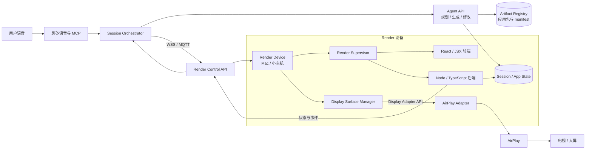
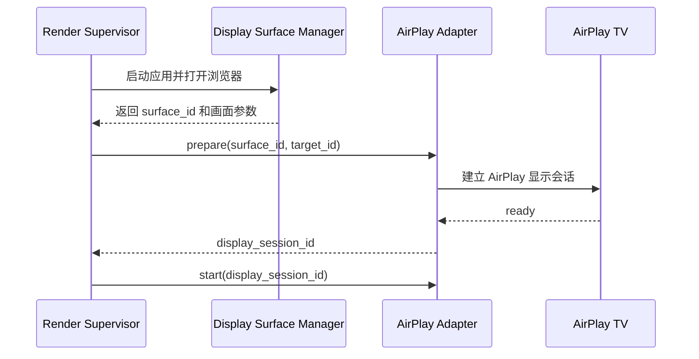

# Open Anywhere 架构设计

> **Open Anywhere：说出你的需要，让应用在身边的屏幕上诞生。**

## 1. 设计目标

Open Anywhere 让用户通过灵矽语音入口，现场创建一个可运行的 Web 应用，并把它展示到身边的屏幕上。首个完整场景是四人知识竞赛：用户说出人数、主题和玩法，Agent 生成游戏，Render 运行游戏，AirPlay 把画面投到电视，后续的答题和规则调整通过应用接口完成。

系统需要同时满足三个要求：

- Agent 能够生成不同类型的应用，而不是只生成固定游戏。
- 应用能够在指定设备上可靠启动、更新和恢复。
- 屏幕输出协议可以替换，应用不依赖 AirPlay 的具体实现。

## 2. 总体架构



### 组件职责

| 组件 | 职责 | 关键边界 |
| --- | --- | --- |
| 灵矽语音与 MCP | 接收语音、识别意图、调用工具 | 不直接执行任意代码 |
| Session Orchestrator | 管理用户、设备、应用和游戏会话 | 决定命令发往哪台 Render 设备 |
| Agent API | 生成应用计划、前端、后端和接口清单 | 负责构建与发布，不承接每次答题 |
| Artifact Registry | 保存版本化应用包和 manifest | 支持校验、回滚和版本追踪 |
| Render Control API | 远程部署、启动、调用和停止应用 | 只暴露受控命令 |
| Render Supervisor | 设备上的本地进程管理器 | 启动后端、浏览器和显示会话 |
| App Runtime | 具体的 Web 应用 | 维护游戏状态和业务逻辑 |
| Display Surface Manager | 准备浏览器窗口、尺寸和音频 | 不关心业务规则 |
| AirPlay Adapter | 将画面投送到 AirPlay 屏幕 | 可替换为其他显示适配器 |

## 3. 三类 API

### 3.1 Agent API

Agent API 负责创建和修改应用。一次构建分为两步：先生成应用计划和接口清单，再根据清单生成代码和构建产物。

```text
POST /v1/apps/plan
POST /v1/apps/{app_id}/build
POST /v1/apps/{app_id}/releases
GET  /v1/apps/{app_id}/releases/{version}
```

Agent 的构建结果包含：

```text
app-package/
├── manifest.json
├── frontend/        # React / JSX 或构建后的静态资源
├── backend/         # Node / TypeScript 服务
└── state-schema.json
```

### 3.2 Render Control API

Render Control API 面向设备和应用生命周期：

```text
register_device
deploy_app
start_session
invoke_command
get_state
stop_session
```

设备建议主动通过 WSS 或 MQTT 连接服务端，服务端不直接暴露 Render 主机端口。命令示例：

```json
{
  "type": "invoke_command",
  "device_id": "render-living-room",
  "session_id": "quiz-session-001",
  "app_id": "quiz-20261023",
  "command": "answer",
  "request_id": "req-123",
  "arguments": {
    "user_id": "player-2",
    "option": "B"
  }
}
```

### 3.3 投屏服务开放 API

投屏服务是一个独立的局域网投屏端，对外开放 HTTP API。Client 可以使用它把自己的实时媒体流投放到局域网中的电视或其他显示设备。投屏服务负责探测局域网设备、维护可用的投屏目标，并通过目标支持的协议建立和停止投屏会话。

Client 的调用流程如下：

```text
Client → 查询投屏服务有哪些 Target
Client → 选择 Target 上的 Endpoint
Client → 创建投屏 Session，并提供自己的实时流 URL
投屏服务 → 调用 DLNA / AirPlay 等协议开始播放
Client → 查询 Session 状态
Client → 停止 Session
```

投屏服务不负责生成 Client 的媒体内容。第一版由 Client 提供一个目标设备可访问的实时 MPEG-TS 流；投屏服务负责将该流交给目标设备播放。

#### 3.3.1 查询投屏目标

```http
GET /v1/targets
```

```json
{
  "targets": [
    {
      "id": "tv-9c1221d09d00",
      "name": "我永远喜欢小米.JPG的小米电视S Pro 85 Mini LED 2026",
      "state": "online",
      "endpoints": [
        {
          "id": "dlna-renderer",
          "protocol": "dlna",
          "capabilities": {
            "formats": ["mpegts"],
            "video_codecs": ["h264"],
            "audio_codecs": ["aac"],
            "realtime": true
          }
        },
        {
          "id": "airplay-mirror",
          "protocol": "airplay",
          "capabilities": {
            "formats": ["airplay-mirror"],
            "video_codecs": ["h264"],
            "audio_codecs": ["aac"],
            "realtime": true
          }
        }
      ]
    }
  ]
}
```

`Target` 表示一个物理投屏设备；`Endpoint` 表示该设备上的一种投屏入口。同一台电视可以同时拥有 `dlna-renderer` 和 `airplay-mirror` 两个 Endpoint。Client 根据 Endpoint 的 `capabilities` 选择协议、封装格式和编码方式。

#### 3.3.2 创建投屏会话

```http
POST /v1/projection-sessions
Content-Type: application/json
```

第一版只支持 Client 提供实时流：

```json
{
  "target_id": "tv-9c1221d09d00",
  "endpoint_id": "dlna-renderer",
  "source": {
    "type": "stream",
    "url": "http://192.168.31.203:8765/live.ts",
    "format": "mpegts",
    "video_codec": "h264",
    "audio_codec": "aac"
  }
}
```

服务端校验目标能力后，使用 DLNA 的 `SetAVTransportURI` 和 `Play` 操作，让电视开始拉取 `source.url`：

```json
{
  "session_id": "projection-session-001",
  "state": "playing",
  "target_id": "tv-9c1221d09d00",
  "endpoint_id": "dlna-renderer",
  "source": {
    "type": "stream",
    "url": "http://192.168.31.203:8765/live.ts",
    "format": "mpegts",
    "video_codec": "h264",
    "audio_codec": "aac"
  }
}
```

`source.url` 必须是目标设备可以访问的地址。Client 负责启动流服务并持续输出符合声明的 MPEG-TS、H.264 和 AAC 数据；投屏服务负责协议控制和会话生命周期。

#### 3.3.3 查询和停止会话

```http
GET /v1/projection-sessions/{session_id}
```

```json
{
  "session_id": "projection-session-001",
  "state": "playing",
  "target_id": "tv-9c1221d09d00",
  "endpoint_id": "dlna-renderer"
}
```

停止投屏：

```http
DELETE /v1/projection-sessions/{session_id}
```

服务端停止目标设备的播放并释放投屏会话。该操作不负责停止 Client 自己的流服务。

### 3.4 App API

App API 由具体应用实现，处理运行时的业务动作。四人知识竞赛可以声明：

```text
start_game
register_player
answer
get_state
update_rules
pause
resume
reset
```

外部调用使用统一的命令入口，避免灵矽依赖每个应用自己生成的公网 URL：

```http
POST /v1/render-sessions/{session_id}/commands
Content-Type: application/json
```

```json
{
  "command": "answer",
  "arguments": {
    "user_id": "player-2",
    "option": "B"
  }
}
```

Render 校验 `manifest.json` 后，将命令转发给本地应用后端。应用可以在本地使用自己的路由，但外部系统只需要理解统一的 Render Control API。

## 4. 应用清单 manifest

Agent 在构建应用时必须同时生成接口描述，让发起者、Render 和灵矽都知道应用具备哪些能力。

```json
{
  "app_id": "quiz-20261023",
  "version": "v1",
  "runtime": {
    "backend": "node",
    "frontend": "react",
    "start_command": "node backend/server.js"
  },
  "entry": {
    "path": "/",
    "health_check": "/health"
  },
  "commands": [
    {
      "name": "answer",
      "description": "玩家提交答案",
      "input_schema": {
        "type": "object",
        "required": ["user_id", "option"],
        "properties": {
          "user_id": { "type": "string" },
          "option": { "enum": ["A", "B", "C", "D"] }
        }
      }
    },
    {
      "name": "update_rules",
      "description": "修改尚未开始的题目规则"
    },
    {
      "name": "get_state",
      "description": "获取当前游戏状态"
    }
  ],
  "events": [
    "question_started",
    "answer_received",
    "score_updated",
    "game_finished"
  ],
  "capabilities": {
    "display": true,
    "audio": true,
    "airplay": true
  }
}
```

## 5. Render 与 AirPlay 的边界

AirPlay 主要传输音频和视频画面，不直接接收 JSX，也不天然提供电视遥控器回传。因此 Render 先准备一个显示表面，再由显示适配器负责投送。



显示适配器统一提供以下能力：

```ts
interface DisplayAdapter {
  discoverTargets(): Promise<DisplayTarget[]>;
  prepareSurface(spec: SurfaceSpec): Promise<Surface>;
  start(session: DisplaySession): Promise<void>;
  stop(displaySessionId: string): Promise<void>;
  getStatus(displaySessionId: string): Promise<DisplayStatus>;
}
```

第一版使用 `mirror` 模式：Render 在 Mac 上启动全屏 Chromium，再由 AirPlay Adapter 调用系统屏幕镜像能力。后续如果需要独立视频流，再增加编码和流式传输模式，应用层不需要改变。

```json
{
  "target_id": "living-room-tv",
  "surface_id": "surface-quiz-001",
  "mode": "mirror",
  "viewport": {
    "width": 1920,
    "height": 1080,
    "device_scale_factor": 1
  },
  "audio_enabled": true
}
```

显示适配器可以继续扩展：

```text
DisplayAdapter
├── AirPlayAdapter
├── ChromecastAdapter
├── WebRTCAdapter
└── HDMIAdapter
```

## 6. 四人知识竞赛完整链路

1. 用户说：“灵矽，创建一个四人的知识竞赛，投到客厅电视。”
2. 灵矽将需求发送给 Session Orchestrator。
3. Agent API 生成应用计划、接口清单和应用包。
4. Orchestrator 根据设备能力选择一台 Render 设备。
5. Render 拉取应用包，启动后端和全屏浏览器。
6. Display Surface Manager 创建显示表面。
7. AirPlay Adapter 将浏览器画面投到电视。
8. 用户说：“张三选 B。”
9. 灵矽调用 Render 的 `answer` 命令。
10. Render 转发给 App API，应用更新状态、比分和动画。
11. 前端通过 WebSocket 或 SSE 接收状态变化，电视显示新画面。
12. 应用通过事件回传当前比分和游戏进度，灵矽播报结果。

```text
语音
  → 灵矽 / MCP
  → Session Orchestrator
  → Render Control API
  → App API: answer(player_2, B)
  → React 状态更新
  → Display Surface
  → AirPlay
  → 电视
```

“创建游戏”“增加新玩法”属于 Agent API；“开始”“答题”“查询比分”“暂停”属于 App API。每次答题不重新调用 Code Agent，避免延迟和状态丢失。

## 7. MVP 范围

- 一台 Mac 作为 Render 设备。
- 一个四人知识竞赛 Web 应用。
- React / JSX 前端和 Node 后端。
- Render Supervisor 负责部署和启动应用。
- AirPlay Adapter 使用 Mac 屏幕镜像模式。
- 灵矽通过 MCP 调用 `start_game`、`answer`、`get_state`、`update_rules`、`reset`。
- 游戏状态持久化，规则更新只影响尚未开始的题目。
- 支持“创建 → 加入 → 答题 → 改规则 → 结算”的连续演示。

首版暂不要求电视遥控器回传、自动发现所有屏幕、同时抢答、自由声纹识别和多设备协同。需要输入回传时，再增加独立的 `InputAdapter`，不修改 AirPlay Adapter 的职责。

## 8. 运行和安全约束

- Render 设备主动建立 WSS / MQTT 连接，避免暴露本地端口。
- 应用包有版本号、哈希和签名，Render 启动前校验。
- 每个应用运行在独立目录或容器中。
- Render 只允许执行 `manifest` 中声明的启动命令和工具。
- 应用升级使用新版本会话，正在进行的游戏保持原版本运行。
- Agent 构建失败、应用启动失败或 AirPlay 连接失败都要向灵矽返回明确状态。
