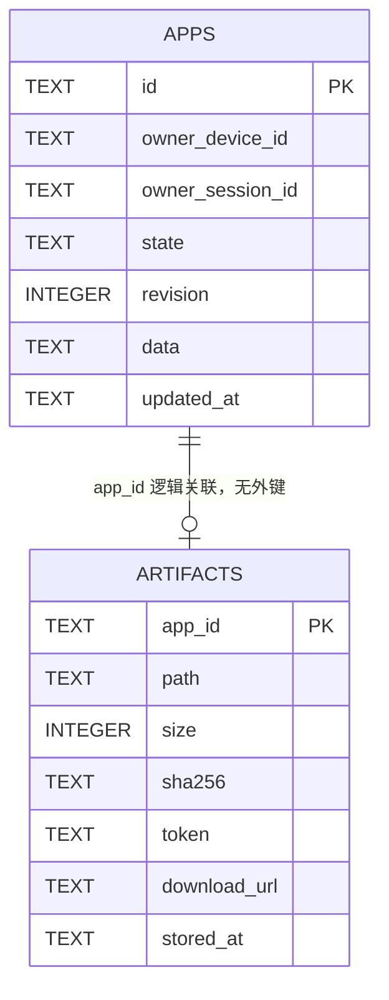
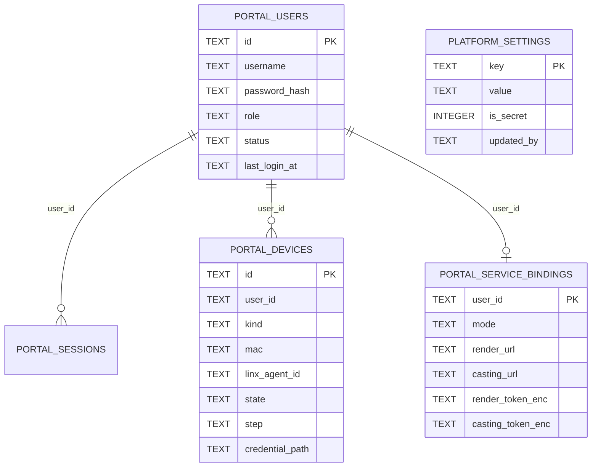

# 控制面数据库设计

> 代码位置：`internal/gateway/store/db.go`、`internal/gateway/store/portal.go`、`internal/gateway/store/platform.go`、`internal/gateway/app/app.go`、`internal/gateway/artifact/store.go`、`internal/gateway/settings/settings.go`、`internal/gateway/secret/secretbox.go`、`internal/gateway/service/`、`cmd/gateway/main.go`

## 1. 定位与边界

控制面用**单文件 SQLite** 保存应用目录和产物元数据，使进程重启后应用记录、构建进度和产物下载令牌仍然可用。它不是业务数据库，也不承担多副本协调。

| 数据 | 存放位置 | 是否在 SQLite |
| --- | --- | --- |
| 应用记录、构建进度、运行绑定 | `apps` 表（整条快照在 `data` JSON 列） | 是 |
| 产物元数据、下载令牌 | `artifacts` 表 | 是 |
| 产物压缩包 | `{artifacts.dir}/{app_id}.tar.gz` | 否，文件系统 |
| 屏幕映射 | `screens` 指向的 JSON 文件 | 否 |
| 投屏会话 | Casting 服务内存 | 否 |
| Render 实例 | Render 服务内存 | 否 |
| 门户账号、角色/状态、会话、设备记录 | `portal_users` / `portal_sessions` / `portal_devices` | 是（v2，v3 增加角色与状态） |
| 用户服务绑定 | `portal_service_bindings` | 是（v3；token 为密文） |
| 平台设置（AgentAPI / Linx / 默认服务 / 注册开关） | `platform_settings` | 是（v3；秘密字段为密文） |
| 平台侧 MCP Server/实例 ID 缓存 | `portal_settings` | 是 |
| 虚拟设备凭证 | `{portal.data_dir}/devices/{device_id}.json` | 否，0600 文件 |
| 主密钥 | `GATEWAY_SECRET_KEY` 或 `{portal.data_dir}/secret.key` | 否 |
| MCP 调用日志 | 进程标准日志 | 否 |

因此控制面重启后能恢复的是"应用属于谁、处于什么阶段、产物在哪、下一步该做什么"，而不是下游的真实运行状态。下游状态通过 `session_id`、`instance_id`、`projection_session_id` 等已持久化标识，由 `reconcile` 只读核对后重建（见 `internal/gateway/service/reconcile.go`）。

设计约束：

- **单进程、单写者**。一个数据库文件只应被一个 Gateway 进程打开。
- **嵌入式、无外部依赖**。使用 `modernc.org/sqlite`（纯 Go，无需 cgo）。
- **只存控制面自己的事实**。应用源码、运行日志、媒体流都不入库。

## 2. 文件与配置

| 配置项 | YAML | 环境变量 | 命令行 | 默认值 |
| --- | --- | --- | --- | --- |
| 数据库文件 | `database.path` | `GATEWAY_DB` | `-db` | `open-anywhere.gateway.db` |
| 产物目录 | `artifacts.dir` | `ARTIFACTS_DIR` | `-artifacts-dir` | `artifacts` |
| 产物下载基地址 | `artifacts.base_url` | `ARTIFACT_BASE_URL` | `-artifact-base-url` | 示例为 `http://192.168.31.203:8090` |
| Portal 数据目录 | `portal.data_dir` | `PORTAL_DATA_DIR` | `-portal-data-dir` | `portal-data` |
| 主密钥 | — | `GATEWAY_SECRET_KEY`（base64 32 字节） | — | 否则读取 `{portal.data_dir}/secret.key` |

相对路径相对于 Gateway 进程的工作目录。打开数据库时会自动创建父目录（`store.Open`，`internal/gateway/store/db.go:57-63`）。

WAL 模式会在数据库文件旁生成 `-wal` 和 `-shm` 文件；备份必须使用 SQLite 的在线备份或先正常停进程，不能只拷贝主文件。

`-db :memory:` 是特殊值：使用带进程序列的共享内存库，仅适合测试，进程退出即丢失（`db.go:66-68`）。

## 3. 逻辑模型



一个应用最多对应一个产物包；产物表以 `app_id` 为主键，重复构建会覆盖同一行和同一个文件。两表之间**没有外键约束**，删除顺序由 Go 代码保证。

门户侧是独立的一组表，通过 `portal_devices` 把灵矽身份映射到用户：



`portal_devices` 的 `(mac, linx_agent_id)` 对应 `apps.data.Owner` 的 `(device_id, agent_id)`，应用归属仍由内存注册表按 `SameOwner` 判断，应用表不增加外键。平台设置是全局键值表，与用户没有外键关系。

## 4. 表结构

### 4.1 `apps`

```sql
CREATE TABLE IF NOT EXISTS apps (
    id TEXT PRIMARY KEY,
    owner_device_id TEXT NOT NULL,
    owner_session_id TEXT NOT NULL,
    state TEXT NOT NULL,
    revision INTEGER NOT NULL,
    data TEXT NOT NULL,
    updated_at TEXT NOT NULL
);
CREATE INDEX IF NOT EXISTS apps_owner_state
    ON apps(owner_device_id, owner_session_id, state);
```

| 列 | 含义 | 说明 |
| --- | --- | --- |
| `id` | 应用 ID | `app_` + `crypto/rand.Text()`，同时是产物文件名的一部分 |
| `owner_device_id` | 灵矽设备 ID | 来自 `X-Linx-Device-Id` |
| `owner_session_id` | 创建应用时的灵矽会话 ID | **仅保留诊断信息**。归属判断已改为"设备 + 智能体"，通知也按设备 + 智能体路由（`app.Identity.SameOwner`、`mcp.Server.Notify`） |
| `state` | `building` / `idle` / `running` / `error` | `data.State` 的冗余列，便于人工排查 |
| `revision` | 快照修订号 | 乐观并发控制：写入时只允许 `excluded.revision >= apps.revision` |
| `data` | 完整 `app.App` JSON 快照 | 恢复时只读取这一列，其余列不参与对象重建 |
| `updated_at` | 最近一次成功写入的墙钟时间 | UTC、`time.RFC3339Nano`；不是应用业务时间 |

索引 `apps_owner_state` 目前**没有被任何查询使用**：运行期的归属过滤在内存注册表完成，持久层只有按主键写入/删除和全表读取。索引列也没有包含 `agent_id`。

### 4.2 `artifacts`

```sql
CREATE TABLE IF NOT EXISTS artifacts (
    app_id TEXT PRIMARY KEY,
    path TEXT NOT NULL,
    size INTEGER NOT NULL,
    sha256 TEXT NOT NULL,
    token TEXT NOT NULL,
    download_url TEXT NOT NULL,
    stored_at TEXT NOT NULL
);
```

| 列 | 含义 | 说明 |
| --- | --- | --- |
| `app_id` | 所属应用 | 与 `apps.id` 逻辑关联，无外键 |
| `path` | 压缩包路径 | `filepath.Join(artifacts.dir, app_id+".tar.gz")`；配置为相对路径时该列也是相对路径 |
| `size` | 压缩字节数 | 保存时重新计算并与构建结果比对 |
| `sha256` | 压缩包摘要 | 十六进制；保存时重新计算 |
| `token` | 下载令牌 | `crypto/rand.Text()`，随机、无过期时间 |
| `download_url` | 完整下载地址 | `{artifacts.base_url}/artifacts/{app_id}/artifact.tar.gz?token={token}` |
| `stored_at` | 保存时间 | UTC、`time.RFC3339Nano` |

产物元数据没有修订号保护，`SaveArtifact` 直接按 `app_id` 覆盖。当前只有构建完成和启动恢复会写入，调用方是串行的。

## 5. `data` 快照格式

`apps.data` 是 `app.App` 的直接 JSON 序列化。顶层字段**没有 JSON tag**，因此列名就是 Go 字段名；只有嵌套的 `Identity`、`Error`、`StreamSource` 和 `openapi.Spec` 有自定义格式。

```json
{
  "ID": "app_abc123",
  "Revision": 7,
  "Owner": {
    "device_id": "dev_1",
    "agent_id": "agent_1",
    "session_id": "sess_1"
  },
  "Prompt": "做一个五题的电影知识竞赛",
  "PlayerNames": ["韩鲁鹏", "邓军辉"],
  "Name": "quiz",
  "State": "running",
  "Error": null,
  "LastAgentMessage": "已完成",
  "LastProgress": "正在打包",
  "SessionID": "ses_1",
  "EventCursor": "evt_42",
  "BuildStartedAt": "2026-10-25T10:00:00Z",
  "BuildFinishedAt": "2026-10-25T10:03:00Z",
  "BuildDuration": 180000000000,
  "LastStatusMessage": "",
  "Artifact": {
    "Path": "artifacts/app_abc123.tar.gz",
    "SHA256": "abc",
    "Size": 1024,
    "DownloadURL": "http://gw/artifacts/app_abc123/artifact.tar.gz?token=tok",
    "StoredAt": "2026-10-25T10:00:00Z"
  },
  "OpenAPI": {
    "operations": [
      {"operationId": "rollDice", "method": "POST", "path": "/api/roll"}
    ],
    "document": {"openapi": "3.1.0", "paths": {"...": "..."}}
  },
  "InstanceID": "inst_1",
  "Port": 39001,
  "AppBaseURL": "http://127.0.0.1:39001",
  "Source": {
    "type": "stream",
    "url": "http://gw/live.ts",
    "format": "mpegts",
    "video_codec": "h264",
    "audio_codec": "aac"
  },
  "ScreenID": "tv_1",
  "TargetID": "tv_1",
  "EndpointID": "dlna-renderer",
  "ProjectionSessionID": "proj_1",
  "PendingRuntime": false,
  "PendingProjection": false,
  "CleanupPending": false,
  "StartedAt": "2026-10-25T10:04:00Z",
  "StoppedAt": "0001-01-01T00:00:00Z"
}
```

字段按用途分组：

| 分组 | 字段 | 持久化意义 |
| --- | --- | --- |
| 归属与输入 | `ID`、`Owner`、`Prompt`、`PlayerNames` | 历史和重启后继续构建 |
| 构建 | `State`、`SessionID`、`EventCursor`、`BuildStartedAt`、`BuildFinishedAt`、`BuildDuration`、`LastAgentMessage`、`LastProgress`、`LastStatusMessage` | 重启后继续监听 `building` 会话 |
| 构建产物 | `Name`、`OpenAPI`、`Artifact` | 无需重新下载即可提供 `get-app-operations` / `get-openapi`；下载地址在重启时重写 |
| 运行绑定 | `ScreenID`、`TargetID`、`EndpointID`、`Source`、`InstanceID`、`Port`、`AppBaseURL`、`ProjectionSessionID` | 重启后核对并清理遗留资源 |
| 运行时间 | `StartedAt`、`StoppedAt` | 状态查询 |
| 未完成意图 | `PendingRuntime`、`PendingProjection`、`CleanupPending`、`Error` | 写前约束：先记录意图，再调用下游；崩溃后由 `reconcile` 核对 |

注意事项：

- `BuildDuration` 是 Go `time.Duration` 的纳秒整数（JSON number），不是秒数。
- 零值时间序列化为 `"0001-01-01T00:00:00Z"`。
- `Artifact.DownloadURL` 内嵌下载令牌，因此**令牌在数据库里出现两次**（`artifacts.token` 与 `data` 内的 URL）。
- `EventCursor` 每收到一个带 `id` 的事件就写入，但重启后 `builder.Resume` 只用内存 `seen` 集合从事件流头部重放去重，**没有读取 `EventCursor`**。这与 `docs/gateway-agentapi-interface.md` 3.7 的描述存在偏差。
- 快照没有内部格式版本号。旧版本程序读取新版本写入的字段时会静默丢弃未知字段，下一次写入即丢失；**不支持直接回滚到旧二进制**。
- 顶层字段名是 Go 标识符，重命名 `app.App` 的导出字段等同于破坏持久化格式，必须同时提供迁移。

## 6. 连接与并发

`store.Open` 使用如下 DSN（`db.go:65`）：

```text
file:{path}?_pragma=busy_timeout(5000)&_pragma=journal_mode(WAL)&_pragma=foreign_keys(1)
```

| 设置 | 作用 |
| --- | --- |
| `busy_timeout(5000)` | 锁等待最多 5 秒 |
| `journal_mode(WAL)` | 允许外部只读工具与进程并发读，写入仍是单写者 |
| `foreign_keys(1)` | 开启外键检查；门户的 session/device 表依赖它做级联删除 |
| `SetMaxOpenConns(1)` | 进程内所有 SQL 串行化，避免 `database/sql` 多连接竞争；也意味着一个慢查询会阻塞健康检查 |

打开流程：

1. 创建数据库父目录（`db.go:57-63`）。
2. 以 10 秒超时 `Ping`。
3. 读取 `PRAGMA user_version`；若大于程序支持的 `schemaVersion`（当前为 3）则拒绝启动。
4. 按版本依次执行尚未应用的迁移（v1 → v2 → v3 → v4）；每个版本在独立事务中执行，成功后在同一事务写入 `PRAGMA user_version`。新库从 0 一次执行到 4，已有 v3 库只执行 v4。

写入并发控制分两层：

- **注册表层**：`Registry.persistMu` 串行化所有持久化调用；`Record.Update/Do` 持有记录锁并递增 `Revision`。
- **SQL 层**：`SaveApp` 的 `ON CONFLICT ... WHERE excluded.revision >= apps.revision` 保证较旧的快照不能覆盖较新的快照。较早开始但较晚到达的写入会被忽略。

`Record.Update` 与 `Record.Do` 的持久化语义不同：

| 方法 | 顺序 | 失败处理 | 使用场景 |
| --- | --- | --- | --- |
| `Update` | 先改内存并 `Revision++`，再持久化 | 只记日志，内存继续生效 | 构建进度、部分失败标记等可自愈状态 |
| `Do` | 先复制快照、修改、持久化成功后才提交内存 | 返回错误，内存不变 | 创建、启动、停止、清理等持久化边界 |

`Registry.Add` 先放入内存再持久化，且忽略 `persist` 错误；`Service.CreateApp` 紧接着用一次空的 `Do` 强制落盘，落盘失败会删除记录并返回 `PERSISTENCE_FAILED`，因此不会带着未持久化的应用去调用 AgentAPI。

所有 CRUD 调用使用不带 `context` 的 `Exec/Query`，没有逐语句超时；最坏阻塞时间由 `busy_timeout` 兜底为约 5 秒。启动阶段的 `Ping`、版本读取和建表使用 10 秒超时上下文。

## 7. 读写路径

### 7.1 启动恢复

`cmd/gateway/main.go:51-124` 的顺序：

1. `store.Open`：打开数据库并确保 schema。
2. `registry.SetPersister(database)`：后续每次状态变更自动落盘。
3. `artifact.NewStore`：读取全部 `artifacts` 行；对每个 `app_id` 重新按当前 `artifacts.dir` 和 `artifacts.base_url` 计算 `path` / `download_url` 并写回。令牌保持不变。
4. `database.ListApps`：读取全部 `data` 并反序列化为 `app.App`。
5. 对每个同时存在产物行的应用，用步骤 3 计算的路径和地址覆盖 `App.Artifact`，`Revision++` 后 `SaveApp`。
6. `registry.Load`：只加载，不写回；`Revision` 为 0 时补为 1。
7. `RecoverRuntime`：把 `PendingRuntime` / `PendingProjection`，以及 `idle` 但仍有实例或投屏绑定的应用标为 `error` + `CleanupPending` + `RECOVERY_PENDING`，等待 `reconcile` 只读核对。
8. `PruneHistory`：按 `(device_id, agent_id)` 分组，每组保留最新 10 个。
9. 对 `State == building` 的应用调用 `builder.Resume`；缺少 `SessionID` 的直接置为构建失败。
10. `RunMonitor` 周期核对运行状态并完成遗留清理。

启动阶段任何一条 `data` 无法解析、`stored_at` 无法解析，都会让整个 `ListApps/ListArtifacts` 返回错误并导致进程启动失败；单行损坏没有隔离。

### 7.2 生命周期写入点

| 场景 | 主要字段 | 持久化方法 |
| --- | --- | --- |
| 创建应用 | `ID`、`Owner`、`Prompt`、`PlayerNames`、`State=building`、`BuildStartedAt` | `Add` + 空 `Do` |
| 创建 AgentAPI 会话 | `SessionID`、`BuildStartedAt` | `Do`（失败则归档会话） |
| 构建进度 | `EventCursor`、`LastAgentMessage`、`LastProgress`、`LastStatusMessage` | `Update` |
| 构建成功 | `State=idle`、`Name`、`OpenAPI`、`Artifact`、`BuildFinishedAt`、`BuildDuration` | `Do` |
| 构建失败 | `State=error`、`BuildFinishedAt`、`Error` | `Update` |
| 启动：占屏 | `ScreenID`、`TargetID`、`CleanupPending=true` | `Do` |
| 启动：Render | `Port`、`PendingRuntime=true` → `InstanceID`、`AppBaseURL` | `Do` |
| 启动：投屏 | `EndpointID`、`Source`、`PendingProjection=true` → `ProjectionSessionID` | `Do` |
| 启动成功 | `State=running`、下游全部绑定、`StartedAt` | `Do` |
| 停止 | 先停投屏，再停 Render，最后清空绑定、`State=idle`、`StoppedAt` | `Do` |
| 清理遗留资源 | 逐步清空 `ProjectionSessionID` / `InstanceID` / 标记，最后清 `CleanupPending` | `Do` |
| 历史裁剪 | 删除 `apps` 行、产物文件、`artifacts` 行 | `DeleteApp` + `Remove` |

`PendingRuntime` / `PendingProjection` / `CleanupPending` 是**写前意图标记**：先落盘"我要调用下游"，再发起网络请求。这样进程在任意位置崩溃，重启后都能从已持久化的标识判断是否存在遗留资源，而不会重复创建。

## 8. 产物生命周期

1. 构建完成，从 AgentAPI 下载并校验压缩包（上限 100 MiB）。
2. `artifact.Store.SaveFile` 复制到 `{app_id}.tar.gz.tmp`，重新计算大小和 SHA-256，与构建结果不一致则删除临时文件。
3. `os.Rename` 原子替换为 `{app_id}.tar.gz`。
4. 生成新令牌和下载地址，`SaveArtifact` 写元数据；**每次保存都会换令牌，旧下载地址立即失效**。
5. 应用快照通过 `Do` 记录 `Artifact.Path/SHA256/Size/DownloadURL/StoredAt`。
6. 下载接口 `GET /artifacts/{app_id}/{name}?token=...` 只校验路径中的 `app_id`、固定文件名 `artifact.tar.gz` 和常量时间比较的令牌，不要求 MCP 鉴权。
7. 删除时先删 `apps` 行（`Registry.Remove`），再删文件和 `artifacts` 行（`Store.Remove`）。

启动时只扫描数据库中的产物行，不扫描产物目录：

- 行存在但文件丢失：`Store.Has` 返回 false，`start-app` 返回 `ARTIFACT_MISSING`。
- 文件存在但行丢失：文件不可见、不可下载，也不会被清理。
- 删除应用后、删除产物前崩溃：留下无主产物行和文件，后续启动不会回收。
- 构建产物已写入、应用快照落盘失败：留下产物行；应用仍为 `building`，恢复后重新构建会覆盖同一行。

## 9. 历史保留

`HistoryLimit = 10`，由 `Service.PruneHistory` 执行：

- 按 `(device_id, agent_id)` 分组，每组保留最新的 10 个应用，用户之间互不挤占。
- 只在创建应用后和进程启动时触发。
- `building`、`running`，以及仍持有 Render 实例、投屏会话、清理标记的应用永不删除。
- 删除一个应用会同时删除其产物文件和元数据。
- 启动或运行时的任何一次裁剪都不做“删除后校验”，因此不是跨表事务。

## 10. Schema 版本与迁移

- 当前 `schemaVersion = 4`，版本号保存在 SQLite `PRAGMA user_version`。
- 迁移是有序列表，而不是一组混合的 `CREATE ... IF NOT EXISTS`：

| 版本 | 内容 |
| --- | --- |
| v1 | `apps`、`artifacts` 及 `apps_owner_state` 索引 |
| v2 | `portal_users`、`portal_sessions`、`portal_devices`、`portal_settings` 及索引 |
| v3 | `portal_users.role/status/last_login_at`、角色/过期索引、虚拟设备与 AgentID 唯一索引、`portal_service_bindings`、`platform_settings` |
| v4 | 删除 `portal_devices_one_virtual` 与 `portal_devices_agent`，新增 `portal_devices_agent_mac(linx_agent_id, mac)` 唯一索引与 `portal_devices.name` |

- 每个版本在一个事务中执行，`PRAGMA user_version` 也在该事务内写入；任一步失败会回滚整个版本，schema 与版本号都保持原状。
- 打开时只拒绝**比程序更新**的数据库，旧程序看到更新的版本会拒绝启动，避免写入不认识的 schema。
- v3 使用 `ALTER TABLE` 增加列，只在 `user_version < 3` 时执行，不做 `IF NOT EXISTS` 兜底。
- **迁移前预检**（`prepareSchemaV3`）：
  - 同一用户存在多台 `kind='virtual'` 设备；
  - 非空 `linx_agent_id` 被多台设备重复使用。
  发现重复时整个 v3 迁移回滚，并给出明确错误，要求人工处理；**不会自动删除任何用户数据**。
- 迁移不硬编码账号。启动时 `EnsureAdmin` 用 `portal.username` / `portal.password` 创建或提升引导账号；已有 v2 账号若与配置的引导账号同名，则被提升为管理员，其余账号保留为 `user`。设备、凭据与应用都保留。
- 修改已有表结构时必须新增迁移版本、在事务内执行 `ALTER TABLE` 或重建表、递增 `schemaVersion`，并保留“新库拒绝启动”的保护。

WAL 模式下的备份：

- 备份必须使用 SQLite 在线备份（`sqlite3 db ".backup 'backup.db'"`）或先正常停进程，不能只拷贝主文件，否则可能丢失 `-wal` 中尚未 checkpoint 的数据。
- 平台密钥与用户服务 token 是密文，备份数据库时必须同时保留 `GATEWAY_SECRET_KEY` 或 `secret.key`，否则恢复后无法解密；反过来，只备份密钥而不备份数据库也恢复不了设置。

## 11. 容量与性能

- 应用记录上限约 10 条（加上无法裁剪的 `building` / `running` 记录）；单条 `data` 大小主要取决于 OpenAPI 文档，通常是几十 KB 到数百 KB。
- 产物单包上限 100 MiB，按 `app_id` 覆盖，不保留历史版本。
- 每次构建事件（`agent.message`、`agent.thinking`、`session.error`）都会把**整条应用快照**重新序列化并写入：高频思考事件会带来明显的写放大和 WAL 增长。
- `ListApps` / `ListArtifacts` 是启动期全表扫描，当前数据量下没有问题；`ORDER BY updated_at` 使用文本排序，而 `RFC3339Nano` 的小数位长度可变，同一秒内"无小数"与"有小数"的字符串顺序不一定等于时间顺序。该顺序只影响启动加载次序，不影响业务。
- 单连接串行化意味着一次锁等待会阻塞后续所有 SQL，也会拖慢 MCP 调用中的持久化步骤。`/healthz` 的 `Ping` 自带 2 秒超时，锁等待超过 2 秒时会直接返回 503。
- 门户数据量按“每个账号最多 10 台设备”增长；用户列表分页查询（默认 50、上限 100），智能体列表最多返回 500 条，全局应用列表最多 200 条。注册、设置与绑定写入都不在应用构建的热路径上。

## 12. 安全

- 数据库保存用户提示词、玩家姓名、设备 ID、智能体 ID、会话 ID、运行端口和产物下载令牌，属于需要按敏感数据对待的本地文件。
- 数据库文件权限由进程 umask 决定，代码没有显式收紧；产物目录以 `0755` 创建，压缩包以 `0644` 写入。多用户主机上建议把数据库与产物目录放到仅服务账户可读的位置。
- 下载令牌无过期时间；只有重新构建才会换令牌，重启不会更换。产物下载接口不经过 MCP Bearer 鉴权，令牌本身就是能力凭证。
- 密码只保存 PBKDF2-SHA256 哈希；会话只保存 token 的 SHA-256；设备 token 在 0600 凭证文件中，不入库。
- 平台 API Key、平台默认服务 token、用户服务 token 以 AES-256-GCM 加密后入库，密文格式为 `enc:v1:<base64(nonce|ciphertext)>`，AAD 分别绑定 `platform:<key>` 与 `binding:<user_id>:<render|casting>`，防止密文在字段间搬运。
- 主密钥来自 `GATEWAY_SECRET_KEY` 或 `{portal.data_dir}/secret.key`（0600）。Gateway 启动阶段会解密校验 `platform_settings` 与 `portal_service_bindings` 中的全部密文，任一失败则拒绝启动并提示恢复密钥；主密钥缺失或不匹配时不会静默重置，不要删除密钥或清空密文来“修复”，必须从备份恢复。
- 数据库没有整体加密；未标记为秘密的字段（用户名、服务地址、时间、状态）仍是明文，日志里会打印应用 ID、会话短 ID 和工具调用摘要。

## 13. 已知限制与建议

以下按影响排序，均为**现状**，不是已实现行为：

1. **归属列与归属规则不一致**：归属规则是"设备 + 智能体"，但表里只有 `owner_device_id` 和 `owner_session_id`，没有 `owner_agent_id`；索引也用了会话而不是智能体，且该索引无人使用。建议 v2 增加 `owner_agent_id`（从 `data` 回填），把索引改为 `(owner_device_id, owner_agent_id, state)`，或直接删除无用索引。
2. **没有外键与孤儿回收**：`artifacts.app_id` 未约束到 `apps.id`。建议增加 `REFERENCES apps(id) ON DELETE CASCADE`（文件删除仍需 Go 代码），并在启动时清理"有产物行但没有应用行"的孤儿记录和文件。
3. **单行损坏会阻塞启动**：一条坏 JSON 或坏时间戳会让 `ListApps` / `ListArtifacts` 整体失败。建议逐行容错：记录日志、隔离坏行，并让其余应用继续恢复。
4. **`EventCursor` 只写不读**：与接口文档 3.7 的"按游标跳过已处理事件"不一致。要么在恢复时真正使用游标/事件 ID 集合，要么从 schema 与文档中移除该字段，避免误以为去重是跨重启的。
5. **整快照高频写入**：构建过程中每个 thinking 事件都重写完整快照。建议把高频进度拆成独立小表或独立列，或按时间/事件数节流，降低 WAL 和磁盘压力。
6. **跨表写入不是事务**：产物与应用快照、应用删除与产物删除分属不同语句。建议明确可接受的中间状态，并配合启动时的孤儿扫描；否则崩溃窗口会留下不一致。
7. **账号删除与资源回收缺失**：本期只有停用/启用，没有删除账号入口；停用会撤销会话并尽力停止应用，但不会删除灵矽智能体、设备凭证或数据库行。需要回收时只能按“停语音 → 解绑设备 → 删除智能体 → 删除凭证 → 删除用户行”人工处理。
8. **缺少逐语句超时**：建议 CRUD 使用带超时的 `ExecContext/QueryContext`，避免锁等待把 `/healthz` 和 MCP 响应一起拖住。
9. **不支持多副本**：`Revision` 只能防止同一数据库内的旧快照覆盖新快照，无法协调两个 Gateway 同时管理同一批应用。部署文档应明确"一个数据库一个进程"。

## 14. 排查命令

```sh
# schema 与版本
sqlite3 open-anywhere.gateway.db ".schema"
sqlite3 open-anywhere.gateway.db "PRAGMA user_version;"

# 应用概览
sqlite3 -header -column open-anywhere.gateway.db \
  "SELECT id, owner_device_id, owner_session_id, state, revision, updated_at FROM apps ORDER BY updated_at DESC;"

# 某个应用的关键字段
sqlite3 open-anywhere.gateway.db \
  "SELECT json_extract(data,'$.Owner.agent_id'), json_extract(data,'$.State'),
          json_extract(data,'$.Artifact.Path'), json_extract(data,'$.InstanceID'),
          json_extract(data,'$.ProjectionSessionID')
     FROM apps WHERE id='app_xxx';"

# 产物元数据
sqlite3 -header -column open-anywhere.gateway.db \
  "SELECT app_id, size, sha256, stored_at FROM artifacts ORDER BY stored_at DESC;"

# 无主产物（有产物行、无应用行）
sqlite3 open-anywhere.gateway.db \
  "SELECT a.app_id FROM artifacts a LEFT JOIN apps p ON p.id=a.app_id WHERE p.id IS NULL;"

# 门户账号与角色
sqlite3 -header -column open-anywhere.gateway.db \
  "SELECT id, username, role, status, created_at, last_login_at FROM portal_users ORDER BY created_at;"

# 虚拟设备与开通状态
sqlite3 -header -column open-anywhere.gateway.db \
  "SELECT id, user_id, kind, mac, linx_agent_id, state, step, error FROM portal_devices ORDER BY created_at;"

# 用户服务绑定（token 为 enc:v1: 密文，不要尝试在 SQL 中解密）
sqlite3 -header -column open-anywhere.gateway.db \
  "SELECT user_id, mode, render_url, casting_url, updated_at FROM portal_service_bindings;"

# 平台设置（value 可能是密文）
sqlite3 -header -column open-anywhere.gateway.db \
  "SELECT key, is_secret, updated_at, updated_by FROM platform_settings ORDER BY key;"

# 在线备份（WAL 模式下不要只拷主文件；备份必须与 secret.key/GATEWAY_SECRET_KEY 一起保存）
sqlite3 open-anywhere.gateway.db ".backup 'gateway-backup.db'"
```

## 15. 门户表（v2 + v3）

> 建表与迁移位于 `internal/gateway/store/db.go`，读写位于 `store/portal.go`、`store/platform.go`。

门户与 Gateway 共用同一个 SQLite。v2 新增账号、会话、设备与旧版设置表；v3 在 v2 上增加角色/状态、约束与新表，不修改 `apps` 与 `artifacts`。

### 15.1 v2 基础表

```sql
CREATE TABLE IF NOT EXISTS portal_users (
    id            TEXT PRIMARY KEY,
    username      TEXT NOT NULL UNIQUE,
    password_hash TEXT NOT NULL,
    created_at    TEXT NOT NULL,
    updated_at    TEXT NOT NULL
);

CREATE TABLE IF NOT EXISTS portal_sessions (
    token_hash   TEXT PRIMARY KEY,
    user_id      TEXT NOT NULL,
    created_at   TEXT NOT NULL,
    expires_at   TEXT NOT NULL,
    last_seen_at TEXT NOT NULL,
    user_agent   TEXT NOT NULL DEFAULT '',
    FOREIGN KEY (user_id) REFERENCES portal_users(id) ON DELETE CASCADE
);
CREATE INDEX IF NOT EXISTS portal_sessions_user ON portal_sessions(user_id);

CREATE TABLE IF NOT EXISTS portal_devices (
    id              TEXT PRIMARY KEY,
    user_id         TEXT NOT NULL,
    kind            TEXT NOT NULL,
    mac             TEXT NOT NULL UNIQUE,
    client_id       TEXT NOT NULL,
    linx_agent_id   TEXT NOT NULL DEFAULT '',
    agent_name      TEXT NOT NULL DEFAULT '',
    state           TEXT NOT NULL,
    step            TEXT NOT NULL DEFAULT '',
    error           TEXT NOT NULL DEFAULT '',
    credential_path TEXT NOT NULL DEFAULT '',
    created_at      TEXT NOT NULL,
    updated_at      TEXT NOT NULL,
    registered_at   TEXT,
    FOREIGN KEY (user_id) REFERENCES portal_users(id) ON DELETE CASCADE
);
CREATE INDEX IF NOT EXISTS portal_devices_user ON portal_devices(user_id, created_at);

CREATE TABLE IF NOT EXISTS portal_settings (
    key        TEXT PRIMARY KEY,
    value      TEXT NOT NULL,
    updated_at TEXT NOT NULL
);
```

### 15.2 v3 变更

```sql
ALTER TABLE portal_users ADD COLUMN role TEXT NOT NULL DEFAULT 'user'
    CHECK (role IN ('admin','user'));
ALTER TABLE portal_users ADD COLUMN status TEXT NOT NULL DEFAULT 'active'
    CHECK (status IN ('active','disabled'));
ALTER TABLE portal_users ADD COLUMN last_login_at TEXT;

CREATE INDEX IF NOT EXISTS portal_users_role ON portal_users(role, status);
CREATE INDEX IF NOT EXISTS portal_sessions_expires ON portal_sessions(expires_at);

CREATE UNIQUE INDEX IF NOT EXISTS portal_devices_one_virtual
    ON portal_devices(user_id) WHERE kind = 'virtual';
CREATE UNIQUE INDEX IF NOT EXISTS portal_devices_agent
    ON portal_devices(linx_agent_id) WHERE linx_agent_id <> '';
CREATE INDEX IF NOT EXISTS portal_devices_mac_agent
    ON portal_devices(mac, linx_agent_id);

CREATE TABLE IF NOT EXISTS portal_service_bindings (
    user_id           TEXT PRIMARY KEY,
    mode              TEXT NOT NULL DEFAULT 'managed'
        CHECK (mode IN ('managed','custom')),
    render_url        TEXT NOT NULL DEFAULT '',
    casting_url       TEXT NOT NULL DEFAULT '',
    render_token_enc  TEXT NOT NULL DEFAULT '',
    casting_token_enc TEXT NOT NULL DEFAULT '',
    created_at        TEXT NOT NULL,
    updated_at        TEXT NOT NULL,
    FOREIGN KEY (user_id) REFERENCES portal_users(id) ON DELETE CASCADE
);

CREATE TABLE IF NOT EXISTS platform_settings (
    key        TEXT PRIMARY KEY,
    value      TEXT NOT NULL,
    is_secret  INTEGER NOT NULL DEFAULT 0,
    updated_at TEXT NOT NULL,
    updated_by TEXT NOT NULL DEFAULT ''
);
```

### 15.3 关系与约定

- `portal_users` 1:N `portal_sessions` / `portal_devices`；外键依赖 DSN 里的 `foreign_keys(1)`。
- `portal_users.role` 取 `admin` / `user`，`status` 取 `active` / `disabled`。v2 旧账号迁移后默认 `user`；启动时 `EnsureAdmin` 把配置文件声明的引导账号提升为 `admin` 并激活，不通过 SQL 批量提升所有旧账号。
- `portal_users.last_login_at` 在成功登录时更新；会话过期或用户被停用时，`Authenticate` 会删除会话。
- v3 曾限制一个用户最多一台 `kind='virtual'` 设备（`portal_devices_one_virtual`）、非空 `linx_agent_id` 全局唯一（`portal_devices_agent`）；v4 删除这两个索引，改用 `portal_devices_agent_mac(linx_agent_id, mac)` 唯一（`mac` 本身仍全局唯一），一个智能体可以挂多台硬件设备，设备数量上限由接口控制。
- `portal_devices.mac` 对应 `apps.data.Owner.device_id`，`linx_agent_id` 对应 `Owner.agent_id`。应用表不新增外键：应用由灵矽 MCP 写入，可能早于门户记录，归属过滤仍在内存完成。
- `credential_path` 只是相对 `portal.data_dir` 的文件名，设备 token 不进数据库；凭证文件 `0600`，目录 `0700`。
- `portal_sessions.token_hash` 存会话 token 的 SHA-256，不存明文；启动时清理 `expires_at < now` 的行。
- `portal_settings` 只保存平台侧 MCP Server/实例 ID 等少量缓存，不保存 API Key。
- `portal_service_bindings` 每个用户最多一行。`mode=managed` 时忽略用户地址，使用 `platform_settings` 的默认服务；`mode=custom` 时必须同时有 Render/Casting 地址。切换到 managed 不会删除已保存的自定义地址与 token。
- `platform_settings` 是平台级键值表，`updated_by` 记录最后修改的管理员用户 ID（配置 seed 的值为 `bootstrap`）。键包括：
  - `agentapi.base_url`、`agentapi.api_key`、`agentapi.agent_id`、`agentapi.agent_version`、`agentapi.environment_id`
  - `linx.api_base`、`linx.ota_url`、`linx.api_key`
  - `services.default_render_url`、`services.default_render_token`、`services.default_casting_url`、`services.default_casting_token`
  - `registration.open`
- 秘密键为 `agentapi.api_key`、`linx.api_key`、`services.default_render_token`、`services.default_casting_token`；值以 `enc:v1:` 开头，使用 AES-256-GCM 和 AAD `platform:<key>` 加密。用户服务 token 使用 AAD `binding:<user_id>:<render|casting>`。密文无法解密时读取设置会报错，不会回退或重置。
- 容量随注册用户增长；用户列表分页读取，设备列表按用户索引读取。账号没有删除入口，停用只撤销会话并尽力停止资源，不删除行。
