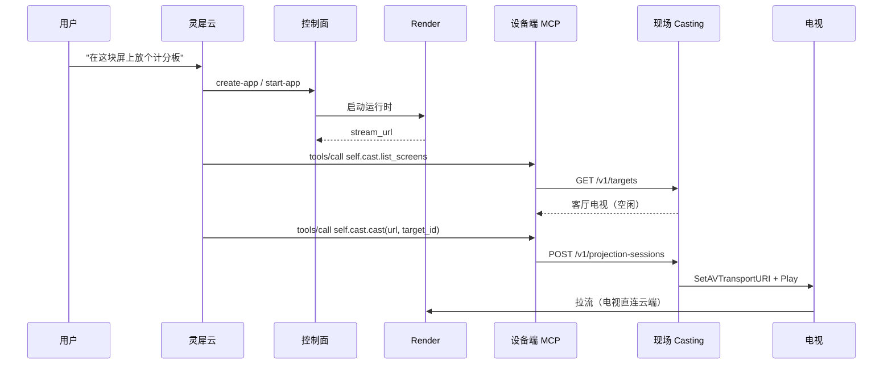

# 现场侧投屏：部署形态与控制链路

本文描述投屏的产品路径：**应用在云端构建与运行，画面由现场的语音设备投到现场局域网里的电视上**。现场可以是家庭，也可以是公司的会议室或门店；两者架构相同，差异只在网络条件，见第 5 节。

## 1. 五步链路

```
1. 现场跑一个局域网投屏服务（Casting），SSDP 发现电视
2. 灵犀调用控制面 MCP 创建并启动应用，Render 开始运行
3. 灵犀问设备端 MCP：现场有没有屏幕？
4. 有屏幕，灵犀从控制面的 start-app 结果里拿到 stream_url
5. 设备端 MCP 把 stream_url 交给本地 Casting，投到那台电视上
```



关键分工：

- **控制面只负责应用。** `start-app` 启动 Render 并返回 `stream_url`，它不接触任何投屏服务，也不接受 `screen_id`。
- **设备负责屏幕。** 设备端 MCP 自带 `self.cast.list_screens` / `self.cast.cast` / `self.cast.stop` 三个工具，通过局域网 HTTP 调用现场 Casting。
- **Casting 只做协议控制。** 它发现设备、建立和结束投屏会话，不代理也不转码媒体。

## 2. 触发：设备 MCP 随语音连接自带

设备连接灵犀时，hello 里声明了 `features: {"mcp": true}`（`main/protocols/websocket_protocol.cc:219`），设备端的 `McpServer` 把 `self.cast.*` 连同 `self.get_device_status` 等工具一起暴露给灵犀。灵犀作为 MCP 客户端，在**同一条语音连接**上发 `tools/list` 与 `tools/call`，工具在设备主任务上执行。

能力随硬件走：换一个智能体、或用户自己配的智能体，投屏工具仍在。控制面 MCP 不需要把投屏工具挂到智能体上。

## 3. 控制：设备访问局域网里的 Casting

Casting 靠 SSDP 发现 DLNA 渲染器，SSDP 是链路本地组播，云端进程看不见现场的屏幕。Casting 因此必须跑在现场，和设备、电视处在同一广播域。

它**没有任何鉴权**（`internal/casting` 的 HTTP 处理器不校验身份），因此：

- 只由同一局域网内的语音设备调用，不暴露到公网，也不做端口映射。
- 设备端不发任何身份头或 token；旧方案里的 `X-Linx-*` 三个头与隧道都已移除。
- 地址烧在设备配置里（`CONFIG_CASTING_URL` 或 NVS `casting/url`），形如 `http://192.168.1.20:8091`。

设备端工具把 Casting 的错误码翻成能直接说出口的话：

| Casting 错误 | 设备回给模型的话 |
| --- | --- |
| `target_busy` | 这块电视正在播放别的内容，先停掉再投 |
| `target_offline` | 这块电视现在离线了 |
| `unsupported_media` | 这块电视不支持这种画面格式 |
| `device_control_failed` | 电视没有响应投屏指令 |
| `not_found`（停止时） | 这块电视已经不在投屏了 |

## 4. 媒体：电视向云端拉流

**Render 固定在云端**，不迁到家里。`start-app` 返回的 `stream_url` 是 `PublicURL/streams/{id}/live.ts`（`internal/render/service.go:442`），设备把这条地址原样交给 Casting，Casting 写进 `SetAVTransportURI`，电视自己向云端 `GET`，边下边播。

方向和投屏控制一致，都是出站：控制连接由设备发起，媒体连接由电视发起。因此不需要 NAT 穿透，也不需要给电视分配公网地址。

两条由此而来的硬约束：

- `PublicURL` 必须是电视能访问的公网地址。设备与 Casting 都不做重写，写错了电视拿到的是一个解析不了的主机名。
- 每屏 2–8 Mbps 的带宽由电视侧承担。一个家庭同时投多块屏时，上限是家庭出口带宽，不是云端。

一个容易误判的地方：会话状态 `playing` 只代表电视接受了这个 URI，不代表它真的拉到了流。断网、DNS 失败、地址不可达时状态仍然是 `playing`，屏幕是黑的。

## 5. 三段链路的失败对照

| 链路 | 谁连谁 | 失败表现 | 排查点 |
| --- | --- | --- | --- |
| 触发 | 设备 → 灵犀云（同一条语音连接） | 模型说"我做不了" | `tools/list` 是否含 `self.cast.*`；设备是否配置了 casting 地址 |
| 控制 | 设备 → 现场 Casting（局域网 HTTP） | "连不上本地投屏服务" | 设备与盒子是否同网段、端口是否可达 |
| 媒体 | 电视 → 云端流地址 | 状态 `playing`，屏幕黑或卡 | 电视出网、`PublicURL` 可达 |

三者互相独立，任何一段不通都表现为"电视不亮"，所以日志里必须能区分这三段。

## 6. 现场前提：公司与家庭

架构对两者是同一套：设备连灵犀、设备连本地 Casting、电视向云端拉流。不同的是部署条件，下面四条在进场前就要核对：

| 前提 | 家庭 | 公司 |
| --- | --- | --- |
| SSDP 广播域 | 通常同一网段 | 可能被 VLAN 或 AP 客户端隔离切断 |
| 出口放行 | 一般无限制 | 可能有代理、TLS 检查、域名白名单 |
| 网络粒度 | 一户一盒子、一块或几块屏 | 一间会议室或一个楼层一盒子，一盒子多屏 |
| 屏的 DLNA 能力 | 家用电视，兼容较好 | 商用标牌机差异大，部分只认 HLS 或不实现 AVTransport |

- **广播域**：盒子必须与目标屏在同一广播域。跨网段就每层放一台，不要试图穿透 VLAN。
- **出口**：需要放行设备到灵犀的语音连接，以及屏向 `PublicURL` 的拉流。公司网络最常在这里失败，表现是"设备说话正常、电视不亮"。
- **屏幕命名**：一块屏一个 `target_id`；一个盒子服务多块屏时，名字要按房间或位置可区分，否则语音里说"投到书房"没有意义。
- **兼容矩阵**：`CreateSession` 已按 `cap.Formats` / `cap.VideoCodecs` 预检（`internal/casting/service.go:153`），但真实设备的覆盖率需要一份实测清单，商用屏优先。

## 7. 验收

1. 设备未配置 casting 地址时，`tools/list` 里没有 `self.cast.*`，其余功能不受影响。
2. 设备配置地址后，`tools/list` 里能看到 3 个 `self.cast.*`（灵犀侧工具有数量上限，超限静默丢弃，固件启动日志会打印工具总数）。
3. 说"投到客厅电视"能完成：控制面产出 `stream_url` → 设备调用 Casting → 电视出画面。
4. 电视正在播放其他内容时，投屏被拒绝，模型转述"正在播放别的内容，先停掉再投"。
5. 说"停止投屏"后，电视回到空闲；重复停止不会被当成错误。
6. 现场网络中断时，设备的投屏调用返回明确错误，不留下"以为投上了"的状态。
7. 两个现场同时投屏互不串。
8. 至少一台商用屏完成 DLNA 抽测；不兼容时 `ListTargets` 的能力字段如实反映，而不是等到 `CreateSession` 才失败。

## 8. 待定

1. **现场盒子的形态与配对流程。** 现在设备侧只需要一个局域网地址；若要一台盒子服务多块屏、多设备共用，需要确定地址分发方式（建议 NVS 烧录，不引入 mDNS）。
2. **构建完成的时机。** 灵犀必须先拿到 `stream_url` 才能调用 `self.cast.cast`；构建是异步的，谁来等、怎么播报进度，取决于灵犀侧的工具编排。
