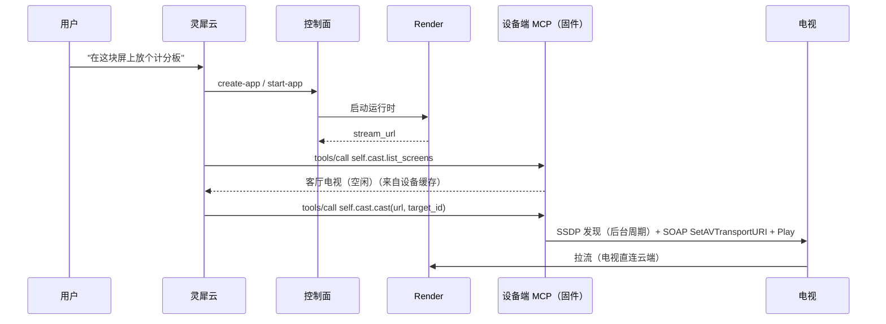

# 现场侧投屏：部署形态与控制链路

本文描述投屏的产品路径：**应用在云端构建与运行，画面由现场的语音设备投到现场局域网里的电视上**。发现与 DLNA 控制都在设备固件里完成，现场不需要再部署投屏服务；现场可以是家庭，也可以是公司的会议室或门店，两者架构相同，差异只在网络条件，见第 5 节。

## 1. 四步链路

```
1. 设备联网后自己 SSDP 搜索，缓存局域网里的 DLNA 电视
2. 灵犀调用控制面 MCP 创建并启动应用，Render 开始运行
3. 灵犀问设备端 MCP：现场有没有屏幕？
4. 灵犀从 start-app 结果里拿到 stream_url，设备用 SOAP 把它交给选中的电视
```



关键分工：

- **控制面只负责应用。** `start-app` 启动 Render 并返回 `stream_url`，它不接触任何投屏设备，也不接受 `screen_id`。
- **设备负责屏幕。** 固件注册 `self.cast.list_screens` / `self.cast.cast` / `self.cast.stop`，自己发现电视、自己发 SOAP。
- **没有中间服务。** 旧方案里的「现场 Casting 进程 + `CONFIG_CASTING_URL`」已从生产链路移除；仓库里的 Go Casting 只用于桌面调试和模拟硬件。

## 2. 触发：设备 MCP 随语音连接自带

设备连接灵犀时，hello 里声明了 `features: {"mcp": true}`（`main/protocols/websocket_protocol.cc:219`），设备端的 `McpServer` 把 `self.cast.*` 连同 `self.get_device_status` 等工具一起暴露给灵犀。灵犀作为 MCP 客户端，在**同一条语音连接**上发 `tools/list` 与 `tools/call`，工具在设备主任务上执行。

能力随硬件走：换一个智能体、或用户自己配的智能体，投屏工具仍在。控制面 MCP 不需要把投屏工具挂到智能体上。

## 3. 控制：设备直接与电视对话

SSDP 是链路本地组播，只有与电视同广播域的设备才看得见。所以发现和控制都由现场设备发起：

- 后台任务每 `CONFIG_CASTING_SCAN_INTERVAL_SEC`（默认 60 秒）发一次 M-SEARCH（`ST: urn:schemas-upnp-org:device:MediaRenderer:1`），解析应答里的 `description.xml`，缓存电视名、UDN 和 AVTransport 的 `controlURL`。
- `cast` 时直接向 `controlURL` 发 SOAP：`SetAVTransportURI`（带 DIDL-Lite 元数据）→ `Play`。`stop` 发 `Stop`。
- 设备**不监听任何端口**，也不接受来自电视的请求；链路是纯出站的。因此不存在"投屏 API 暴露公网"的问题，但设备与电视仍必须处在同一广播域。

`self.cast.*` 没有鉴权：调用它的是灵犀云，走已经建立的设备语音连接，不需要额外的身份头或 token。旧方案里的 `X-Linx-*` 三个头、`mcp_token` 与隧道都已移除。

设备端把 UPnP 错误码翻成能直接说出口的话：

| UPnP 错误 | 设备回给模型的话 |
| --- | --- |
| 714 | 这块电视不支持这种画面格式 |
| 715 | 这块电视正在播放别的内容，先停掉再投 |
| 716 | 电视找不到这个视频地址 |
| 718 | 电视拒绝了投屏请求 |
| 其他 / 传输层失败 | 电视没有响应投屏指令 |

## 4. 媒体：电视向云端拉流

**Render 固定在云端**，不迁到家里。`start-app` 返回的 `stream_url` 是 `PublicURL/streams/{id}/live.ts`（`internal/render/service.go:442`），设备把这条地址原样写进 `SetAVTransportURI`，电视自己向云端 `GET`，边下边播。

方向和投屏控制一致，都是出站：控制连接由设备发起，媒体连接由电视发起。因此不需要 NAT 穿透，也不需要给电视分配公网地址。

两条由此而来的硬约束：

- `PublicURL` 必须是电视能访问的公网地址。设备不做重写，写错了电视拿到的是一个解析不了的主机名。
- 每屏 2–8 Mbps 的带宽由电视侧承担。一个家庭同时投多块屏时，上限是家庭出口带宽，不是云端。

一个容易误判的地方：SOAP 返回 200 只代表电视接受了这个 URI，不代表它真的拉到了流。断网、DNS 失败、地址不可达时 SOAP 仍然成功，屏幕是黑的。

## 5. 三段链路的失败对照

| 链路 | 谁连谁 | 失败表现 | 排查点 |
| --- | --- | --- | --- |
| 触发 | 设备 → 灵犀云（同一条语音连接） | 模型说"我做不了" | `tools/list` 是否含 `self.cast.*`；固件日志是否有 `casting tools registered` |
| 控制 | 设备 → 电视（局域网 SSDP + SOAP） | "附近没有发现可投屏的电视" / "电视没有响应投屏指令" | 设备日志的扫描结果；设备与电视是否同广播域；电视是否实现 AVTransport |
| 媒体 | 电视 → 云端流地址 | SOAP 成功，屏幕黑或卡 | 电视出网、`PublicURL` 可达 |

三者互相独立，任何一段不通都表现为"电视不亮"，所以日志里必须能区分这三段。固件每轮扫描都会打印发现数量与 `heap=`，可以直接看出是"没发现屏"还是"发现后投不出去"。

## 6. 现场前提：公司与家庭

架构对两者是同一套：设备连灵犀、设备自己在局域网发现并控制电视、电视向云端拉流。不同的是部署条件，下面四条在进场前就要核对：

| 前提 | 家庭 | 公司 |
| --- | --- | --- |
| SSDP 广播域 | 通常同一网段 | 可能被 VLAN 或 AP 客户端隔离切断 |
| 出口放行 | 一般无限制 | 可能有代理、TLS 检查、域名白名单 |
| 网络粒度 | 一户一台设备、一块或几块屏 | 一间会议室或一个楼层一台设备，一台设备多屏 |
| 屏的 DLNA 能力 | 家用电视，兼容较好 | 商用标牌机差异大，部分只认 HLS 或不实现 AVTransport |

- **广播域**：设备必须与目标屏在同一广播域。跨网段就每层放一台设备，不要试图穿透 VLAN。
- **出口**：需要放行设备到灵犀的语音连接，以及屏向 `PublicURL` 的拉流。公司网络最常在这里失败，表现是"设备说话正常、电视不亮"。
- **联网方式**：目前投屏只在设备走 Wi-Fi 时工作；切到 4G 后 SSDP 没有可用的局域网，工具自动空转。
- **屏幕命名**：一块屏一个 `target_id`；一台设备服务多块屏时，名字要按房间或位置可区分，否则语音里说"投到书房"没有意义。
- **兼容矩阵**：固件按 DLNA MediaRenderer + AVTransport:1 预筛，但真实设备的覆盖率仍需要一份实测清单，商用屏优先。

## 7. 验收

1. 设备联网后，`tools/list` 里能看到 3 个 `self.cast.*`（灵犀侧工具有数量上限，超限静默丢弃，固件启动日志会打印工具总数）。
2. 说"现场有哪些屏幕"能列出电视名与状态，稳态下不带明显停顿（读缓存）。
3. 说"投到客厅电视"能完成：控制面产出 `stream_url` → 设备 SOAP → 电视出画面。
4. 电视正在播放其他内容时，投屏被拒绝，模型转述"电视拒绝了投屏请求"或"正在播放别的内容"。
5. 说"停止投屏"后，电视回到空闲；重复停止不会被当成错误。
6. 现场网络中断时，设备的投屏调用返回明确错误，不留下"以为投上了"的状态；恢复后一个扫描周期内重新发现。
7. 两个现场同时投屏互不串。
8. 至少一台商用屏完成 DLNA 抽测；不兼容时 `list_screens` 里根本看不到它，而不是等到 `cast` 才失败。

## 8. 待定

1. **多屏与多设备。** 现在一台设备驱动一块屏的会话；一台设备服务多块屏、多设备共用一块屏的占用协调都还没有定义。
2. **构建完成的时机。** 灵犀必须先拿到 `stream_url` 才能调用 `self.cast.cast`；构建是异步的，谁来等、怎么播报进度，取决于灵犀侧的工具编排。
3. **投屏会话内切换应用。** 当前换应用要重新 `cast`：同一块屏会直接覆盖 URI，电视短暂黑屏；换到另一块屏时，设备等新屏接受流之后再停止旧屏。
