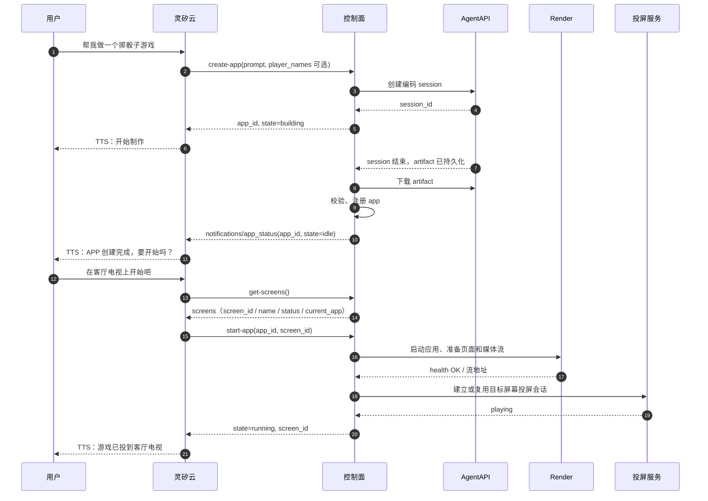

# 应用管理 MCP

> 多应用并发构建、`app_id`↔session 绑定与 `update-app` 见 [multi-app-sessions.md](multi-app-sessions.md)；多租户 Portal 的角色、注册与服务绑定见 [user-portal.md](portal.md)。

## 1. 范围

本文定义灵矽云（Linx）与控制面（gateway）之间的应用管理 MCP 契约：灵矽通过控制面发现屏幕，并管理应用从构建到运行的生命周期。

- 灵矽只看见 MCP Tool，不直接接触 AgentAPI、Render 或投屏服务。
- 应用运行后的能力调用仍走 OpenAPI / HTTP 契约，不在本文展开。
- 控制面与 Render 的接口见[控制面与 Render 接口设计](gateway-render.md)，应用产物见[应用包设计](app-artifact.md)，系统整体架构与投屏服务的 Target/Endpoint 见[architecture.md](../overview.md)。

### 1.1 角色与调用方向

| 组件 | 本文中的职责 | 调用方 |
| --- | --- | --- |
| 灵矽云（Linx） | 理解用户意图、选择并调用 MCP Tool、组织播报话术 | 用户 |
| 控制面（gateway） | MCP Server、工具路由、应用注册表、构建与启动编排、屏幕映射、按 owner 解析 Render/Casting | 灵矽 |
| AgentAPI | 异步构建应用 artifact | 控制面 |
| Render | 启动应用、提供应用 HTTP 与媒体流 | 控制面 |
| 投屏服务 | 把媒体流投放到物理屏幕 | 控制面 |
| Portal | 管理员引导账号、用户注册、为每个用户创建虚拟智能体并绑定服务 | 浏览器 |

灵矽是唯一的 MCP 调用方。`app_id` 在 `create-app` 时分配，`get-app-status`、`start-app` 和 `stop-app` 都用它定位应用。AgentAPI 的 session id、Render 的 `instance_id`、应用端口、Casting 的 `endpoint_id` 和投屏会话 id 只在控制面内部使用，不通过 MCP 返回。

### 1.2 契约原则

- 工具名按灵矽侧约定使用 kebab-case。
- 只暴露稳定、与运行时无关的业务标识（`app_id`、`screen_id`），不暴露端口、运行目录或 Render 标识。
- `app_id` 必须属于当前设备和智能体（device + agent）。Linx 会话重连不影响归属，控制面拒绝跨设备或跨智能体访问。
- 构建是长任务：`create-app` 立即返回，状态通过 `get-app-status` 查询，构建完成通过 MCP 通知告知。
- 写操作按业务键幂等：同一 `app_id` 不重复创建构建 session、应用进程或投屏会话。`create-app` 每次新建应用与 session；修订走 `update-app` 复用绑定 session。
- 屏幕与应用都按 owner 作用域：同一 `screen_id` 在两个用户的 Casting 上是两块互不相关的屏幕。

### 1.3 身份与租户隔离（Portal 模式）

Portal 启用时，MCP 连接必须携带三个头，且都必须与当前 SSE 会话一致：

| 头 | 含义 |
| --- | --- |
| `X-Linx-Device-Id` | 虚拟设备的 MAC，对应 `portal_devices.mac` |
| `X-Linx-Agent-Id` | Linx 智能体 ID，对应 `portal_devices.linx_agent_id` |
| `X-Linx-Session-Id` | 本次 MCP 会话 ID |

校验规则：

- `GET /sse`：缺少任一头返回 `400 MISSING_IDENTITY`；设备不存在、未完成开通或用户被停用返回 403（`OWNER_NOT_FOUND` / `IDENTITY_NOT_REGISTERED` / `USER_DISABLED`），不建立会话。
- `POST /mcp/message`：每次请求都要求三头齐全且与 SSE 会话精确一致；缺失或不一致返回 `403 IDENTITY_MISMATCH`。随后再次查库校验设备与用户状态，不只依赖建连时的检查。
- `mcp_token` 在 Portal 模式下必填；未配置时 Gateway 拒绝启动。MCP 端点仍由该 Bearer token 保护。
- 单租户部署（`portal.enabled=false`）不注入 owner 校验器，兼容旧的 `X-Linx-Device-Id` / `X-Linx-Session-Id` 行为。
- 设备必须在 `registered` 状态才能调用工具；一个用户最多一台虚拟设备，一个 `linx_agent_id` 只能属于一台设备。

## 2. 工具与状态

### 2.1 工具集

| Tool | 作用 | 输入 | 输出 |
| --- | --- | --- | --- |
| `get-screens` | 查询当前可用屏幕及占用情况 | 无 | `screens` 数组，见第 5 章 |
| `create-app` | 创建应用并启动 AgentAPI 构建 | `prompt`、可选 `player_names` | `app_id`, `state: building` |
| `update-app` | 在已有应用的绑定会话上提交修订并重建产物 | `app_id`, `prompt` | `app_id`, `state: building` |
| `list-apps` | 查询当前设备和智能体的历史应用 | 无 | `apps` 数组，见 3.1 |
| `get-app-status` | 查询应用状态 | `app_id` | 随状态变化，见第 4 章 |
| `get-app-operations` | 查询应用声明的 OpenAPI 业务操作 | `app_id` | `app_id`, `state`, `operations` |
| `start-app` | 在指定屏幕上启动已构建的应用 | `app_id`, `screen_id`, 可选 `force` | `app_id`, `screen_id`, `state: running`, 可选 `replaced_app_id` |
| `stop-app` | 停止运行中的应用 | `app_id` | `app_id`, `state: idle` |
| `send-request` | 调用应用的业务操作 | `app_id`, `operation_id`, `parameters`, `body` | `status`, `body` |

### 2.2 应用状态

应用状态表示应用在指定屏幕上的整体可用性。`running` 要求应用健康检查通过且投屏服务报告正在播放；只启动应用进程不算成功。不向灵矽暴露独立的 `display.state`。

| state | 含义 |
| --- | --- |
| `building` | AgentAPI 正在构建，应用还不可启动 |
| `idle` | 构建完成并注册，进程未启动 |
| `running` | 应用健康检查通过，指定屏幕的投屏会话处于播放状态 |
| `error` | 构建、启动或运行失败，包含投屏失败 |

`error.stage` 区分失败阶段，取 `building`、`starting` 或 `running`；构建失败不会产生可启动的 `idle` 应用。构建成功但启动失败的应用仍处于 `error`，保留失败原因；再次 `start-app` 或 `stop-app` 会先清理上次启动遗留的资源，成功后回到 `idle`，因此可以重试。清理尚未完成时工具返回 `CLEANUP_PENDING`。错误结构与错误码见第 9 章。

## 3. `create-app`

输入是灵矽整理后的用户诉求，不是原始 ASR 文本：

```json
{
  "prompt": "做一个掷骰子游戏，点击按钮掷出两个骰子，显示点数和最近几次结果"
}
```

多人游戏同时传入已确认的初始玩家名称。名单使用独立字段，不只写在自由文本里：

```json
{
  "prompt": "做一个三人五题知识竞赛，依次确认玩家准备后开始答题",
  "player_names": ["韩鲁鹏", "邓军辉", "张之阳"]
}
```

`create-app` 的输入 schema：

```json
{
  "type": "object",
  "properties": {
    "prompt": {"type": "string", "minLength": 1},
    "player_names": {
      "type": "array",
      "items": {"type": "string", "minLength": 1},
      "uniqueItems": true,
      "description": "用户已确认的初始玩家名称，按加入或点名顺序填写；未知时不要编造"
    }
  },
  "required": ["prompt"],
  "additionalProperties": false
}
```

控制面启动构建时还会注入固定渲染画布（1280×720，16:9）和页面不得溢出的约束。画布是部署级运行参数，不出现在 `create-app` 的 MCP 输入中，调用方不需要也无法指定尺寸。

名单规则：

* 非游戏应用或尚未确定名单时可省略 `player_names`；空数组与省略均表示没有提供初始名单，不代表零人游戏。可先构建支持后续加入的应用。
* 灵矽只传已确认的参与者名称。当前说话人的声纹名字不代表所有玩家，也不表示其他人已加入。用户只说人数时不得补造姓名；应用必须预置完整名单时先询问。
* 控制面去除名称首尾空白，拒绝空白名称、非字符串和规范化后的重复名称，返回 `INVALID_PLAYER_NAMES`。保持输入顺序，不做模糊匹配或同音替换。重名时先请用户选择可区分的称呼。
* `prompt` 中明确指定的人数或名单与非空 `player_names` 冲突时，灵矽在调用前向用户确认，不能静默增删玩家。控制面对自然语言不再做第二次语义推断。
* 控制面将规范化后的 `player_names` 与 `prompt` 一起保存为构建输入，并通过构建消息交给 AgentAPI。生成应用据此建立初始玩家，直接使用 `user_name` 作为本局唯一标识和展示名称，不另行生成用户 ID 或维护名字到 ID 的映射；见 [应用包约定](app-artifact.md#32-openapi-和业务响应)。
* 名单中的名字表示参与者，不表示已准备好；准备状态由运行时的加入/确认操作更新。后续增减玩家走应用 OpenAPI，不通过再次 `create-app` 修改构建输入。
* 一期直接以用户名标识玩家。运行时灵矽把声纹 `speaker_name` 作为业务接口的 `user_name` 传入，例如 `{"user_name":"韩鲁鹏"}`。应用去除首尾空白后与本局名单精确匹配，不生成额外 ID，不要求声纹 `speaker_id`。未知名字不能直接参与答题或计分，应先确认或通过应用加入操作登记。本局内名字保持不变，改名流程不在一期范围内。

建议工具 description 包含："创建应用。多人游戏请在 player_names 中传入用户已确认的初始玩家姓名，保留顺序。未知姓名不要猜测；名单不完整且需要预置全部玩家时先询问。名单只定义初始玩家，不代表已准备好。"

控制面创建 AgentAPI session 后立即返回，不等待构建完成：

```json
{
  "app_id": "app_01J...",
  "state": "building"
}
```

同一设备和智能体可以同时有多个 `building` 应用：每次 `create-app` 都分配新的 `app_id`，并创建独立的 AgentAPI 构建会话。控制面在内部把 `app_id` 与 `session_id` 一对一绑定；`session_id` 不通过 MCP 返回。已返回的 `app_id` 用 `get-app-status` 或通知跟踪；不要为同一用户意图盲目重试 `create-app`（会多出一个应用）。修改已有应用走 `update-app`，见第 3.2 节与 [multi-app-sessions.md](multi-app-sessions.md)。

### 3.1 `list-apps`

输入为空对象。返回当前设备和智能体构建过的应用，最新的在前，不受 Linx 会话重连影响。历史是全局上限：所有设备和智能体共享最近 10 个应用；超出时淘汰最旧且不在 `building` / `running`、也不持有下游资源的应用及其产物。`list-apps` 只返回当前设备和智能体的应用。

```json
{
  "apps": [
    {
      "app_id": "app_01J...",
      "name": "掷骰子游戏",
      "title": "掷骰子",
      "summary": "做一个掷骰子游戏…",
      "state": "idle",
      "startable": true,
      "built_at": "2026-10-24T08:20:00Z",
      "build_duration_seconds": 95,
      "operation_count": 1,
      "operations": ["rollDice"],
      "screen_id": ""
    }
  ]
}
```

- `startable` 表示现在能否直接 `start-app`；false 时 `not_startable_reason` 说明原因（构建中、运行中、构建失败、产物丢失，或上次启动还在核对/清理）。
- 用户说“玩上次那个/之前那个”时，先 `list-apps` 让用户确认，再用 `start-app` 启动；不要重新 `create-app`。
- `list-apps` 是历史快照，启动时仍以 `get-app-status` / `start-app` 的结果为准。

### 3.2 `update-app`

向已有应用绑定的 AgentAPI 会话提交补充需求，异步重建产物。新应用用 `create-app`；运行中的业务操作仍用 `send-request`。

```json
{
  "app_id": "app_01J...",
  "prompt": "题目改成动物主题，仍保持五题、三人依次作答"
}
```

输入 schema：

```json
{
  "type": "object",
  "properties": {
    "app_id": {"type": "string", "minLength": 1},
    "prompt": {"type": "string", "minLength": 1}
  },
  "required": ["app_id", "prompt"],
  "additionalProperties": false
}
```

`prompt` 是整理后的修改说明，不是原始 ASR。本期不传 `player_names`。

立即返回：

```json
{
  "app_id": "app_01J...",
  "state": "building"
}
```

状态与错误：

| 当前状态 | 行为 |
| --- | --- |
| `idle` | 进入 `building`，复用绑定 session 提交 `user.message`；保留上一版产物直到新产物校验成功 |
| `running` | 返回 `APP_RUNNING`，不改状态；先 `stop-app` 再更新 |
| `building` | 返回 `APP_BUILDING`，不插队 |
| `error` 且会话仍可用、或仍有可启动产物 | 允许更新；成功后 `idle` |
| 会话缺失、已终止或已归档 | 返回 `SESSION_UNAVAILABLE`；有旧产物时仍可 `start-app`，修订需重新 `create-app` |

更新失败且此前已有可启动产物时，恢复 `idle` 并保留旧产物，通过通知说明更新失败。无产物时进入 `error(stage=building)`。完成通知与 `get-app-status` 的字段约定与初次构建相同；通知文案可区分「创建完成」与「更新完成」。完整绑定与恢复规则见 [multi-app-sessions.md](multi-app-sessions.md)。

建议工具 description 包含："修订已有应用。app_id 必填。prompt 为整理后的修改说明。应用 building 时不要调用；running 时先 stop-app。新应用用 create-app；答题计分等用 send-request。"

## 4. `get-app-status`

输入：

```json
{
  "app_id": "app_01J..."
}
```

不同状态返回不同字段：

| state | 含义 | 字段 |
| --- | --- | --- |
| `building` | AgentAPI 正在构建，应用还不可启动 | `app_id`, `state`, `elapsed_seconds`, `message` |
| `idle` | 构建完成并注册，进程未启动 | `app_id`, `state`, `name`, `build_duration_seconds` |
| `running` | 应用健康检查通过，指定屏幕的投屏会话处于播放状态 | `app_id`, `state`, `screen_id`, `name`, `started_at`, `uptime_seconds` |
| `error` | 构建、启动或运行失败，包含投屏失败 | `app_id`, `state`, `error`；已指定屏幕时带 `screen_id` |

`building`：

```json
{
  "app_id": "app_01J...",
  "state": "building",
  "elapsed_seconds": 42,
  "message": "正在写页面"
}
```

`idle`：

```json
{
  "app_id": "app_01J...",
  "state": "idle",
  "name": "掷骰子游戏",
  "build_duration_seconds": 95
}
```

`running`：

```json
{
  "app_id": "app_01J...",
  "state": "running",
  "screen_id": "tv-living-room",
  "name": "掷骰子游戏",
  "started_at": "2026-10-24T08:30:00Z",
  "uptime_seconds": 12
}
```

`error`：

```json
{
  "app_id": "app_01J...",
  "state": "error",
  "error": {
    "stage": "building",
    "code": "BUILD_FAILED",
    "message": "构建完成，但产物校验失败",
    "last_agent_message": "代码已经写完，但启动检查报错"
  }
}
```

`building` 的 `message` 取 AgentAPI Session Event 中最近的进度事件，按到达顺序取最后一条：`agent.message`、`agent.thinking` 或 `session.error`。agent 长时间调用工具、没有正式消息输出时，thinking 也会更新进度，`message` 因此不会长时间停留在旧文案；thinking 内容不保证存在（可能为空或被脱敏），此时沿用上一条进度。`idle` 完成后由控制面发送“APP 创建完成”通知，通知里的 `message` 才是给灵矽播报的文案。`name` 是应用的展示名称，由控制面在注册应用时确定。

`error.stage` 取 `building`、`starting` 或 `running`；`error.last_agent_message` 保留最近一次 agent 消息。构建失败时进入 `error`，不会进入 `idle`。

## 5. `get-screens`

输入为空对象：

```json
{}
```

控制面返回调用者自己的服务绑定范围内的屏幕。屏幕按 owner 作用域：`managed` 用户使用平台默认 Casting（部署配置的 `screens` catalog 可作为别名），`custom` 用户使用自己的 Casting；另一个用户即使使用相同的 `screen_id`，也是另一块屏幕。`screen_id` 是灵矽侧使用的屏幕标识，而非 Endpoint 或 Render 标识。控制面将 `screen_id` 映射到该用户投屏服务的 `target_id`，再选择该目标支持的 Endpoint；灵矽通过 `screen_id` 指定启动屏幕，`get-app-status(app_id)` 在结果中返回该标识。控制面把当前 owner 的 Casting 发现结果、可用的屏幕别名与当前应用占用情况汇总为屏幕列表。

```json
{
  "screens": [
    {
      "screen_id": "tv-living-room",
      "name": "客厅电视",
      "status": "free",
      "current_app": null
    },
    {
      "screen_id": "tv-study",
      "name": "书房电视",
      "status": "showing_app",
      "current_app": {
        "app_id": "app-dice",
        "name": "掷骰子"
      }
    },
    {
      "screen_id": "tv-bedroom",
      "name": "卧室电视",
      "status": "external",
      "current_app": null
    },
    {
      "screen_id": "tv-kitchen",
      "name": "厨房电视",
      "status": "unavailable",
      "current_app": null
    }
  ]
}
```

- `status` 是这块屏幕现在能做什么，取值：
  - `free`：可以直接 `start-app`。
  - `showing_app`：调用者自己的应用正在展示，`current_app` 给出是哪一个；换应用要先征得用户同意，再用 `force=true` 替换。
  - `external`：屏幕被无法归属的投屏会话占用（含共享 Casting 上其他租户的会话）；不要选择，`force=true` 也不能接管。Casting 只知道自己管理的会话，电视被其他来源直接投屏时可能无法检测。
  - `unavailable`：当前不能接收画面（离线、不可达或没有支持的协议）；不要选择。
- `current_app` 只在 `showing_app` 时非 `null`，且只可能是当前 owner 自己的应用。
- `get-screens` 不返回其他用户的屏幕或应用；跨用户的应用在 `get-app-status` / `start-app` 中统一表现为 `APP_NOT_FOUND`。
- 没有发现任何可用目标时允许返回空数组；用户没有可用智能体或未绑定服务时返回 `SERVICE_NOT_CONFIGURED`。
- 返回结构化字段，不生成描述屏幕列表的顶层 `message`；由灵矽组织话术。`start-app` 的成功响应也不额外生成顶层 `message`，既有构建进度、通知和错误的消息字段保留原约定。
- 用户明确指定屏幕时，灵矽匹配其 `screen_id`；未指定时可沿用当前会话的选择，或在只有一块 `free` 屏幕时直接选择；无法唯一确定时询问用户。调用 `start-app` 时始终传入明确的 `screen_id`。
- MVP 中一个应用同时绑定一个屏幕，一个屏幕同时展示一个应用。列表是查询时快照，启动时控制面仍需重新校验可达性与占用，避免并发冲突。

## 6. `start-app`

输入：

```json
{
  "app_id": "app_01J...",
  "screen_id": "tv-living-room",
  "force": false
}
```

`screen_id` 必填，来自 `get-screens` 返回的屏幕列表。控制面使用当前 owner 绑定的 Render/Casting（平台默认或用户自有服务），启动应用、准备页面和媒体流，再选择目标屏幕兼容的 Endpoint 建立或复用投屏会话。只有应用健康检查通过且投屏服务报告 `playing` 后，才返回 `running`：

```json
{
  "app_id": "app_01J...",
  "state": "running",
  "screen_id": "tv-living-room",
  "name": "掷骰子游戏",
  "started_at": "2026-10-24T08:30:00Z",
  "uptime_seconds": 0
}
```

`force=true` 且替换了屏幕上的应用时，响应额外带 `replaced_app_id`，表示被停止的应用。这个字段只在内部使用，不需要对用户念出。

应用端口、Render 的 `instance_id`、Casting 的 `endpoint_id` 和投屏会话 id 只在控制面内部使用，不通过 MCP 返回给灵矽；应用访问由控制面按 `app_id` 路由，灵矽不需要知道端口。

可以从 `idle` 启动，也可以从“构建成功但启动失败”的 `error` 重试；`start-app` 会先清理上次失败遗留的资源，成功后回到 `running`。已经在同一屏幕上 `running` 时幂等返回当前状态；若指定不同屏幕，返回 `APP_ALREADY_RUNNING`，由调用方先停止再启动。`building` 时返回 `APP_BUILDING`；构建失败、没有可启动产物的 `error` 返回 `APP_IN_ERROR`。

屏幕占用按 owner 判定：

- 目标屏幕被**调用者自己的**另一个应用占用时，默认返回 `TARGET_BUSY`，不自动替换；只有用户明确要求替换时才传 `force=true`，控制面先停止自己的那个应用并返回 `replaced_app_id`。
- 目标屏幕被**其他 owner** 的应用占用时，即使 `force=true` 也返回 `TARGET_BUSY`。`force` 不能跨租户停止应用；`screen_id` 只在当前 owner 的 Casting 内有意义。
- 共享 Casting 上存在无法归属的活动投屏会话（`target.ActiveSessionID` 非空且无法对上当前 owner 的应用）时返回 `TARGET_BUSY`，`force` 同样不能接管。
- 目标屏幕不存在、离线或无法访问时返回 `TARGET_UNREACHABLE`；应用不属于当前 owner 时返回 `APP_NOT_FOUND`。

启动流程有时限，由控制面配置超时。连接过程中请求等待最终结果，不返回 `running + connecting`；超时或失败时进入 `error`，工具返回 `isError: true`。同一应用的并发启动请求不得重复创建进程或投屏会话。输入或占用校验不通过时拒绝操作，不改变已有应用状态。

失败时进入 `error`，`error.stage` 不新增 `projection` 阶段；具体错误码见第 9 章。控制面内部维护应用进程和投屏会话的对应关系，跟踪投屏状态；运行中一旦确认投屏断开，整体状态进入 `error`，即使应用进程仍在运行。`screen_id` 保留用于定位失败目标。失败后的资源清理由控制面负责；只有确认进程和投屏资源已释放后才能释放屏幕占用。

启动请求超时或响应丢失时，结果未知。控制面会在本次工具调用内连续核对最多三次：查到本应用资源就清理，确认没有资源就释放屏幕；三次都无法完成核对时返回 `CLEANUP_PENDING`，稍后重试即可，不要重新 `create-app`。控制面仍会在后台继续核对，恢复可达且确认没有资源后立即释放，不再按固定时间等待；应用保持在可重试的 `error`。如果电视上存在无法证明归属的投屏会话，控制面不会停止它，只放弃本应用的占用；这时屏幕在 `get-screens` 中显示为 `external`。Render/Casting 不可达时保留占用，直到能完成核对。

启动成功后，后续应用操作仍通过既有的 OpenAPI / HTTP 契约完成。

### 6.1 调用应用能力

应用构建完成后，灵矽先调用 `get-app-operations(app_id)` 获取 `operation_id`、说明、路径/查询参数和 JSON 请求体 schema。该工具从应用的 `openapi.yaml` 读取信息，`building` 时返回 `APP_BUILDING`，`error` 时返回 `APP_IN_ERROR`。

```json
{
  "app_id": "app_01J...",
  "state": "idle",
  "operations": [
    {
      "operation_id": "rollDice",
      "method": "POST",
      "path": "/api/roll",
      "description": "掷两个骰子并记录结果",
      "request_body": {
        "required": false,
        "schema": {"type": "object", "properties": {"count": {"type": "integer"}}}
      }
    }
  ]
}
```

随后用 `send-request` 调用。路径参数放在 `parameters` 中，名称与路径模板一致；其余标量参数作为查询参数；JSON 请求体放在 `body`。返回应用原始 HTTP `status` 和解析后的 `body`。只有 `running` 状态可调用，否则返回 `APP_NOT_RUNNING`；`operation_id` 不在应用 OpenAPI 中时返回 `OPERATION_NOT_FOUND`。

工具列表保持稳定，不随应用动态注册；`get-app-operations` 只返回当前应用的操作，避免灵矽侧工具列表热更新问题。

## 7. `stop-app`

输入：

```json
{
  "app_id": "app_01J..."
}
```

停止应用进程，解除它与屏幕的展示绑定并释放占用后回到 `idle`。控制面先停止该屏幕的投屏会话，再停止 Render 实例，避免电视继续拉取已关闭的流。`idle` 响应不再携带 `screen_id`：

```json
{
  "app_id": "app_01J...",
  "state": "idle",
  "stopped_at": "2026-10-24T08:45:00Z"
}
```

已经在 `idle` 时幂等返回；`building` 时返回 `APP_BUILDING`；应用处于构建成功但启动失败的 `error` 时，会先清理上次启动遗留的资源并回到 `idle`；其他 `error` 幂等返回当前错误。清理未完成返回 `CLEANUP_PENDING`。停止失败返回 `STOP_FAILED`。用户主动停止后回到 `idle`；应用进程异常退出则进入 `error`（`stage=running`，`code=APP_EXITED`），由后续 `get-app-status` 反映。

## 8. 创建到启动



构建完成后，控制面通过已有的 MCP SSE 连接发送通知：

```json
{
  "jsonrpc": "2.0",
  "method": "notifications/app_status",
  "params": {
    "app_id": "app_01J...",
    "state": "idle",
    "message": "APP 创建完成"
  }
}
```

构建失败时发送同一方法，`state` 为 `error`，`error` 结构与 `get-app-status` 一致。

灵矽收到通知后决定是否播报并等待用户指令；控制面不直接推 TTS。通知是 best-effort，断线或丢失时以 `get-app-status` 为准。

## 9. 错误模型

应用进入 `error` 时，`get-app-status` 返回的错误结构与 `notifications/app_status` 的 `params` 一致：

```json
{
  "app_id": "app_01J...",
  "state": "error",
  "screen_id": "tv-living-room",
  "error": {
    "stage": "starting",
    "code": "TARGET_UNREACHABLE"
  }
}
```

`error.stage` 与 `error.code`：

| 场景 | `error.stage` | `error.code` 示例 |
| --- | --- | --- |
| 构建或产物校验失败 | `building` | `BUILD_FAILED` |
| 应用启动或健康检查失败 | `starting` | `START_FAILED` |
| 启动过程中屏幕不可达 | `starting` | `TARGET_UNREACHABLE` |
| 启动过程中投屏超时 | `starting` | `PROJECTION_TIMEOUT` |
| 应用运行后进程异常退出 | `running` | `APP_EXITED` |
| 应用运行后投屏断开 | `running` | `PROJECTION_DISCONNECTED` |

`error.message` 可选，用于补充失败原因；`error.last_agent_message` 保留最近一次 agent 消息。

以下错误由工具直接返回，不改变应用状态：

| `code` | 工具 | 场景 |
| --- | --- | --- |
| `INVALID_PLAYER_NAMES` | `create-app` | 名称为空白、类型错误或去除首尾空白后重名 |
| `BUILD_START_FAILED` | `create-app` | 无法启动 AgentAPI 构建 |
| `UPDATE_START_FAILED` | `update-app` | 绑定会话存在但提交修订消息失败 |
| `SESSION_UNAVAILABLE` | `update-app` | 绑定会话缺失、已终止、已归档或无法接收消息 |
| `APP_RUNNING` | `update-app` | 应用仍在运行，需先 `stop-app` |
| `MISSING_CONTEXT` | `list-apps` 等 | 缺少设备标识 |
| `APP_BUILDING` | `start-app`, `stop-app`, `get-app-operations`, `update-app` | 应用仍在构建或修订中 |
| `APP_IN_ERROR` | `start-app`, `get-app-operations`, `update-app` | 应用处于不可启动或不可修订的 `error` |
| `APP_ALREADY_RUNNING` | `start-app` | 应用已在其他屏幕运行 |
| `TARGET_BUSY` | `start-app` | 目标屏幕被其他应用或无法归属的投屏会话占用 |
| `TARGET_UNREACHABLE` | `start-app` | 屏幕不存在、离线或无法访问 |
| `ARTIFACT_MISSING` | `start-app` | 应用包已丢失，需要重新创建 |
| `START_FAILED` | `start-app` | 应用进程启动失败 |
| `STREAM_START_FAILED` | `start-app` | 应用媒体流未就绪 |
| `CLEANUP_PENDING` | `start-app`, `stop-app` | 上次启动结果还在核对或资源正在清理，稍后重试 |
| `STOP_FAILED` | `stop-app` | 停止进程或释放屏幕占用失败 |
| `APP_NOT_RUNNING` | `send-request` | 应用未在运行 |
| `RUNTIME_UNAVAILABLE` | `start-app`, `send-request` | 无法确认应用进程状态 |
| `PROJECTION_UNAVAILABLE` | `start-app`, `send-request` | 无法确认投屏状态 |
| `OPERATION_NOT_FOUND` | `send-request` | 应用 OpenAPI 中没有该 operationId |
| `APP_NOT_FOUND` | 所有接收 `app_id` 的工具 | 应用不存在，或不属于当前设备和智能体 |
| `PERSISTENCE_FAILED` | 写操作 | 无法保存控制面状态，后续操作已停止 |
| `INVALID_ARGUMENT` | 所有工具 | 参数为空、类型错误或无法序列化 |

`CLEANUP_PENDING` 是临时状态：屏幕和资源还在核对或清理，稍后用同一 `app_id` 重试即可，不要重新 `create-app`。`APP_NOT_FOUND` 同时覆盖“不存在”和“不属于当前设备和智能体”，控制面不区分两者，避免泄露其他设备的应用是否存在。

Portal 模式下，身份校验失败发生在建立 SSE 或 POST 消息之前，不属于工具错误：

| HTTP | `code` | 场景 |
| --- | --- | --- |
| `400` | `MISSING_IDENTITY` | `/sse` 缺少任一 `X-Linx-*` 头 |
| `401` | — | 配置了 `mcp_token` 但 Bearer token 缺失或错误 |
| `403` | `IDENTITY_MISMATCH` | `/mcp/message` 的头缺失或与 SSE 会话不一致 |
| `403` | `OWNER_NOT_FOUND` | 设备不存在，或 `(MAC, AgentID)` 无法匹配 |
| `403` | `IDENTITY_NOT_REGISTERED` | 设备存在但尚未完成开通（`state != registered`） |
| `403` | `USER_DISABLED` | 设备所属账号已被停用 |

身份通过后，工具层仍按 owner 校验应用与屏幕；跨 owner 的应用返回 `APP_NOT_FOUND`，跨 owner 的 `force` 返回 `TARGET_BUSY`。
