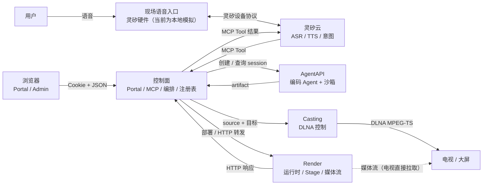

# Open Anywhere 架构设计

## 1. 摘要

Open Anywhere 让用户通过语音描述需求，由云端编码 Agent 生成一个可运行的 Web 应用，并在身边的屏幕上通过 DLNA 呈现和控制（AirPlay 是后续扩展）。

系统由四个组件、一个现场语音入口和一个多租户 Portal 构成：

| 组件 | 角色 |
| --- | --- |
| 灵矽云（Linx） | 语音入口：ASR、TTS、意图识别、MCP Client |
| 控制面（Control Plane） | MCP Server、任务编排、应用注册表、OpenAPI 到 HTTP 的适配、多租户 Portal 与管理后台 |
| AgentAPI | 异步应用工厂：编码 Agent + 沙箱，产出应用 artifact |
| Render | 应用运行时与舞台：启动应用、转发 HTTP、输出 DLNA 可播放的媒体流 |
| 现场语音入口 | 用户面前的语音设备。真实形态是灵矽硬件，目前由本地程序模拟；以设备身份接入灵矽云，收发语音、回应设备端 MCP（详见 [现场语音入口](voice-entry.md)） |
| Portal | 与 Gateway 同进程的浏览器控制台：管理员配置平台、管理用户；用户注册、查看智能体与应用、绑定服务并语音对话 |

系统有三条契约：

1. **MCP**：灵矽云与控制面之间。灵矽只看见 MCP Tool，不直接接触 AgentAPI 或 Render。应用管理 Tool 见[应用管理 MCP](interfaces/app-management-mcp.md)。
2. **OpenAPI + launch.json + HTTP**：控制面、Render 与应用之间。应用只暴露 HTTP，不感知 MCP。产物结构、启动约定和构建提示见[应用包设计](interfaces/app-artifact.md)。
3. **Casting HTTP API**：控制面与投屏服务之间。Render 提供媒体流地址，控制面调用 Casting 完成协议控制与播放，见 [Casting 服务](../operations/casting.md)。

Portal 的浏览器接口（`/api/portal/*`、`/api/admin/*`）是控制面之上的独立 HTTP 面，不属于上述三条平面契约，见[多租户用户 Portal 设计](interfaces/portal.md)。

应用包下载、进程运行、Chromium 渲染与媒体流输出的接口约定见 [控制面与 Render 接口设计](interfaces/gateway-render.md)。

现场语音入口与灵矽云之间使用灵矽自己的设备协议（WebSocket），不是 Open Anywhere 定义的契约，见 [现场语音入口](voice-entry.md)。

核心原则：**MCP 面稳定，应用能力动态；构建慢而异步，控制快而同步；投屏是会话级通道，应用是通道里的内容；租户按 owner 隔离。** 当前切换应用会重建投屏会话，复用会话是后续目标。

## 2. 目标与非目标

### 2.1 目标

- 用户用自然语言创建应用，不需要知道代码、构建或部署。
- 灵矽只依赖一组稳定的 MCP Tool；新应用不需要在灵矽侧重新注册工具。
- 构建是长任务，可以异步执行、按需查询状态和已用时间，不阻塞语音对话。
- 同一设备与智能体可并行创建多个应用；每个应用在控制面绑定独立的 AgentAPI 构建会话，并可通过 `update-app` 在同一会话上修订产物（见 [multi-app-sessions.md](interfaces/multi-app-sessions.md)）。
- 应用生成后可以在 Render 上稳定启动，并通过 OpenAPI 被控制面调用。
- 应用画面通过 DLNA（MPEG-TS）投到屏幕上；当前切换应用会先停旧会话再建新会话，在会话内换源是后续目标。
- Agent 产出的应用必须经过模板和检查脚本的硬约束，保证“Render 能跑、控制面能调”。
- 控制面重启后从本地 SQLite 恢复应用和构建状态，未完成的构建继续监听，产物下载地址保持有效。持久化模型、恢复顺序与表结构见[控制面数据库设计](database.md)。
- **多租户**：管理员引导账号配置平台；普通用户自助注册后自动获得一台虚拟 Linx 智能体；用户之间在应用、屏幕、语音与下游服务上完全隔离。
- **服务绑定**：每个用户可以选择平台托管的 Render/Casting，或绑定自己的两个公网地址；控制面按 owner 解析端点，不在租户之间复用下游服务。

### 2.2 非目标

- 计费、配额、套餐、应用市场、任意第三方应用托管。
- 用户自行部署 Render/Casting 的安装流程、局域网发现、穿透或连接器。
- 文字输入式对话（灵矽没有发送文字的开放接口；本期只做语音 + 实时字幕）。
- 管理员查看或操作屏幕内容；管理员单独停止/接管用户应用（仅在停用用户时 best-effort 停止）。
- 邮箱验证、找回密码、修改密码、删除账号；多管理员邀请、审计表、细粒度权限。
- 为每个 OpenAPI 操作动态注册一个 MCP Tool；MVP 使用稳定的 `get-app-operations` + `send-request`。
- 服务端主动 TTS 推送；MVP 由灵矽在用户询问时轮询任务状态。
- 在 macOS 上程序化发起 AirPlay 系统镜像（AirPlay 是后续扩展）；MVP 使用 DLNA，必要时浏览器或 HDMI 兜底。
- 把 AgentAPI 的沙箱当作应用运行时；AgentAPI 只负责构建。
- 多副本 Gateway；一个 SQLite 只对应一个进程。

## 3. 术语

| 术语 | 含义 |
| --- | --- |
| 灵矽（Linx） | 七牛云的 AI 智能硬件平台，负责语音入口、ASR、TTS 和意图识别 |
| 控制面（Control Plane） | 对灵矽暴露 MCP、对 AgentAPI 编排构建、对 Render 转发请求的服务 |
| AgentAPI | 托管智能体框架，运行编码 Agent 和沙箱，产出持久化文件 |
| Render | 现场的应用运行时，负责启动应用、提供 HTTP、输出 MPEG-TS 媒体流 |
| Task | 一次 `create-app` 构建任务；构建结果注册为应用并使用 `app_id` 标识 |
| App | AgentAPI 产出的、已经在 Render 上运行的应用 |
| Artifact | 应用产物目录，包含 `app/`、OpenAPI 文档和 `launch.json` |
| Stage | Render 上常驻的展示页面；投屏播放的就是它 |
| 现场语音入口 | 用户面前、接入灵矽云的语音设备的统称。真实形态是灵矽硬件，目前用本地程序模拟 |
| 灵矽硬件 | 真实的语音设备，由固件通过 OTA 和 WebSocket 接入灵矽云 |
| 模拟硬件 | 本地程序，按同一套设备协议扮演灵矽硬件，并用 Web 控制台代替麦克风、扬声器和控制入口 |
| 设备身份 | 设备在灵矽平台上的标识，由 MAC、Client-Id 和 token 组成；真实硬件由固件持有，模拟硬件由程序生成 |
| 激活码 | 设备在 OTA 上报后获得的 6 位码，用来把设备绑定到智能体 |
| Portal | 与 Gateway 同进程的浏览器控制台，分用户端 `/portal` 与管理端 `/admin` |
| 虚拟智能体 | 注册时为每个用户自动创建的 Linx 智能体，对应一台 `kind=virtual` 的虚拟设备 |
| 服务绑定 | 用户选择的 Render/Casting 来源：`managed` 使用平台默认服务，`custom` 使用自己的公网地址与可选 token |
| 平台设置 | 管理员维护的 AgentAPI、Linx、默认 Render/Casting 与注册开关，保存在 `platform_settings` |
| OpenAPI | 应用能力的 HTTP 契约，控制面据此校验和转发请求 |
| launch.json | 应用启动契约，描述可执行文件和参数；端口由部署环境通过 `PORT` 注入 |

## 4. 系统上下文



### 4.1 组件职责

| 组件 | 负责 | 不负责 |
| --- | --- | --- |
| 现场语音入口 | 保持与灵矽云的设备会话、收发语音与文字、回应设备端 MCP、设备注册与重连；真实形态是灵矽硬件，当前由模拟硬件代替（另提供本地 Web 控制台） | 声纹、ASR、TTS，构建与运行应用，投屏 |
| 灵矽云 | ASR、TTS、意图识别、选择并调用 MCP Tool | 构建应用、运行应用、投屏 |
| 控制面 | MCP Server、工具路由、任务编排、应用注册表、OpenAPI 校验与 HTTP 转发、artifact 下载与二次校验；Portal 注册/登录、管理 API、平台设置、按 owner 解析 Render/Casting | 写代码、运行应用、理解应用的业务语义、查看用户屏幕内容 |
| AgentAPI | 运行编码 Agent、在沙箱中写代码和自测、持久化 artifact | 承载应用运行时、直接面对灵矽 |
| Render | 解压 artifact、按 `launch.json` 启动、健康检查、进程保活、接收控制面 HTTP 转发、Stage 与媒体流 | 理解应用业务、决定应用能力 |
| 应用 | 提供 UI 和 `/api/*` HTTP 接口、维护自己的状态 | 感知 MCP、直接面对灵矽 |
| Portal | 注册、登录、角色与归属；用户查看智能体/应用/屏幕/服务/活动；管理员管理用户、智能体、全局应用与平台设置 | 代替灵矽做语音意图、直接操作屏幕内容 |

## 5. 投屏服务

投屏服务是一个独立的局域网投屏端：探测设备、维护 Target 与 Endpoint、按协议建立和结束会话。它不生成、代理或转码媒体，只负责协议控制与会话生命周期；媒体流由 Render 提供，地址必须对电视可达。

当前只支持 DLNA 的 MPEG-TS 实时流，AirPlay 是后续扩展。会话是通道，应用是内容；但**当前切换应用会先停止旧会话再创建新会话**，电视会短暂黑屏，在会话内更换 source 是后续目标。目标状态、错误码、占用释放与边界见 [Casting 服务](../operations/casting.md)。

## 6. 应用管理 MCP

灵矽通过控制面发现屏幕，并创建、修订、查询、启动和停止应用。工具与错误码的权威清单见[应用管理 MCP](interfaces/app-management-mcp.md#21-工具集)，本文不重复列举；多应用并行与会话绑定见[多应用并发与同会话更新](interfaces/multi-app-sessions.md)。

Portal 模式下，MCP 会话必须携带 `X-Linx-Device-Id`、`X-Linx-Agent-Id`、`X-Linx-Session-Id`，屏幕与应用均按 owner 作用域；跨 owner 的 `force` 不会接管屏幕。

## 7. 技术特色：应用的表现形式是接口

在 Open Anywhere 里，一个应用的实体不是页面，而是它通过 `openapi.yaml` 暴露的操作集合。页面只是这组操作的一个客户端：同一个「提交答案」，可以由语音调用、由电视前的按钮触发，也可以由 curl 发出。应用不区分调用者，也不需要知道调用者是谁。

这个选择由生成方式决定。应用是构建时当场写出来的，控制面不可能为每个应用预先编写适配代码。如果应用只交付页面，语音侧就只能靠截图、坐标或猜测来操作它；如果应用交付一份机器可读的接口，控制面用同一组 `get-app-operations` + `send-request` 就能理解并驱动所有应用。

因此构建契约把「页面上的每个可执行动作都必须对应一个 OpenAPI 操作」写成硬约束。生成出来的应用有两个面：给人看的页面，和给系统调的接口。两者共享同一份业务状态，不能各说各话。**接口是应用的定义，页面是接口的投影。**

### 7.1 应用是接口，不是页面

| 维度 | 页面驱动 | 接口驱动（本项目） |
| --- | --- | --- |
| 能力存在哪里 | 散落在 UI 事件处理里 | 收敛在 `openapi.yaml` 的 `operationId` |
| 语音如何理解应用 | 看屏幕、猜坐标 | 读操作表、参数与响应 schema |
| 新增入口 | 每个入口单独适配 | 复用同一组操作 |
| 验收依据 | 页面是否好看 | 操作能否解析、调用并返回合法响应 |
| 呈现方式 | 与应用绑定 | 只是接口的一个客户端 |

页面仍然必需，而且要做好——它是给人看的。但架构上，页面不拥有能力，只呈现能力。

### 7.2 规范

- `openapi.yaml` 是应用包的必填文件，也是应用对外的唯一能力声明。每个业务操作声明 `operationId`、方法、路径、说明、参数和 JSON 请求体 schema。
- 操作覆盖页面上所有可执行动作：开始、提交、计分、重置、查询。
- 操作是原子的、参数可校验的。纯视觉变化（例如动画）不构成可被语音调用的能力。
- 说明字段面向语义理解，写清楚“做什么”，不写实现细节。
- 页面与 API 共享同一份业务状态；通过 API 改变状态后，已打开的页面同步反映结果。

### 7.3 调用链

```text
用户说话
  → 灵矽 ASR 与意图识别
  → get-app-operations(app_id)        读取当前应用的操作表
  → 选择 operation_id 与参数
  → send-request(app_id, operation_id, parameters, body)
  → 控制面校验并转发 HTTP
  → 应用状态变化，页面同步刷新
  → Chromium 重新截图并编码
  → 屏幕更新
```

### 7.4 为什么这样设计

- **应用不需要理解语音。** 它只暴露标准 HTTP，语音、意图和编排全部留在灵矽与控制面。
- **工具面稳定。** 应用能力只通过 `get-app-operations` 与 `send-request` 两个通用工具暴露，不为每个应用注册新工具；`get-app-operations` 只返回当前应用的操作。
- **能力随应用动态变化。** 新应用构建完成时，它的全部操作通过 `openapi.yaml` 出现在操作表里，不需要在灵矽侧重新接入。
- **生成即可用。** “所有操作必须 API 化”写在构建契约里，由模板、自检脚本和产物准入校验共同保证，编码 Agent 产出的应用天然具备被语音操作的能力。
- **结果一致。** 语音调用与页面点击走同一条路径，画面、状态和语音反馈不会出现两套事实。
- **呈现与能力解耦。** 屏幕是显示器，不是运行时。Render 只截页面，不理解业务；控制面只读接口，不读页面。页面和接口通过同一份状态对齐，任一侧演进都不会绑死另一侧。
- **验收可以机械化。** 产物准入校验的不是页面好不好看，而是 OpenAPI 能否解析、操作能否调用、响应是否符合 schema。「生成的应用一定能被语音驱动」因此是一条可验证的约束，而不是事后期望。
- **入口可以继续增加。** 今天的调用者是灵矽；未来任何愿意按 OpenAPI 发 HTTP 请求的客户端都能获得同一组能力，应用不需要为多端改造。

应用包格式与操作声明见[应用包设计](interfaces/app-artifact.md)，操作发现与转发规则见[应用管理 MCP](interfaces/app-management-mcp.md)。

## 8. 多租户 Portal

Portal 与 Gateway 同进程，分用户端与管理端。注册时原子创建用户与虚拟智能体；每个用户按 owner 解析自己的 Render/Casting 绑定，租户之间不复用下游服务。角色、开通流程、接口清单与安全边界见[多租户 Portal](interfaces/portal.md)。
