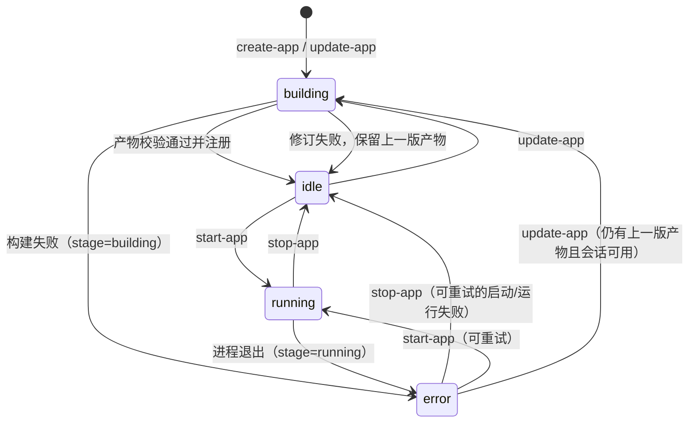

# 状态与恢复：生成、上屏、操作

一条现场体验跨三个阶段：**生成**（一句话变成一个可运行的应用）、**上屏**（把画面放到现场的电视上）、**操作**（用语音继续驱动这个应用）。站在用户面前时，上屏之后的失败几乎都表现为"电视没反应"，但三个阶段的负责方、状态归属和恢复手段完全不同。

本文只讲一件事：**每个阶段的状态由谁持有、哪里能看到、坏了怎么恢复**。状态机、错误码与工具语义的权威定义仍在各自的契约文档里，本文不重复列举，只做串联与对照：

- 应用状态、错误码与工具行为：[应用管理 MCP](interfaces/app-management-mcp.md)
- 多应用并发、修订与重启恢复：[多应用并发与同会话更新](interfaces/multi-app-sessions.md)
- 投屏链路与三段失败对照：[现场侧投屏](home-casting.md)
- 设备端工具与现场排障：[固件投屏工具](../operations/yunliao-s3-max-firmware-mcp.md)

## 1. 状态归属

| 阶段 | 状态持有方 | 权威记录 | 控制面看得到吗 | 灵矽看得到吗 |
| --- | --- | --- | --- | --- |
| 生成 | 控制面 + AgentAPI | `apps` 表中的 `state`、`error`、构建时间与最近进度 | 是 | 是（`get-app-status`、通知） |
| 运行 | 控制面 + Render | `apps.state=running`、`instance_id`、`port`、`source` | 是（每 5 秒对账） | 是（`running` + `stream_url`） |
| 上屏 | 设备固件 + 电视 | 固件内存里的扫描缓存与最近一次投放目标 | **否** | 是（`self.cast.*` 的返回值） |
| 操作 | 控制面 + Render + 应用 | 应用自己的业务状态 | 仅转发结果 | 是（`send-request` 的响应） |

最关键的一条：**控制面的 `running` 只说明云端运行时健康和媒体流地址可用，不代表电视上正在播。** 控制面不持有投屏会话，也没有屏幕查询接口；屏幕状态只存在于设备端工具的结果里。任何"已上屏"的判断都必须来自设备侧。

控制面只为前两个阶段维护状态机，上屏不在其中：

## 2. 生成阶段

### 2.1 状态与进度

`building` 是三个阶段里唯一有**异步进度**的状态。控制面把 AgentAPI 会话事件里最近的一条作为进度，优先顺序按到达时间取最后一条：

1. `agent.message`：Agent 的正式输出；
2. `agent.thinking`：思考事件，长时间调用工具时用来兜底，可能为空或被脱敏；
3. `session.error`：会话级错误。

进度写入 `app.LastProgress`，`get-app-status` 在 `building` 时以 `message` 返回；构建成功后清空。失败时保留最近一条 agent 消息，放在 `error.last_agent_message` 里。

### 2.2 转换

| 从 | 到 | 触发 | 持久化变化 |
| --- | --- | --- | --- |
| — | `building` | `create-app` / `update-app` 成功提交 | 新建 `app_id`（创建）或保留原 `app_id`（修订），记录 `session_id`、`build_started_at`；`event_cursor` 随事件推进 |
| `building` | `idle` | 产物下载、校验、注册通过 | 写入 `artifact`、`openapi`、`name`、`build_duration`；发通知 |
| `building` | `error(stage=building)` | 构建超时、会话终止、产物校验失败 | 写入 `error`；**不会**产生可启动的 `idle` |
| `building` | `idle`（保留旧包） | 修订失败但上一版产物可用 | 清空 `error`，保留旧 `artifact`；通知说明更新失败 |
| `idle` | `building` | `update-app` | 复用绑定的 AgentAPI 会话提交修订 |
| — | `idle` | 从应用商城安装（`install-app` 或门户复制） | 新建 `app_id`，复制产物与 OpenAPI，写入 `installed_from`；**没有构建会话，也没有 `building` 阶段** |

安装是唯一跳过生成阶段进入 `idle` 的路径：它复制的是别人已经验证过的产物，秒级完成，不需要 `get-app-status` 轮询。代价是这类应用**不能修订**——`update-app` 返回 `APP_INSTALLED`，而不是含糊的 `SESSION_UNAVAILABLE`；要改内容只能按新需求重新 `create-app`。安装同样计入该 `(device, agent)` 的 10 个历史上限，满了返回 `QUOTA_EXCEEDED`。

### 2.3 失败与恢复

| 失败 | 表现 | 是否可自愈 | 恢复动作 |
| --- | --- | --- | --- |
| 无法创建 AgentAPI 会话 | 工具返回 `BUILD_START_FAILED`，应用不产生 | 否 | 重新 `create-app`；先用 `list-apps` 确认没有建成 |
| 构建超时（默认 60 分钟） | `error(stage=building)` | 否 | `update-app` 再试，或重新 `create-app` |
| 事件流中断 | 自动重连，重连间隔递增；会话仍 `running` 时继续观察 | 是 | 无需动作 |
| 产物缺失或结构不合法 | `error(stage=building)`，`code=BUILD_FAILED` | 否 | `update-app` 重新交付 |
| 修订时会话已终止/归档 | `SESSION_UNAVAILABLE` | 否 | 重新 `create-app`；旧产物仍可 `start-app` |
| 控制面重启时仍在 `building` | 启动时 `Resume` 重新挂上事件流 | 是 | 无需动作；缺 `session_id` 才转 `error` |

要点：**构建阶段没有"断点续传"**，恢复只有两条路——继续观察（进程内自动）或整轮重来（`update-app` / `create-app`）。修订失败时控制面会保留上一版产物，这是唯一"不丢已有结果"的失败路径。

## 3. 运行阶段

`start-app` 让云端运行时跑起来，返回 `stream_url`。这一步不接触屏幕。

### 3.1 转换

| 从 | 到 | 触发 | 备注 |
| --- | --- | --- | --- |
| `idle` | `running` | `start-app` 成功：预留端口 → Render 创建实例 → 健康检查通过 → 媒体流就绪 | 先写 `pending_runtime`，再写 `instance_id`/`port`/`source`，最后切 `running`，崩溃点都被记录 |
| `running` | `idle` | `stop-app` | 删除 Render 实例，清空运行时字段，写 `stopped_at` |
| `running` | `error(stage=running)` | 后台对账发现实例消失（404）或状态为 `error`/`stopped`/`stopping` | `code=APP_EXITED`，进入清理 |
| `error`（可重试） | `idle` | `stop-app` | 释放失败遗留的资源，应用重新可启动 |
| `error`（可重试） | `idle` → `running` | 再次 `start-app` | 先清理上次残留，再重新启动 |
| `error` | `error` | 不可重试（`ARTIFACT_INVALID`）或没有可用产物（`ARTIFACT_MISSING`） | 必须 `update-app` 或 `create-app` |

"可重试"的判定是：`error.stage` 不是 `building`、`error.code` 不是 `ARTIFACT_INVALID`，且仍有 OpenAPI 与产物路径。构建类失败和产物类失败都不符合，必须回到构建阶段解决。

### 3.2 启动失败分类

| 失败类型 | 对灵矽可见的错误 | 是否改状态 | 可重试 |
| --- | --- | --- | --- |
| 端口被占 | 不单独暴露：控制面自动换端口，最多 3 次，之后归入 `START_FAILED` | 进入 `error` | 是 |
| Render 上已有该应用的实例 | `APP_ALREADY_RUNNING` | 否，保持 `idle` | 是，先确认实例归属再重试 |
| 产物结构或启动契约不合法（422） | `ARTIFACT_INVALID` | 进入 `error` | 否，先重建产物 |
| 进程启动或健康检查失败 | `START_FAILED` | 进入 `error` | 是 |
| 已就绪但没有媒体流 | `STREAM_START_FAILED` | 进入 `error` | 是 |
| 重复 `start-app` 时无法确认实例状态 | `RUNTIME_UNAVAILABLE` | 否 | 是，稍后重试 |
| 上次结果还在核对或清理 | `CLEANUP_PENDING` | 否 | 是，稍后用同一 `app_id` |

除"已有实例"和"保存失败"两类外，启动失败都会先把应用标成 `error` 再对账，所以进程在"标记"和"清理"之间崩溃，也不会留下一个看似 `idle`、背后却占着端口的应用。

### 3.3 运行中对账

控制面每 5 秒（`monitor_interval`）检查一次所有 `running` 应用：

- 实例状态变为 `error`/`stopped`/`stopping`，或查询返回 404 → 标记 `APP_EXITED(error.stage=running)`，发起清理；
- 清理失败保留 `cleanup_pending`，下一轮继续；清理成功后才把 `instance_id` 置空；
- Render 不可达时无法对账，应用保持 `running`，直到下次成功对账。

## 4. 上屏阶段

### 4.1 控制面到 `stream_url` 为止

`start-app` 返回的 `stream_url` 是控制面对投屏的唯一输出。之后：

1. 灵矽调设备端 `self.cast.list_screens`，拿固件缓存里的电视列表；
2. 灵矽调 `self.cast.cast(stream_url, target_id)`；
3. 设备向电视发 SOAP `SetAVTransportURI` + `Play`；
4. 电视自己向云端拉流。

控制面全程不参与，也不知道结果。设备端只记住最近一次投放目标：同一块屏重复 `cast` 覆盖 URI；换到另一块屏时，新屏接受流之后才停止旧屏。

### 4.2 三段失败对照

上屏可以独立坏在三段链路上，现象都是"电视不亮"：

| 段 | 谁连谁 | 典型表现 | 恢复 |
| --- | --- | --- | --- |
| 触发 | 设备 → 灵矽 | 模型说"做不了投屏" | 检查 `tools/list` 是否含 `self.cast.*`、固件是否注册成功；重连设备 |
| 发现与控制 | 设备 → 电视（SSDP + SOAP） | "附近没有发现可投屏的电视"、"电视没有响应投屏指令" | 确认设备与电视同广播域；等一个扫描周期（默认 60 秒）后重新 `cast` |
| 媒体 | 电视 → 云端流地址 | **SOAP 返回成功，屏幕黑或卡** | 检查电视出网、`public_url` 对电视可达；重新 `cast` 不会修好，要先修网络 |

最容易误判的是第三段：**SOAP 成功只代表电视接受了这个 URI，不代表拉到了流。** 这条链路上没有任何一端能确认"真的在播"，设备端工具的结果是唯一的权威。

### 4.3 恢复手段都在设备侧

| 场景 | 控制面动作 | 设备侧动作 |
| --- | --- | --- |
| 电视换源、关机、断网 | 无（`running` 不变） | 重新 `self.cast.cast` |
| 换一块屏 | 无 | 向新屏 `cast`，新屏接受后再停旧屏 |
| 结束放映 | `stop-app` 只释放云端运行时 | `self.cast.stop` 停止电视播放 |
| 换应用 | `stop-app` 旧应用 → `start-app` 新应用 | 用新的 `stream_url` 重新 `cast` |

**已知限制**：换应用必须先停旧应用再投新流，同一块屏会短暂黑屏，切换不是无缝的；控制面也没有投屏会话可以查询或恢复。

## 5. 操作阶段

应用 `running` 后，灵矽用 `get-app-operations` 拿到操作清单，再用 `send-request` 按 `operation_id` 调用；控制面校验后转发到应用自己的 HTTP 接口，返回应用的原始 `status` 与 `body`。

| 失败 | 来源 | 状态是否变化 | 恢复 |
| --- | --- | --- | --- |
| `APP_NOT_RUNNING` | 应用已不在 `running` | 否 | 查看 `get-app-status`，必要时重新 `start-app` |
| `RUNTIME_UNAVAILABLE` | 无法确认实例状态 | 否 | 稍后重试 |
| `OPERATION_NOT_FOUND` | 应用 OpenAPI 没有该操作 | 否 | 先 `get-app-operations` 取正确 `operation_id` |
| 应用返回 4xx/5xx | 应用自己的业务语义 | 否 | 由应用状态决定，控制面原样透传 |
| 应用进程中途退出 | 后台对账 | 是，转 `APP_EXITED` | `stop-app` 清理后重新 `start-app` |

控制面不理解业务语义，也不替应用重试：业务错误的处理权在应用和灵矽的播报策略里。

## 6. 重启与断链

进程和依赖重启是现场最常见的"状态丢失"来源。恢复由控制面自动完成的部分与需要人的部分区分如下：

| 重启/断链对象 | 对应用的影响 | 自动恢复 | 需要人工的动作 |
| --- | --- | --- | --- |
| 控制面重启 | `building` 应用重新挂上事件流；`running` 应用保留记录，靠对账确认 | 是（`Resume` + `RecoverRuntime` + 对账） | 无。中断的启动会被标成 `error(stage=starting, code=RECOVERY_PENDING)`，对账完成后回到可重试状态 |
| Render 重启 | **所有实例丢失**，媒体流中断 | 部分：5 秒内对账把应用标成 `APP_EXITED` 并清理 | 重新 `start-app`，再重新 `cast` |
| AgentAPI 会话终止 | 只能 `create-app` 重建；已构建的旧产物仍可启动 | 否 | `create-app` 重新生成 |
| 设备掉线/重连 | 应用归属是 `(device, agent)`，不随灵矽会话变化，无需重建 | 归属自动保持 | 重新 `cast`，投屏状态不恢复 |
| 电视重连或换源 | 控制面不可见 | 否 | 重新 `cast` |
| 网络分区 | 控制面与灵矽的通知可能丢失 | 部分 | 以 `get-app-status` 为准，通知是 best-effort |

## 7. 对用户可见的信号

三个阶段里，用户能听到什么由主持提示词决定（`docs/agent-system-prompts/open-anywhere-host.txt`），控制面只提供数据：

| 阶段 | 灵矽可用的信号 | 目前能回答的问题 |
| --- | --- | --- |
| 生成 | `state`、`elapsed_seconds`、`message`、`build_duration_seconds` | 做到哪一步了、还要多久 |
| 启动 | `state`、`stream_url`、`started_at` | 云端准备好了没有 |
| 上屏 | 设备端工具返回值 | 现场有没有屏、投上没有、电视报了什么错 |
| 操作 | `status` + `body` | 这一步做成了没有、给谁什么反馈 |

一个仍然存在的缺口：**三个阶段没有一条对用户统一可见的状态线**。生成阶段有进度文案，上屏阶段只有一次性工具返回，操作阶段只有单次调用结果；跨阶段"现在卡在哪、为什么、下一步做什么"只能靠灵矽自己组织语言，控制面没有提供结构化结论。

## 8. 现场排查顺序

按链路顺序问，不要跳步：

1. **生成了吗** — `get-app-status` 是不是 `idle` 或 `running`；`error` 看 `error.stage`。
2. **流可用吗** — `running` 且拿到 `stream_url`，否则问题在启动阶段。
3. **屏幕看见了吗** — 设备端 `self.cast.list_screens` 有没有目标；没有就查广播域与扫描周期。
4. **投上去了吗** — `self.cast.cast` 的返回；UPnP 错误码直接对应用户能听懂的话。
5. **电视拉到了吗** — SOAP 成功但黑屏，检查电视出网与 `public_url` 可达性。
6. **操作成功了吗** — `send-request` 的 `status`；非 2xx 看应用自己的响应体。

前三步在控制面和设备侧有日志可查，第四步以后只能看设备固件日志与电视的实际画面。
