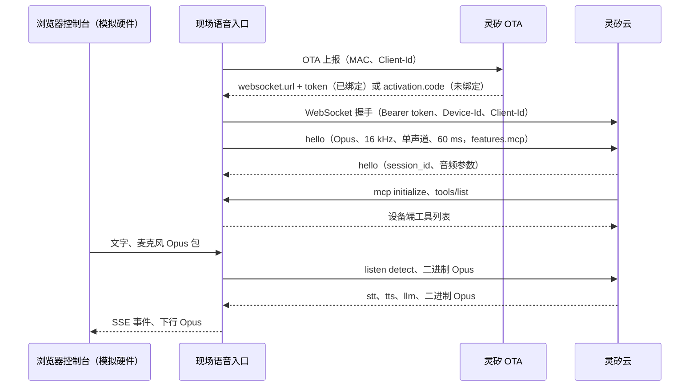

# 现场语音入口

本文描述现场语音入口：用户面前、接入灵矽云的语音设备。**真实形态是灵矽硬件**；在没有真机的环境中，用本地程序（模拟硬件）按同一套设备协议扮演它。整体架构见 [architecture.md](overview.md)。

## 形态：灵矽硬件与模拟硬件

| 方面 | 灵矽硬件 | 模拟硬件 |
| --- | --- | --- |
| 设备身份 | 固件持有 MAC 与 Client-Id | 程序生成本地管理的 MAC 与 UUID，保存为凭证文件 |
| 接入 | OTA 上报，WebSocket 连接灵矽云 | 相同 |
| 激活与绑定 | 激活码绑定到智能体 | 相同；另可在 Web 页面完成 |
| 音频 | 板载麦克风和扬声器，Opus | 浏览器的麦克风和播放器，由浏览器编解码 Opus，程序只转发 |
| 设备端 MCP | 固件注册设备工具（含 `self.cast.*`） | 程序默认上报两个仅作用于网页播放器的音量工具；加 `-casting-url` 时另上报三个 `self.cast.*` 调试工具 |
| 本地控制 | 由硬件自身决定 | Web 控制台和 HTTP / SSE / WebSocket 接口 |

“与灵矽的连接”到“状态、断开与重连”几节描述的是设备协议层，对两种形态都成立，切换到真实硬件时设计目标是行为不变，具体以灵矽的设备协议文档为准。模拟硬件自带的 Web 控制台及其 HTTP / SSE 接口只用于调试和演示，不是系统之间的契约，也不属于真实硬件，接口说明见 [实现与使用](../../internal/voiceentry/README.md)，不写在本文。

## 定位与边界

| 负责 | 不负责 |
| --- | --- |
| 以虚拟设备身份建立并保持与灵矽云的 WebSocket 会话 | 构建、运行应用，理解应用业务 |
| 收发文字、主动播报和 Opus 音频，转发灵矽的识别与播报事件 | 声纹识别、ASR、TTS（都在灵矽云） |
| 回应灵矽对设备端 MCP 的 `initialize`、`tools/list`、`tools/call` | 架构文档第 6 章的应用管理 MCP（由控制面提供） |
| 模拟硬件另外提供本地 Web 控制台，供调试和演示 | 公网访问 |
| 设备注册、断开与重连 | 生产投屏（真机固件负责）、Stage、DLNA 会话；模拟硬件只在 `-casting-url` 时提供调试用 `self.cast.*` |

架构文档第 6 章的 MCP 是控制面提供给灵矽云的云端工具；本文的设备端 MCP 由现场语音入口提供，两者互不替代。

## 与灵矽的连接



上下行的消息类型和字段以灵矽的设备协议文档为准，这里只记录对我们有影响的几点：

- 设备可以发送：监听开关（`listen start` / `stop`）、文字（`listen detect` + `text`）、主动播报（`listen detect` + `text_response`）、打断（`abort`）和 Opus 音频。
- 灵矽返回：`stt`、按句分段的 `tts`（`start`、`sentence_start`、`stop`，`stop` 带 `is_aborted`）、携带表情与动作的 `llm`、`mcp` 调用，以及 Opus 音频。
- 主动播报会被平台回显成一条 `stt`，设备要忽略它，否则会被当成用户又说了一遍。
- 监听模式默认 `realtime`，可选 `auto` 和 `manual`。

模拟硬件由浏览器负责 Opus 编解码（WebCodecs），程序只转发 Opus 包，因此不依赖 cgo、libopus 和 ffmpeg；真实硬件由板载音频链路完成。

## 设备端 MCP

灵矽把设备当作 MCP Server：会话建立后先发 `initialize`，再发 `tools/list`，之后按需发 `tools/call`。`initialize` 的 `capabilities.vision` 里带有平台下发的视觉服务地址和 token，语音入口不会把 token 展示出来。

模拟硬件默认上报两个仅作用于网页播放器的工具，用来验证 `tools/list` 与 `tools/call` 整条链路：

| 工具 | 参数 | 说明 |
| --- | --- | --- |
| `self.audio_speaker.set_volume` | `volume`：0–100 整数，必填 | 设置网页播放器音量；越界或非整数返回 `isError` |
| `self.audio_speaker.get_volume` | 无 | 返回当前音量 |

约束：

- 不为应用注册业务工具。灵矽侧的动态工具列表目前不能热更新，应用能力走第 6 章的稳定工具加 OpenAPI。
- 调用未知工具时返回标准 JSON-RPC 错误（`-32601`）。
- 云端自己完成的工具调用（例如查天气）不经过设备，现场语音入口只能看到最终的 `stt`、`tts`、`llm`，看不到调用过程。

### 投屏工具（`-casting-url`）

模拟硬件可以额外上报三个 `self.cast.*` 工具，用来把云端应用投到现场的电视上。它**只连本机的 casting 服务，不连云端**：应用由控制面构建、启动并返回 `stream_url`，设备只负责找屏和投放。工具描述明确 `url` 只用于投屏，不要把链接念给用户。小智云聊 S3 MAX 固件是生产路径：工具名和话术相同，但 SSDP 发现与 DLNA 控制都在固件里，不需要本地 casting 服务，见 [小智云聊 S3 MAX 接入投屏](../operations/yunliao-s3-max-firmware-mcp.md)。模拟硬件开启方式：

```bash
go run ./cmd/voiceentry -serve -casting-url http://192.168.1.20:8091
```

- 三个工具直接对应 casting 的 HTTP 接口：`self.cast.list_screens` → `GET /v1/targets`；`self.cast.cast(url, target_id)` → `POST /v1/projection-sessions`，固定 `mpegts / h264 / aac` 并自动选中支持该格式的 Endpoint；`self.cast.stop(session_id 可选)` → `DELETE /v1/projection-sessions/{id}`。真机固件不经过这些 HTTP 接口，直接发 DLNA SOAP。
- 不带任何身份头、token 或灵矽会话信息。casting 没有鉴权，只应部署在同一台可信的局域网机器上，不要暴露到公网。
- `cast` 原样使用控制面返回的 `stream_url`，不拼接、不改写；`target_id` 来自 `list_screens`。
- 失败翻译成可直接播报的中文：被占用（409 `target_busy`）、离线（409 `target_offline`）、格式不支持（422）、电视不响应（502）。`stop` 不传 `session_id` 时停止本进程最近一次投放的内容，会话已经不在了也视为成功。
- 构建、启动和应用业务请求全部由灵矽直接调用控制面 MCP；设备不再代理，也不轮询构建状态。

## 设备注册

激活流程对两种形态相同：设备向 OTA 上报身份，得到激活码，绑定到智能体后取得连接凭证。下面是模拟硬件的具体做法。

模拟硬件把凭证保存在 `.device.json`（`mac`、`clientId`、`token`、`wsUrl`），文件权限 0600，已在 `.gitignore`。没有这个文件时，常驻模式仍能启动，在 Web 控制台注册：

1. 生成设备身份（本地管理的单播 MAC 和 UUID v4），向 OTA 上报，得到激活码。真实硬件使用固件持有的身份。
2. 把激活码绑定到智能体：在灵矽控制台手动绑定；或在页面填 Agent ID 和 API Key，由模拟硬件调用绑定接口。API Key 只用于这一次请求，不保存，错误信息里也不会带出。
3. 绑定后再次上报，平台返回 `websocket.token`，设备保存凭证并自动连接（模拟硬件写入凭证文件）。

同一次注册内，身份与激活码保持不变，可以重复点击检查。

## 状态、断开与重连

状态：`connecting`、`listening`、`thinking`、`speaking`、`idle`（用户暂停）、`reconnecting`、`disconnected`（用户手动断开）。

- 主动播报在灵矽讲话期间排队，`tts stop` 后发送下一条；被打断时清空队列；平台回显的 `stt` 被忽略。
- 意外断线：按 1、2、4、8、15 秒退避自动重连，成功后恢复监听；用户暂停过的，重连后保持暂停。
- 手动断开：不自动重连，丢弃排队的播报，需要点“重新连接”。
- 按平台文档，智能体配置 `goodbye.idle_timeout_seconds`（60–3600 秒）后，空闲会话会被服务端断开，此时走意外断线路径。该路径还没有在真实空闲超时下观察过。

## 安全

- 模拟硬件的控制接口没有鉴权，只应监听回环地址，不要暴露到公网或不可信网络。
- 设备凭证和 API Key 不进入日志和页面；展示灵矽原始消息时会遮蔽其中的 `token`（`initialize` 里带有平台下发的视觉服务 token）。
