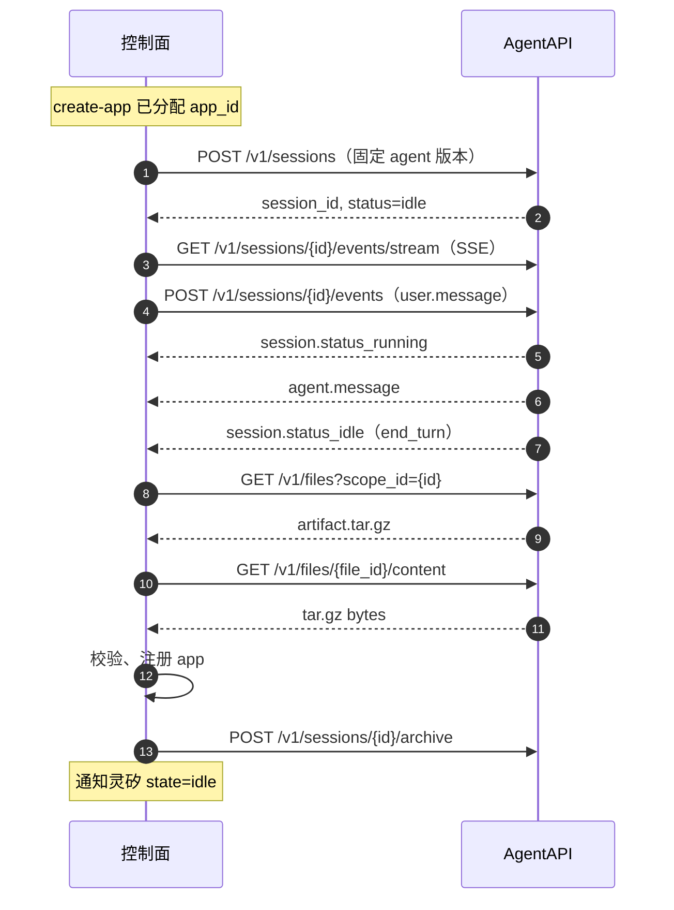

# 控制面与 AgentAPI 接口设计

> 状态：Proposal（供 PR 评审）
> 版本：v0.1
> 日期：2026-10-24

## 1. 范围

本文定义控制面（gateway）与 AgentAPI 之间的构建契约：

- AgentAPI 侧：一次性准备构建智能体、内置技能模板和云端环境；智能体不使用 MCP。
- 控制面侧：`create-app` 之后创建构建会话、提交构建任务、订阅会话事件，并在会话进入 `idle` 后收集、校验 `outputs/` 产物。

### 1.1 角色与调用方向

| 组件 | 本文中的职责 | 调用方 |
| --- | --- | --- |
| 控制面（gateway） | 准备构建智能体与技能、创建会话、消费事件、收集并校验产物、注册应用 | 灵矽（MCP） |
| AgentAPI | 在云端沙箱中运行编码智能体，持久化 `/mnt/session/outputs/` 中的文件 | 控制面 |

控制面是 AgentAPI 的唯一调用方。灵矽、Render 和应用都不直接访问 AgentAPI；AgentAPI 的 API Key 只保存在控制面。

### 1.2 契约原则

- 控制面与 AgentAPI 之间使用 HTTP + JSON，事件流使用 SSE。
- `app_id` 是控制面分配的业务标识；AgentAPI 的 `session_id` 只在控制面内部使用，不通过 MCP 返回。
- 智能体和技能按版本准备，环境按部署配置复用；创建会话时固定智能体版本，构建过程可追溯、可复现。
- 构建异步执行：`create-app` 在会话创建并提交任务后立即返回 `building`，不等待构建完成。
- 构建智能体不接入 MCP、不配置自定义工具、不挂载输入文件；它只使用运行时内置工具和内置技能模板。
- 产物以单个 `artifact.tar.gz` 交付；控制面在会话结束后从 Files API 取回并校验，再交给 Render。

### 1.3 认证与地址

所有请求使用控制面配置的 AgentAPI 地址和 API Key：

```http
x-api-key: $AGENTAPI_API_KEY
```

`AGENTAPI_BASE_URL`、`AGENTAPI_API_KEY`、模型 ID、智能体版本、技能版本和环境 ID 都是控制面的部署配置，不进入灵矽的 MCP 响应。

### 1.4 接口一览

| 方法 | 路径 | 作用 | 使用阶段 |
| --- | --- | --- | --- |
| `POST` | `/v1/skills` | 上传内置技能模板 | 发布 |
| `POST` | `/v1/environments` | 创建构建环境 | 发布 |
| `POST` | `/v1/agents` | 创建构建智能体 | 发布 |
| `POST` | `/v1/sessions` | 创建构建会话 | 每次 `create-app` |
| `POST` | `/v1/sessions/{id}/events` | 提交 `user.message` 或 `user.interrupt` | 每次构建 |
| `GET` | `/v1/sessions/{id}/events/stream` | 订阅会话事件（SSE） | 每次构建 |
| `GET` | `/v1/sessions/{id}` | 查询会话快照 | 恢复与超时处理 |
| `GET` | `/v1/files?scope_id={session_id}` | 列出交付目录中的文件 | 构建结束 |
| `GET` | `/v1/files/{file_id}/content` | 下载 `artifact.tar.gz` | 构建结束 |
| `POST` | `/v1/sessions/{id}/archive` | 归档构建会话 | 构建结束或失败 |

## 2. AgentAPI 侧：智能体准备

准备物在部署或发布阶段创建一次，不随每次 `create-app` 重复创建。控制面保存它们的 ID 和版本，构建时只创建会话。

### 2.1 准备物

| 资源 | 用途 | 创建接口 | 控制面保存 |
| --- | --- | --- | --- |
| 技能模板 | 约束构建方法和产物结构 | `POST /v1/skills` | `skill_id`、`skill_version` |
| 云端环境 | 提供 Node.js 沙箱和网络策略 | `POST /v1/environments` | `environment_id` |
| 构建智能体 | 运行时、模型、系统提示、技能和工具 | `POST /v1/agents` | `agent_id`、`agent_version` |

技能和智能体独立版本化；环境是可复用资源，更新后只影响后续新建的会话。智能体版本固定了当时引用的技能版本；已有会话继续使用创建时的智能体版本，不受后续更新影响。

### 2.2 内置技能模板

内置技能以自定义技能包上传。技能包在控制面仓库中维护，发布时打包为 zip：

```text
skills/app-builder/
├── SKILL.md
├── references/
│   ├── app-template/            # 参考应用模板，对应 app-artifact.md 的产物结构
│   │   ├── app/
│   │   │   ├── app.js
│   │   │   └── public/index.html
│   │   ├── openapi.yaml
│   │   └── launch.json
│   ├── artifact-contract.md     # 应用包、launch.json、运行约定
│   ├── api-contract.md          # OpenAPI 3.1 与业务响应约定
│   └── self-test.md             # 自测步骤和检查项
└── scripts/
    └── validate-artifact.sh     # 归档结构和启动契约的静态检查
```

`references/app-template/` 是可直接复制的最小 Node.js 应用，`SKILL.md` 要求先复制模板再按需求修改，避免智能体从零搭建。模板放在 `references/` 而不是 `assets/`：`assets/` 容易被当作仅供展示的素材，智能体不保证读取和使用。模板内容跟随 [app-artifact.md](app-artifact.md) 更新。

上传技能：

```http
POST /v1/skills
Content-Type: multipart/form-data
```

| part | 类型 | 内容 |
| --- | --- | --- |
| `files` | `application/zip` | 保留顶层目录的技能 zip，例如 `app-builder/SKILL.md` |

成功响应：

```json
{
  "id": "skill_01J...",
  "latest_version": "1"
}
```

约束：

- zip 内所有文件位于同一个顶层目录，目录根部必须包含 `SKILL.md`。
- 每个技能版本默认最多 200 个文件、解压后总计最多 8 MiB；单个 multipart 请求最多 32 MiB。
- 技能版本由 AgentAPI 生成；智能体引用时固定版本号字符串，不使用 `latest`，保证构建可复现。
- 技能只提供说明、脚本和模板，不包含 MCP 配置，也不依赖外部服务。

### 2.3 云端环境

构建环境使用云端沙箱。Node.js 和 npm 已预装（Node.js 22 / npm 12），应用依赖在构建期安装并打包进产物。

```http
POST /v1/environments
Content-Type: application/json
```

```json
{
  "name": "open-anywhere-builder",
  "config": {
    "type": "cloud",
    "networking": {"type": "unrestricted"}
  }
}
```

成功响应：

```json
{
  "id": "env_01J...",
  "name": "open-anywhere-builder",
  "config": {
    "type": "cloud",
    "networking": {"type": "unrestricted"}
  }
}
```

- 构建期不限制出站网络：智能体可以访问包管理器、镜像和其他构建依赖，不需要维护 `allowed_hosts`。
- 网络放开只用于构建；产出的应用仍要求运行期自包含，不依赖外部服务或 CDN（见 [app-artifact.md](app-artifact.md)）。
- 环境不配置 MCP 相关选项，也不挂载 GitHub 仓库、记忆存储或输入文件。

### 2.4 创建构建智能体

```http
POST /v1/agents
Content-Type: application/json
```

```json
{
  "name": "open-anywhere-app-builder",
  "runtime": "claudecode",
  "model": {
    "id": "your-model-id",
    "effort": {"type": "high"}
  },
  "system": "你是 Open Anywhere 的应用构建智能体。按 app-builder 技能完成应用，遵守产物契约并自测。不要提问，不要等待确认。",
  "tools": [
    {"type": "agent_toolset_20260401"}
  ],
  "skills": [
    {
      "type": "custom",
      "skill_id": "skill_01J...",
      "version": "1"
    }
  ],
  "metadata": {
    "purpose": "open-anywhere-app-builder"
  }
}
```

成功响应包含智能体 ID、版本和状态：

```json
{
  "id": "agt_01J...",
  "type": "agent",
  "name": "open-anywhere-app-builder",
  "runtime": "claudecode",
  "version": 1,
  "status": "ready",
  "created_at": "2026-10-24T08:00:00Z"
}
```

字段约定：

| 字段 | 取值 | 说明 |
| --- | --- | --- |
| `runtime` | `claudecode` | 编码能力完整，内置工具开箱即用；技能由 AgentAPI 在沙箱启动前准备 |
| `model.id` | 部署配置 | 必须支持工具调用；部署前确认模型在当前账户可用 |
| `model.effort` | `high` 或按模型能力 | 构建任务较长，默认使用较高思考强度 |
| `tools` | `agent_toolset_20260401` | 只启用运行时内置工具集，不声明 `mcp_toolset` 或自定义工具 |
| `skills` | 固定 `skill_id` 和版本号字符串 | 一个智能体最多附加 20 个技能；本期只附加一个构建技能 |
| `mcp_servers` | 省略 | 不接入任何 MCP Server，也不在会话上关联 Vault |
| `metadata.purpose` | `open-anywhere-app-builder` | 便于在 Portal 和资源列表中识别 |

不配置 MCP 是刻意的边界：构建只需要沙箱内的文件、命令和模型能力；接入 MCP 会增加凭证、网络和工具确认流程，而控制面没有对应的审批逻辑。

### 2.5 版本与发布

控制面保存一组构建配置：

```json
{
  "agent_id": "agt_01J...",
  "agent_version": 1,
  "environment_id": "env_01J...",
  "skill_id": "skill_01J...",
  "skill_version": "1"
}
```

发布流程：

1. 修改技能内容，重新打包并上传，得到新的 `skill_version`。
2. 用当前 `agent_version` 更新智能体，替换 `skills` 数组，得到新的 `agent_version`。
3. 更新控制面配置；此后新建的会话使用新版本。
4. 已在运行的构建会话继续使用创建时固定的版本，不中途切换。

更新智能体时必须携带当前 `version`；版本不匹配返回 `409`，应重新读取智能体后重试，不能用旧版本覆盖。控制面启动时调用 `GET /v1/agents/{agent_id}` 检查智能体存在且 `status=ready`，并确认环境未归档；检查失败则拒绝新的 `create-app`，避免每个构建都重复失败。

## 3. 控制面侧：构建会话

### 3.1 `create-app` 之后的处理顺序

1. 控制面在 MCP 层校验输入，分配 `app_id`，记录 `state=building`、`build_started_at` 和 `prompt`。
2. 调用 `POST /v1/sessions`，固定智能体版本和环境，写入 `app_id` 元数据。
3. 保存 `session_id`；同一 `app_id` 只创建一个构建会话。
4. 注册该会话的事件流消费者。消费者可以在连接建立前注册，AgentAPI 会回放历史事件。
5. 调用 `POST /v1/sessions/{id}/events` 提交 `user.message`，把用户需求和构建约束交给智能体。
6. 立即向灵矽返回 `app_id` 和 `state=building`；构建在后台继续。
7. 消费事件流，更新 `building.message`；会话进入 `idle` 后按停止原因处理。
8. 成功时收集并校验 `/mnt/session/outputs/artifact.tar.gz`，注册应用并进入 `idle`；失败时进入 `error(stage=building)`。



### 3.2 创建会话

```http
POST /v1/sessions
Content-Type: application/json
```

```json
{
  "agent": {
    "type": "agent",
    "id": "agt_01J...",
    "version": 1
  },
  "environment_id": "env_01J...",
  "title": "app_01J...",
  "metadata": {
    "app_id": "app_01J..."
  }
}
```

成功响应：

```json
{
  "id": "ses_01J...",
  "status": "idle",
  "agent": {
    "type": "agent",
    "id": "agt_01J...",
    "version": 1
  },
  "environment_id": "env_01J...",
  "title": "app_01J...",
  "metadata": {
    "app_id": "app_01J..."
  },
  "created_at": "2026-10-24T08:30:00Z"
}
```

- 会话以 `idle` 开始，提交 `user.message` 后才执行。
- `metadata` 只放 `app_id`，不放设备、声纹或用户隐私数据。
- 不使用 `agent_with_overrides`；模型、系统提示和技能都来自固定版本，避免每次构建的配置漂移。
- 不传 `resources`、`vault_ids`，不挂载输入文件或凭证。

### 3.3 提交构建任务

```http
POST /v1/sessions/{id}/events
Content-Type: application/json
```

```json
{
  "events": [
    {
      "type": "user.message",
      "input": {
        "parts": [
          {
            "type": "text",
            "text": "需求：做一个掷骰子游戏，点击按钮掷出两个骰子，显示点数和最近几次结果。\n\n请使用 app-builder 技能完成构建。硬性要求：\n- 产物写入 /mnt/session/outputs/artifact.tar.gz，归档根目录包含 app/、openapi.yaml、launch.json；\n- app/ 是自包含 Node.js 应用，入口 app/app.js，读取 PORT，实现 GET /health 和 GET /；\n- /api/* 使用 OpenAPI 3.1 描述，业务响应包含 message；\n- 不依赖外部数据库、外部服务或 CDN；\n- 完成后自测、打包并校验。\n不要提问；按合理假设完成。"
          }
        ]
      }
    }
  ]
}
```

- `text` 由控制面拼接：前半部分是灵矽整理后的用户需求，后半部分是固定的构建约束。
- 硬性约束在消息里重复一次，避免技能未加载时智能体缺少关键要求；完整说明仍以技能为准。
- 不在消息里放入 `app_id`、`session_id`、屏幕信息或任何凭证。
- 请求返回只表示事件已被接收，构建结果必须从事件流读取。

### 3.4 订阅事件流

```http
GET /v1/sessions/{id}/events/stream
Accept: text/event-stream
```

事件流先回放历史，再推送实时事件；`session.status_idle` 之后连接仍保持打开，由控制面决定何时关闭。控制面在处理完本轮并归档会话后关闭连接。

```text
event: session.status_running
data: {"type":"session.status_running","id":"evt_01J..."}

event: agent.message
data: {"type":"agent.message","id":"evt_01J...","content":[{"type":"text","text":"正在创建页面和接口"}]}

event: session.status_idle
data: {"type":"session.status_idle","id":"evt_01J...","stop_reason":{"type":"end_turn"}}
```

控制面处理的事件：

| `event.type` | 控制面动作 |
| --- | --- |
| `agent.message` | 取 `content` 中的 `text` 块，更新 `building.message`，同时保存 `last_agent_message` |
| `user.message` | 标记构建任务已进入事件流，可用于确认提交；不改变应用状态 |
| `session.status_running` | 记录本轮开始时间，保持 `building` |
| `session.error` | 记录错误信息；它不代表会话已终止，继续等待后续状态 |
| `session.status_idle` | 按 `stop_reason.type` 处理，见 3.5 |
| `session.status_terminated` | 会话不可恢复，按构建失败处理，不能再发送输入 |
| 其他 `span.*`、`usage` 等事件 | 忽略或写入日志，不改变应用状态 |

消费规则：

- 先注册消费者，再提交 `user.message`；即使首次连接晚于任务提交，回放也能补齐事件。
- 按事件 `id` 去重；控制面持久化已处理事件 ID 的集合（或可排序的事件游标），重连后从头回放并跳过已处理事件。
- 只有在观察到本轮 `user.message`、`session.status_running` 或 `agent.message` 之后，才接受 `session.status_idle`；提交前回放的旧 `idle` 不能当作本轮完成。
- 连接断开时按 1、2、4、8、15 秒退避重连，上限 30 秒；重连期间不重复发送 `user.message`。
- 同一 `session_id` 只允许一个消费者推进状态；多副本部署时用 `app_id` 或 `session_id` 加分布式锁。

`building.message` 的取值：

- 取最近一条完整 `agent.message`，把 `content` 中所有 `type=text` 的文本拼接，压缩连续空白。
- 超过 200 个字符时截断，保留前 200 个字符；没有文本时保留上一条。
- 不使用 `event_delta` 增量预览；它不是持久事件，重连后无法补回。

### 3.5 停止原因处理

收到 `session.status_idle` 后，必须读取 `stop_reason.type`，不能仅凭 `idle` 判定构建成功。

| `stop_reason.type` | 含义 | 控制面处理 |
| --- | --- | --- |
| `end_turn` | 本轮正常结束 | 进入 outputs 收集与校验 |
| `requires_action` | 会话在等待工具确认或自定义工具结果 | 构建失败；本设计没有自定义工具、MCP 或确认处理 |
| `interrupted` | 本轮被中断 | 构建失败 |
| `budget_reached` | 达到执行预算 | 构建失败 |
| `retries_exhausted` | 重试耗尽 | 构建失败 |
| 缺失或未知值 | 无法确认本轮结果 | 构建失败 |

`session.error` 只作为诊断信息保存；如果随后没有 `session.status_idle` 或 `session.status_terminated`，控制面继续等待，直到构建超时。

### 3.6 超时与中断

- 构建超时由控制面控制，默认 60 分钟。AgentAPI 的沙箱运行时长默认 1 小时，部署时需要调高（例如 2 小时），并为产物收集和清理留出时间；CLI 命令执行上限也按需一并调高。
- 超时后发送 `user.interrupt`，最多等待 5 分钟让会话回到 `idle`；仍未回到 `idle` 时归档会话并按 `BUILD_FAILED` 处理。

```http
POST /v1/sessions/{id}/events
Content-Type: application/json
```

```json
{
  "events": [
    {"type": "user.interrupt"}
  ]
}
```

- 中断是尽力而为：已经发生的文件修改不会回滚；控制面不下载未完成的产物。
- 不盲目重试 `POST /v1/sessions` 或 `POST /v1/sessions/{id}/events`。请求超时或返回 5xx 时，先查询会话状态和事件历史，确认会话或事件是否已经创建；无法确认时按失败处理，避免重复会话或重复执行。
- 用户侧没有单独的取消接口；构建中的 `stop-app` 按架构文档返回 `APP_BUILDING`。控制面清理设备会话时，可以中断并归档仍在运行的构建会话。

### 3.7 控制面重启后的恢复

控制面为每个 `building` 应用持久化 `session_id`、已处理事件 ID 的游标或集合，以及构建阶段。重启后：

1. 调用 `GET /v1/sessions/{id}` 获取会话快照。
2. 重新打开事件流，回放历史并按事件 ID 去重。
3. `status=running` 或 `rescheduling`：继续消费，保持 `building`。
4. `status=idle` 且尚未处理本轮 `idle`：按 3.5 处理。
5. `status=terminated`：按构建失败处理。
6. 会话不存在（404）：按构建失败处理，保留 `last_agent_message` 供诊断。

如果应用处于 `building` 但从未保存 `session_id`，说明控制面在创建会话期间崩溃。MVP 不自动重建会话，直接把应用置为 `error`，由用户重新发起 `create-app`；这样不会产生无法归属的重复会话。

## 4. outputs 处理

### 4.1 交付约定

构建智能体在沙箱中使用两个目录：

| 目录 | 用途 |
| --- | --- |
| 会话工作目录下的 `outputs/` | 构建目录，存放 `app/`、`openapi.yaml`、`launch.json` 和中间文件 |
| `/mnt/session/outputs/` | AgentAPI 交付目录，只放最终压缩包 |

构建目录 `outputs/` 是 [app-artifact.md](app-artifact.md) 约定的产物目录名；`/mnt/session/outputs/` 是 AgentAPI 的文件收集目录，两者不是同一个目录。

最终交付文件固定为 `/mnt/session/outputs/artifact.tar.gz`。在会话工作目录执行：

```bash
tar -czf /mnt/session/outputs/artifact.tar.gz -C outputs .
```

归档根目录直接是 `app/`、`openapi.yaml`、`launch.json`，不嵌套 `outputs/`。选择单个压缩包而不是逐文件交付，原因如下：

- Files API 的 `FileObject` 只有 `filename`，没有相对路径字段，逐文件交付无法可靠还原目录结构。
- 单个文件便于计算摘要、限制大小和交给 Render；Render 的接口本来就接收 `artifact.tar.gz`。
- 构建中间文件不进入交付目录，避免触发 100 MiB 输出总量限制，也避免把临时文件暴露给控制面。

### 4.2 收集产物

会话进入 `idle` 且 `stop_reason.type=end_turn` 后，产物收集可能比 `idle` 晚几秒。控制面先查询一次；没有找到时按 5 秒、15 秒、30 秒的间隔最多重试三次，仍找不到则判定产物缺失。

```http
GET /v1/files?scope_id={session_id}
```

响应是分页的：

```json
{
  "data": [
    {
      "id": "file_01J...",
      "filename": "artifact.tar.gz",
      "mime_type": "application/gzip",
      "size_bytes": 245760,
      "downloadable": true,
      "scope": {
        "id": "ses_01J...",
        "type": "session"
      },
      "created_at": "2026-10-24T08:42:00Z",
      "type": "file"
    }
  ],
  "has_more": false,
  "first_id": "file_01J...",
  "last_id": "file_01J...",
  "next_page": null
}
```

收集规则：

- 按 `next_page` 继续分页，直到 `has_more=false`；不要只读取第一页。
- 选择 `filename=artifact.tar.gz` 且 `downloadable=true` 的文件；同一名称有多个时取 `created_at` 最新的一个。
- 文件不存在、不可下载或超过保留时间时，按产物缺失处理，不把其他文件拼成产物。
- 下载：

```http
GET /v1/files/{file_id}/content
```

- 下载设置 5 分钟超时；404/410 视为文件尚未就绪，按 5、15、30 秒重试，仍失败则按产物下载失败处理。
- 先把响应写入临时文件，边写边计数；超过 100 MiB 立即中止并删除临时文件。
- 下载完成后计算 `sha256(artifact.tar.gz)`，保存摘要和字节数。

### 4.3 校验产物

控制面在注册应用前做静态校验。运行期健康检查由 Render 负责，不在控制面执行。

| 检查项 | 规则 | 失败原因 |
| --- | --- | --- |
| 大小 | 压缩包不超过 100 MiB；技能以 80 MiB 为构建目标 | `ARTIFACT_TOO_LARGE` |
| 归档路径 | 拒绝绝对路径、`..`、符号链接和硬链接；允许 `./` 前缀并在检查前归一化 | `INVALID_ARTIFACT` |
| 根目录 | 必须包含 `app/`、`openapi.yaml`、`launch.json`，且没有 `outputs/` 这一层 | `INVALID_ARTIFACT` |
| 入口 | `runtimeArgs` 中至少有一个参数指向 `app/` 内存在的文件 | `INVALID_ARTIFACT` |
| 启动契约 | `runtimeExecutable=node`；`runtimeArgs` 非空且不含固定端口参数；`healthPath` 缺省或为 `/health`；`readyTimeoutMs` 为正整数且不超过运行端上限；`launch.json` 不含 `port` 字段 | `INVALID_ARTIFACT` |
| OpenAPI | 合法 OpenAPI 3.1；`paths` 只包含 `/api/*`；每个操作有唯一 `operationId`；`servers` 使用相对地址 | `INVALID_ARTIFACT` |
| 完整性 | 下载字节数与 `size_bytes` 一致；gzip/tar 可读；存储后摘要与下载时计算的值一致 | `ARTIFACT_CORRUPT` |

`app/` 必须非空；`package.json` 不是必需文件，但存在时必须是合法 JSON。OpenAPI 的 `message` 字段由技能和构建提示约束，控制面做结构检查；后续可以增加更严格的 schema 校验。

校验成功后，控制面保留原始 `artifact.tar.gz`，同时解析 `openapi.yaml` 并存入应用注册表，后续 `send_request` 按该规范转发。

### 4.4 注册与通知

校验通过后：

1. 应用状态从 `building` 变为 `idle`。
2. 应用名称取 `launch.json.name`，去除首尾空白并限制长度；为空时使用 `app_id`。
3. 保存 `artifact_sha256`、`artifact_size`、`build_duration_seconds`（从提交构建任务到产物校验通过）和产物存储地址。
4. 通过已有的 MCP SSE 连接发送 `notifications/app_status`，`state=idle`，`message` 为给灵矽播报的完成文案。
5. 归档构建会话，释放沙箱资源；归档失败只记录日志，不回滚已注册的应用。

### 4.5 失败处理

任一检查失败时：

- 应用进入 `error`，`error.stage=building`，`error.code=BUILD_FAILED`。
- `error.message` 使用面向用户的中文摘要，例如“构建产物缺失”“构建产物校验失败”“构建超时”。
- `error.last_agent_message` 保留最近一条完整 `agent.message`，便于排查；没有 agent 消息时使用 `session.error` 的 `message`。
- 不进入 `idle`，不注册应用，不把产物交给 Render。
- 归档或中断构建会话；已下载的临时产物删除。

MVP 不做自动修复轮次。构建失败后由用户重新发起 `create-app`；如果后续需要“把校验错误回传给同一个会话再修一次”，应作为独立设计，明确最大修复轮次、总超时和幂等边界。

如果失败发生在 `create-app` 返回之前，控制面应清理已创建的会话：会话创建或任务提交在返回前确定失败时，MCP 工具直接返回错误，不向灵矽暴露一个无法推进的 `building` 应用；请求结果无法确认时保留应用记录，由后续状态查询和恢复流程给出最终结果。

## 5. 状态与错误映射

### 5.1 构建状态

| 阶段 | 应用状态 | 触发条件 |
| --- | --- | --- |
| 会话创建、任务提交、智能体执行 | `building` | `create-app` 返回后到本轮结束 |
| 产物收集、校验、注册 | `building` | `session.status_idle` 且 `stop_reason=end_turn` |
| 注册完成 | `idle` | 产物校验通过，应用可被 `start-app` |
| 任一失败 | `error` | 会话失败、超时、产物缺失或校验失败 |

### 5.2 内部原因到 MCP 错误

控制面内部记录具体原因用于日志和指标；对灵矽统一返回 `stage=building`、`code=BUILD_FAILED`。`message` 和 `last_agent_message` 提供可读信息。

| 内部原因 | 典型场景 | MCP `error.message` |
| --- | --- | --- |
| `AGENT_UNAVAILABLE` | 智能体不存在、未就绪或模型不可用 | 构建服务暂不可用 |
| `SESSION_CREATE_FAILED` | 创建会话失败或结果无法确认 | 无法启动构建 |
| `MESSAGE_SUBMIT_FAILED` | 任务事件提交失败且无法确认 | 无法提交构建任务 |
| `AGENT_REQUIRES_ACTION` | 出现 `requires_action` | 构建需要人工处理 |
| `BUILD_INTERRUPTED` | `stop_reason=interrupted` | 构建被中断 |
| `BUILD_BUDGET_EXHAUSTED` | `stop_reason=budget_reached` | 构建超出执行预算 |
| `BUILD_RETRIES_EXHAUSTED` | `stop_reason=retries_exhausted` | 构建重试耗尽 |
| `BUILD_TERMINATED` | `session.status_terminated` | 构建会话已终止 |
| `BUILD_TIMEOUT` | 超过控制面构建超时 | 构建超时 |
| `OUTPUT_MISSING` | 交付目录中没有 `artifact.tar.gz` | 构建产物缺失 |
| `OUTPUT_DOWNLOAD_FAILED` | 产物下载失败 | 构建产物下载失败 |
| `ARTIFACT_TOO_LARGE` | 超过 100 MiB | 构建产物超过大小限制 |
| `INVALID_ARTIFACT` | 归档结构或启动契约非法 | 构建产物校验失败 |
| `ARTIFACT_CORRUPT` | 摘要不一致 | 构建产物损坏 |

## 6. 超时、重试与幂等

| 操作 | 超时 | 重试策略 |
| --- | --- | --- |
| `POST /v1/sessions` | 30 秒 | 不盲目重试；超时后查询会话状态，无法确认则失败 |
| `POST /v1/sessions/{id}/events` | 30 秒 | 不重复提交；先读取事件历史确认是否已接收 |
| SSE 事件流 | 长连接 | 断线按 1/2/4/8/15 秒退避重连，回放并按事件 ID 去重 |
| `GET /v1/files` | 10 秒 | 5/15/30 秒三次重试，之后判定产物缺失 |
| `GET /v1/files/{id}/content` | 5 分钟 | 5/15/30 秒三次重试 |
| `POST /v1/sessions/{id}/archive` | 30 秒 | 尽力重试，不阻塞应用注册 |
| 整体构建 | 60 分钟 | 超时中断并归档，不自动重启 |

幂等与并发：

- 同一 `app_id` 最多创建一个构建会话；MCP 层重复 `create-app` 返回已有的 `building` 应用。
- 产物只在应用尚未注册时处理；重复的 `session.status_idle` 或重放事件不能重复注册应用。
- 同一 `session_id` 的消费者串行推进；多副本部署使用分布式锁。
- 应用注册成功后，即使构建会话归档失败，也不再重新下载或重新注册产物。

## 7. 安全与边界

- 构建智能体不配置 `mcp_servers`、`mcp_toolset`、自定义工具或 `vault_ids`，不接收输入文件；它只能使用沙箱内置工具和技能。
- 构建环境不限制出站网络，便于安装依赖；构建产物仍要求运行期自包含，不依赖外部服务。
- AgentAPI API Key 只保存在控制面，不进入提示词、日志、MCP 响应或 Render。
- 会话 `metadata` 只包含 `app_id`；不放设备标识、声纹或用户隐私数据。
- 构建产物视为不可信输入：控制面在交给 Render 前完成归档结构和启动契约校验；Render 会再次校验摘要和归档。
- 构建会话完成后归档，保留事件和文件用于审计；按保留策略删除会话或文件对象，不影响已注册应用。

## 8. 验证状态

已按 AgentAPI 文档核对：智能体、技能和环境资源，会话创建，`user.message`，SSE 事件类型与停止原因，Files API 的产物收集与 100 MiB 限制，会话归档。

尚未在真实 AgentAPI 上验证：`claudecode` 加载自定义技能后的实际行为、构建期依赖安装与整体耗时、产物文件在 `idle` 后的出现延迟、SSE 断线回放与去重、60 分钟构建超时是否适合实际模型速度。

这些是实现阶段需要优先验证的假设；验证结果应回写到本文和技能模板。
