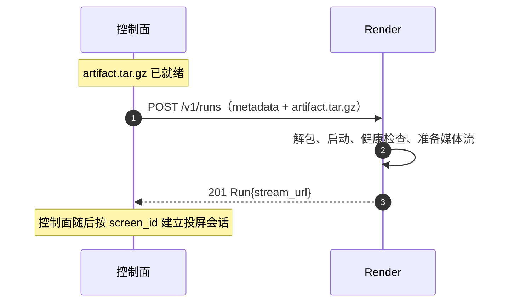

# 控制面与 Render 接口设计

> 状态：Proposal（供 PR 评审）
> 版本：v0.1
> 日期：2026-10-24

## 1. 范围

本文定义控制面（gateway）与 Render 之间的 HTTP 契约：

- 控制面把 artifact tar.gz 交给 Render；
- Render 解包 artifact、按 `launch.json` 启动应用、完成健康检查并返回媒体流地址；
- 控制面查询、停止 run，转发应用 HTTP 请求，拉取媒体流。

### 1.1 角色与调用方向

| 组件 | 本文中的职责 | 调用方 |
| --- | --- | --- |
| 控制面（gateway） | 打包 artifact、调度 Render、转发应用请求、管理 run 生命周期 | 灵矽（MCP） |
| Render | 解包 artifact、按 `launch.json` 启动、健康检查、提供应用 HTTP 与媒体流 | 控制面 |

控制面是唯一调用方：Render 不感知灵矽，也不管理投屏会话；媒体流交给控制面后续的投屏编排使用。

### 1.2 契约原则

- 内部接口使用 HTTP + JSON；artifact 用 tar.gz 传输。
- `app_id` 是控制面分配的业务标识，Render 以它为 run 的主键。
- `render_id`、应用端口和运行目录只在 Render 内部使用，不通过 MCP 返回。
- 写接口按业务键幂等：控制面可能因超时重发，Render 不得重复创建进程或媒体流。

## 2. Artifact 包

### 2.1 目录结构

控制面在构建完成后得到 `outputs/` 产物目录，归档其内容为 `artifact.tar.gz` 交给 Render。归档根目录如下，不再嵌套 `outputs/`：

```text
app/
├── app.js
├── package.json        # 应用元信息；依赖须预打包
├── public/
│   ├── index.html
│   ├── styles.css      # 可选
│   └── ui.js           # 可选
└── assets/             # 可选
openapi.yaml
launch.json
```

| 路径 | 作用 | 使用方 |
| --- | --- | --- |
| `app/` | 应用代码与静态资源 | Render |
| `launch.json` | 启动契约 | Render |
| `openapi.yaml` | 应用 HTTP 能力契约 | 控制面 |

Render 只依赖 `app/` 和 `launch.json`，忽略 `openapi.yaml`。`openapi.yaml` 和 `launch.json` 必填，`app/` 必须自包含；Render 不执行 install 或 build，也不依赖构建环境中的全局依赖，并提供约定版本的 Node.js。应用的 `GET /`、`GET /health` 和 `/api/*` 约定见 [app-artifact.md](app-artifact.md)。

### 2.2 launch.json

```json
{
  "name": "掷骰子游戏",
  "runtimeExecutable": "node",
  "runtimeArgs": ["app/app.js"],
  "healthPath": "/health",
  "readyTimeoutMs": 10000
}
```

| 字段 | 必填 | 约束 |
| --- | --- | --- |
| `name` | 是 | 非空，应用展示名称 |
| `runtimeExecutable` | 是 | 一期固定为 `node`，其他值拒绝 |
| `runtimeArgs` | 是 | 入口文件路径等启动参数，例如 `["app/app.js"]`；不含端口，不经过 shell |
| `healthPath` | 否 | 默认 `/health`；MVP 若声明必须为 `/health` |
| `readyTimeoutMs` | 否 | 就绪超时，单位毫秒，默认 `10000`，须为正整数；Render 可设置上限 |

`launch.json` 没有 `port` 字段，也不在参数中固定 `--port`。Render 注入 `PORT` 和 `HOST=0.0.0.0`，应用必须据此监听；所有相对路径以归档根目录为基准，进程工作目录也是该目录。Render 直接执行 `runtimeExecutable`，不拼接 shell 命令，也不对 `runtimeArgs` 做变量展开。

### 2.3 归档包

控制面把 `outputs/` 的内容打成 `tar.gz`：

```bash
tar -czf artifact.tar.gz -C outputs .
```

- 归档根目录直接是 `app/`、`openapi.yaml`、`launch.json`，不再嵌套 `outputs/`。
- 包内不允许符号链接、硬链接、绝对路径和 `..`；Render 遇到任一情况直接拒绝。
- 压缩包大小上限 100 MiB。
- 控制面计算 `sha256(artifact.tar.gz)`，作为 `artifact_sha256` 传给 Render；Render 校验后才能解包。

## 3. 控制面 ↔ Render

### 3.1 接口

| 方法 | 路径 | 作用 |
| --- | --- | --- |
| `POST` | `/v1/runs` | 上传 artifact 并启动应用 |
| `GET` | `/v1/runs/{app_id}` | 查询 run 状态 |
| `DELETE` | `/v1/runs/{app_id}` | 停止 run |
| `ANY` | `/v1/runs/{app_id}/app/{path...}` | 转发应用 HTTP 请求 |
| `GET` | `/v1/runs/{app_id}/stream.ts` | 拉取媒体流 |
| `GET` | `/healthz` | Render 健康检查 |

除 artifact 上传外，请求和响应均使用 JSON。`GET /healthz` 返回 `{"status":"ok"}`，控制面用它确认 Render 可达。

### 3.2 启动应用

```http
POST /v1/runs
Content-Type: multipart/form-data
```

| part | 类型 | 内容 |
| --- | --- | --- |
| `metadata` | `application/json` | 启动参数 |
| `artifact` | `application/gzip` | `artifact.tar.gz` |

`metadata`：

```json
{
  "app_id": "app_01J...",
  "screen_id": "tv-living-room",
  "artifact_sha256": "..."
}
```

成功响应 `201 Created`：

```json
{
  "app_id": "app_01J...",
  "screen_id": "tv-living-room",
  "render_id": "render-living-room-1",
  "state": "running",
  "stream_url": "http://192.168.31.50:9000/v1/runs/app_01J.../stream.ts",
  "started_at": "2026-10-24T08:30:00Z"
}
```

`stream_url` 只在 `state=running` 时出现，指向 Render 提供的 MPEG-TS 直播流，编码为 H.264/AAC，局域网内设备可直接拉取。

`state` 取值：

| state | 含义 |
| --- | --- |
| `starting` | 正在解包、启动或健康检查 |
| `running` | 应用健康，媒体流可用 |
| `failed` | 启动失败，或运行中进程退出、断流 |
| `stopped` | 已停止 |

`failed` 时响应带 `error`：

```json
{
  "app_id": "app_01J...",
  "screen_id": "tv-living-room",
  "render_id": "render-living-room-1",
  "state": "failed",
  "started_at": "2026-10-24T08:30:00Z",
  "error": {
    "code": "APP_EXITED",
    "message": "process exited with code 1"
  }
}
```

### 3.3 Render 的处理顺序

1. 校验 metadata 和归档包大小，计算并比对 `artifact_sha256`。
2. 解包到新的运行目录；拒绝链接、绝对路径和 `..`，要求根目录包含 `app/` 和 `launch.json`，且没有 `outputs/` 这一层。
3. 确认 `screen_id` 非空，把 run 绑定到该屏幕对应的 Stage；读取根目录的 `launch.json` 并校验字段，`runtimeExecutable` 必须为 `node`。
4. 以归档根目录为工作目录，直接执行 `node` 和 `runtimeArgs`，不经过 shell；不执行 install 或 build。
5. 分配空闲端口，注入 `PORT` 和 `HOST=0.0.0.0`；在 `readyTimeoutMs` 内请求 `GET /health`，要求 HTTP `200` 且响应 `{"status":"ok"}`。
6. 启动 Stage（Chromium 打开 `http://127.0.0.1:{port}/`）和媒体流，流就绪后返回 `running` 与 `stream_url`。

就绪超时取 `readyTimeoutMs`（默认 10 秒），Render 可设置上限。超时或任一步失败时，Render 负责终止进程、删除运行目录并释放端口。

### 3.4 幂等与并发

- 同一 `app_id` 已在运行且 `artifact_sha256` 相同：返回 `200 OK` 和现有 run，不重复启动。
- 同一 `app_id` 已在运行但 digest 不同：返回 `409 APP_ALREADY_RUNNING`，不替换正在运行的实例。
- 同一 `app_id` 已停止或失败：删除旧运行目录后重新启动。
- 并发请求按 `app_id` 串行化，避免重复创建进程和媒体流。

### 3.5 查询与停止

```http
GET /v1/runs/{app_id}
```

```http
DELETE /v1/runs/{app_id}
```

`GET` 返回 run 状态；`app_id` 不存在时返回 `404 RUN_NOT_FOUND`。

`DELETE` 先向进程发送 `SIGTERM`，等待应用退出；超时后强制终止，再删除运行目录。成功或目标已不存在都返回 `204`。run 进入 `failed` 时带 `error.code`：

| code | 场景 |
| --- | --- |
| `APP_EXITED` | 应用进程退出 |
| `STREAM_STOPPED` | 媒体流中断 |

应用启动后，控制面按固定间隔（建议 5 秒）轮询 `GET /v1/runs/{app_id}`；状态不再是 `running` 时，把应用置为 `error(stage=running, ...)`。

### 3.6 应用 HTTP 转发

```http
ANY /v1/runs/{app_id}/app/{path...}
```

Render 把请求转发到 `http://127.0.0.1:{port}/{path}`，保留方法、查询参数、请求体和内容类型，把应用响应原样返回。控制面按 `app_id` 路由到对应 Render，端口不出 Render。

### 3.7 媒体流

```http
GET /v1/runs/{app_id}/stream.ts
```

返回 `video/mp2t`，仅在 `running` 时可用。`stream_url` 是该地址的绝对 URL。Render 不管理投屏会话，只保证流在 run 生命周期内可拉取。

### 3.8 错误模型

错误响应：

```json
{
  "error": {
    "code": "INVALID_ARTIFACT",
    "message": "launch.json not found at archive root"
  }
}
```

| HTTP | code | 场景 |
| --- | --- | --- |
| 400 | `INVALID_REQUEST` | metadata 缺失或 JSON 非法 |
| 409 | `APP_ALREADY_RUNNING` | 同一 `app_id` 已有不同 artifact 的 run |
| 413 | `ARTIFACT_TOO_LARGE` | tar 超过 100 MiB |
| 422 | `ARTIFACT_MISMATCH` | digest 与 tar 内容不一致 |
| 422 | `INVALID_ARTIFACT` | 归档结构或 `launch.json` 非法 |
| 422 | `UNSUPPORTED_RUNTIME` | `runtimeExecutable` 不是 `node` |
| 504 | `START_TIMEOUT` | 健康检查或媒体流准备超时 |
| 500 | `START_FAILED` | 其他启动失败 |

## 4. start-app 时序与错误映射

灵矽调用 MCP `start-app` 的部分见 [architecture.md](architecture.md) 6.4；投屏编排不在本文展开。控制面与 Render 的交互：



Render 错误到 MCP 错误的映射：

| Render 结果 | MCP 错误 |
| --- | --- |
| `INVALID_ARTIFACT` / `ARTIFACT_MISMATCH` / `ARTIFACT_TOO_LARGE` | `stage=starting`, `START_FAILED` |
| `UNSUPPORTED_RUNTIME` | `stage=starting`, `START_FAILED` |
| `START_TIMEOUT` / `START_FAILED` | `stage=starting`, `START_FAILED` |
| 运行中 `APP_EXITED` | `stage=running`, `APP_EXITED` |
| 运行中 `STREAM_STOPPED` | `stage=running`, `PROJECTION_DISCONNECTED` |

## 5. 超时与重试

| 操作 | 超时 | 重试策略 |
| --- | --- | --- |
| `POST /v1/runs` | 默认 10 秒就绪超时（`readyTimeoutMs`），整体 30 秒 | 同一 digest 可重试，Render 幂等 |
| `GET /v1/runs/{app_id}` | 5 秒间隔轮询 | 持续轮询，直到 run 停止 |
| `DELETE /v1/runs/{app_id}` | 10 秒 | 幂等，可重试 |
| 媒体流拉取 | 长连接 | 断开后由投屏侧重连，不重启 run |
