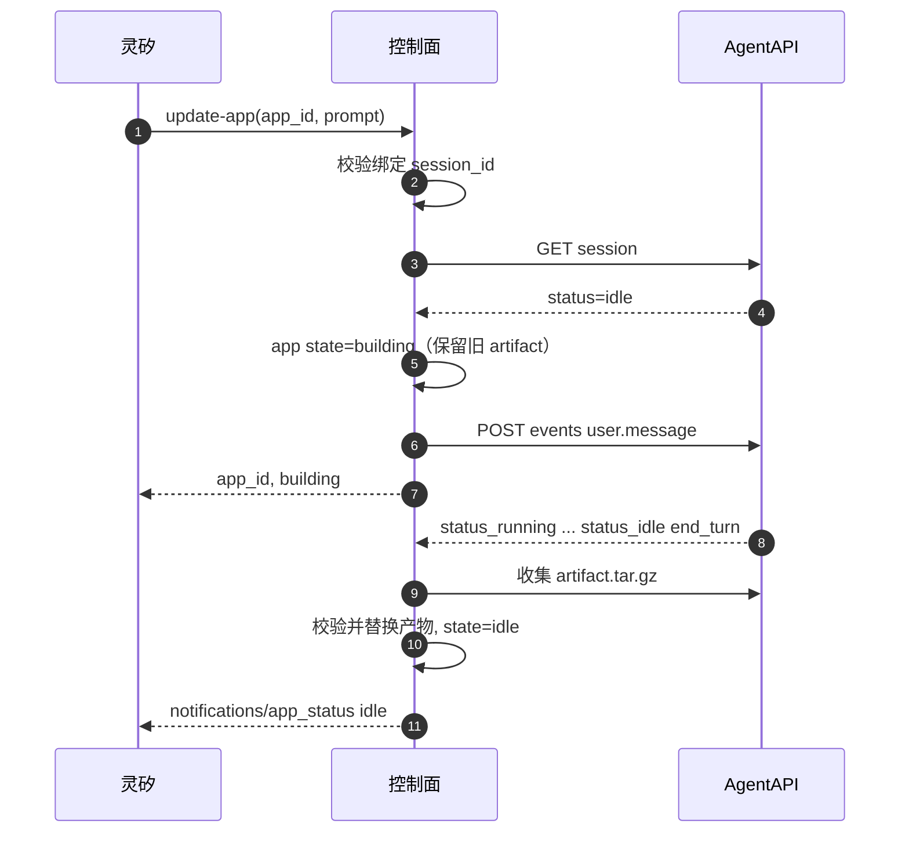

# 多应用并发构建与同会话更新

> 状态：Proposal（供 PR 评审）
> 版本：v0.2
> 日期：2026-10-25
> 关联：[应用管理 MCP](app-management-mcp.md)、[控制面与 AgentAPI 接口](gateway-agentapi-interface.md)、[系统架构](architecture.md)
> Issue：[＃69 同时多个应用 / agent session](https://github.com/open-anywhere/open-anywhere/issues/69)、[＃68 update-app](https://github.com/open-anywhere/open-anywhere/issues/68)
> AgentAPI 依据：仓库内 [agentapi-use](../.agents/skills/agentapi-use/SKILL.md) 离线镜像（会话、会话操作、事件、运行时）

## 1. 摘要

放开「同一设备 + 智能体同时只能有一个 `building` 应用」的限制。每次 `create-app` 都分配新的 `app_id`，并创建独立的 AgentAPI 构建会话。控制面在内部把 `app_id` 与 `session_id` 一对一绑定；灵矽始终只用 `app_id` 寻址。

新增 MCP 工具 `update-app`：在已有应用的绑定会话上再次提交 `user.message`，让编码智能体按补充需求改应用并产出新产物。运行中的业务操作仍走 `send-request`，不经过构建会话。

## 2. 目标与非目标

### 2.1 目标

- 同一设备与智能体可以并行创建多个应用，互不抢占彼此的构建会话。
- 每个应用在控制面持有稳定的 AgentAPI `session_id` 绑定，重启后可恢复监听与后续更新。
- 用户说「改一下这个应用」时，灵矽用 `update-app(app_id, prompt)` 走同一会话，而不是再 `create-app`。
- MCP 面仍只暴露 `app_id` / `screen_id`；`session_id`、Render、Casting 标识不外泄。

### 2.2 非目标

- 热更新正在投屏中的进程（不中断 `running` 就替换产物）。本期要求先 `stop-app` 再 `update-app`，或更新完成后再 `start-app`。
- 在构建进行中插队追加需求（不对 `building` 发第二条消息；不实现排队）。
- 多租户配额、按用户的并发上限计费。
- 把 `update-app` 做成业务操作入口；计分、下一题等仍用 `get-app-operations` + `send-request`。
- 会话归档或沙箱丢失后自动重建空会话冒充「同一会话」；绑定断开时明确失败，由用户重新 `create-app`（不把旧产物挂进新会话冒充续聊，那是后续能力）。
- 切换到 `native` 运行时以摆脱沙箱存续限制；本期构建智能体仍是 `claudecode`。

## 3. 概念与绑定模型

| 概念 | 含义 |
| --- | --- |
| `app_id` | 控制面业务标识，MCP 唯一寻址键 |
| AgentAPI `session_id` | 构建与修订用的沙箱会话，只存在于控制面 |
| 绑定 | 每个 `app_id` 最多对应一个未终止的 `session_id`；创建时写入，更新时复用 |
| 轮次（turn） | 一次 `user.message` 触发的 AgentAPI 执行；初次构建与每次 `update-app` 各算一轮 |

```text
灵矽  --MCP(app_id)-->  控制面  --HTTP(session_id)-->  AgentAPI
                              |
                              +-- 持久化：app_id ↔ session_id ↔ artifact
```

规则：

1. `create-app` 分配 `app_id`，创建 AgentAPI session，写入绑定后立即返回。
2. 同一 `app_id` 在整个生命周期内不更换绑定，除非会话已 `terminated` / 404 / 已归档且无法继续发消息。
3. 多个 `app_id` 可以同时处于 `building`，各自消费自己的事件流。
4. 灵矽用 `list-apps` / `get-app-status` 区分多个进行中的应用，不要假设「全局只有一个构建」。

## 4. `create-app`：并发创建

### 4.1 行为变更

| 项目 | 原行为 | 新行为 |
| --- | --- | --- |
| 同 owner 已有 `building` | 返回原 `app_id`，不新建 session | 每次调用新建 `app_id` 与 session |
| 幂等键 | owner 级「正在构建」 | 无 owner 级短路；同一 `app_id` 仍最多一个构建会话 |
| 历史淘汰 | `building` 不淘汰 | 不变；可同时保留多个 `building` |

控制面仍用进程内互斥串行化「分配 ID → 落库 → 启动构建」的临界区，避免并发 create 与 prune 竞态；互斥不限制后台 watch 并行。

### 4.2 灵矽侧约定

- 用户明确要做**另一个**应用时，再次调用 `create-app`。
- 已拿到某次 `create-app` 返回的 `app_id` 后，用 `get-app-status` / 通知跟踪该应用；不要为同一意图盲目重试 `create-app`（重试会多出一个应用）。
- 用户说「玩上次那个」时走 `list-apps` + `start-app`，不新建。

### 4.3 不变约束

- 一块屏幕同时只展示一个应用；`start-app` 的 `TARGET_BUSY` / `force` 语义不变。
- 一个应用同时只绑定一块屏幕。
- 全局历史仍约 10 个可淘汰槽位；`building` / `running` / 仍占下游资源的应用不淘汰。

## 5. `update-app`：同会话修订

### 5.1 工具定义

| 项 | 内容 |
| --- | --- |
| 名称 | `update-app` |
| 作用 | 向应用已绑定的 AgentAPI 会话提交补充需求，异步重建产物 |
| 输入 | `app_id`（必填）、`prompt`（必填，整理后的修改说明） |
| 输出 | `app_id`, `state: building` |

输入 schema：

```json
{
  "type": "object",
  "properties": {
    "app_id": {"type": "string", "minLength": 1},
    "prompt": {"type": "string", "minLength": 1}
  },
  "required": ["app_id", "prompt"],
  "additionalProperties": false
}
```

`prompt` 是灵矽整理后的修改意图（例如「题目改成动物主题，仍保持五题、三人」），不是原始 ASR。本期不接受 `player_names`；名单变更写进 `prompt`，或之后用应用 OpenAPI 调整运行时玩家。

建议工具 description 要点：

- 只用于**已有**应用的界面或规则重建；新应用用 `create-app`。
- 运行中的答题、计分等用 `send-request`，不要用本工具。
- 应用正在 `building` 时不要调用；`running` 时先 `stop-app`（或接受「更新只影响下次启动」的产品话术——本期实现要求先停再更，见 5.2）。
- 立即返回 `building`，进度与完成通知与 `create-app` 相同通道。

成功响应：

```json
{
  "app_id": "app_01J...",
  "state": "building"
}
```

### 5.2 允许的应用状态

| 当前状态 | `update-app` | 说明 |
| --- | --- | --- |
| `idle` | 允许 | 主路径：会话应仍为 AgentAPI `idle`，可接收下一轮 `user.message` |
| `running` | 拒绝 `APP_RUNNING` | 避免热替换；灵矽先 `stop-app` 再更新，或告知用户先结束本局 |
| `building` | 拒绝 `APP_BUILDING` | 本轮未结束不插队；完成后可再更新 |
| `error` 且仍有可启动产物、绑定会话仍可用 | 允许 | 例如启动失败后的应用；更新成功后回到 `idle` |
| `error` 且无产物或会话不可用 | 拒绝 `SESSION_UNAVAILABLE` 或 `APP_IN_ERROR` | 引导重新 `create-app` |

「会话可用」判定（对齐 AgentAPI 会话操作 / 事件文档）：

1. `GET /v1/sessions/{id}` 成功，且 `status=idle`。完成工作的会话进入 `idle`，不是 `terminated`；`terminated`（含归档）不能再收输入。
2. 404、已归档、`terminated` → `SESSION_UNAVAILABLE`。
3. `idle` 后 AgentAPI 会把沙箱标成待暂停（约 90–150 秒后处理），暂停保留沙箱文件与上下文；下一轮 `user.message` 会清除暂停并恢复同一沙箱、重设完整运行时长。会话状态在此期间仍是 `idle`，可以提交。
4. 构建智能体使用 `claudecode`：原沙箱一旦丢失，会话终止，**不会**仅凭事件历史重建沙箱 → `SESSION_UNAVAILABLE`，需重新 `create-app`。
5. `running` / `rescheduling` 时对 `claudecode` 再发 `user.message` 返回 `409`（agent busy）。因此应用处于 `building` 时禁止 `update-app` 既是产品选择，也是 AgentAPI 约束；竞态下若状态检查为 `idle` 但提交仍收到 `409`，映射为 `UPDATE_START_FAILED`，不改变已有可启动产物（若尚未把应用切到 `building` 则保持原状；已切入则按更新失败回滚到上一版 `idle`）。

### 5.3 控制面处理顺序

1. 校验归属与 `prompt`。
2. 按 5.2 检查状态；读取绑定的 `session_id`。
3. 确认 AgentAPI 会话可接收消息；否则返回 `SESSION_UNAVAILABLE`，不改应用状态。
4. **先**注册或复用该 `session_id` 的事件流消费者（AgentAPI 要求先订 SSE 再发消息；同一时刻同一 `session_id` 只有一个推进者）。
5. 将应用置为 `building`，刷新 `build_started_at` 与进度字段；**保留**上一版 `artifact` / OpenAPI，直到新产物校验成功。
6. `POST .../events` 提交 `user.message`（修订提示词，见 [gateway-agentapi-interface.md](gateway-agentapi-interface.md) 修订轮约定）。
7. 立即返回 `building`；后台按与初次构建相同的停止原因 / 产物收集逻辑处理（必须看 `stop_reason.type`，不能只凭 `idle`）。
8. 成功：替换产物与 OpenAPI，进入 `idle`，发送完成通知（文案区分「创建完成」与「更新完成」）。会话保持 `idle`，**不**归档。
9. 失败：若仍有上一版可启动产物，恢复 `idle` 并保留旧产物，通知中说明更新失败；若无上一版产物，进入 `error(stage=building)`。仅当会话已不可再用时归档。



### 5.4 与 `create-app` / `send-request` 的分工

| 用户意图 | 工具 |
| --- | --- |
| 做一个新东西 | `create-app` |
| 改已有应用的玩法 / 界面 / 规则（需重新生成） | `update-app` |
| 开始、答题、查分等已有 API | `send-request` |
| 换屏展示 | `stop-app` / `start-app` |

## 6. AgentAPI 侧要点

详细请求形状仍以 [gateway-agentapi-interface.md](gateway-agentapi-interface.md) 为准。下列条款与 agentapi-use 镜像一致：

| 主题 | AgentAPI 结论 | 对本设计的含义 |
| --- | --- | --- |
| 同任务续聊 | 补充/修订发 `user.message` 到原会话；无关任务开新会话 | `update-app` 复用绑定；`create-app` 总是新会话 |
| 成功后状态 | 做完工作进 `idle`，不是 `terminated` | 成功构建**不要**归档，否则无法 `update-app` |
| 归档 | 拒绝新事件，`status=terminated` | 失败/超时/设备清理才归档 → `SESSION_UNAVAILABLE` |
| 空闲沙箱 | `idle` 后待暂停 → 暂停保留文件；下轮输入恢复并重设时长 | `GET` 见 `idle` 即可提交，不必等「未暂停」 |
| `claudecode` 恢复 | 原沙箱丢失则会话终止，不能靠历史重建 | 长期空闲后更新可能失败，需重新 `create-app` |
| 运行中发消息 | `claudecode`/`codex` 返回 `409` agent busy | `building` 禁 `update-app`；竞态映射 `UPDATE_START_FAILED` |
| 消费顺序 | 先 SSE，再 `user.message`；旧 `idle` 不是本轮结束 | update 与 create 同一套 watch 规则 |
| 停止原因 | 必须读 `stop_reason.type` | `end_turn` 才收集产物 |
| 产物目录 | 交付写入 `/mnt/session/outputs/` | 每轮仍只认 `artifact.tar.gz`；多轮可能多文件对象，取最新可下载 |

本期增量实现注意：

- **多会话并行**：不同 `app_id` 各有 session 与 SSE 消费者；锁粒度是 `session_id` / `app_id`。
- **修订轮消息**：只含修改说明 + 固定收尾（完整交付 `artifact.tar.gz`）。不传屏幕、凭证、`session_id`。
- **沙箱寿命**：默认运行时长与 CLI 上限均为 1 小时；控制面构建超时 60 分钟；部署宜调高沙箱时长并为收集留余量（既有 AgentAPI 接口文档已写）。

## 7. 错误码（增量）

工具直接返回、默认不破坏已有可启动产物：

| `code` | 工具 | 场景 |
| --- | --- | --- |
| `APP_BUILDING` | `update-app` | 应用已在构建或修订中 |
| `APP_RUNNING` | `update-app` | 应用仍在运行，需先停止 |
| `APP_IN_ERROR` | `update-app` | 不可恢复的错误态且无可用会话/产物 |
| `SESSION_UNAVAILABLE` | `update-app` | 绑定会话缺失、已终止、已归档或无法接收消息 |
| `UPDATE_START_FAILED` | `update-app` | 会话存在但提交 `user.message` 失败 |
| `BUILD_START_FAILED` | `create-app` | 含义不变 |
| `INVALID_ARGUMENT` | `update-app` | `prompt` 为空等 |

## 8. 持久化与恢复

控制面为每个应用持久化至少：`app_id`、`session_id`、事件游标、状态、上一版产物元数据、`prompt`（最近一次创建或更新的文本可分开存「创建 prompt」与「最近 update prompt」，便于诊断）。

重启后：

- 所有 `building`（含更新中）按现有 Resume 逻辑恢复 watch。
- `idle` 且绑定仍在的应用可继续接受 `update-app`。
- 会话 404 / `terminated`：应用可保持 `idle`（若有产物），但 `update-app` 返回 `SESSION_UNAVAILABLE`。

## 9. 验收场景

1. 同一 owner 连续两次不同 `prompt` 的 `create-app`，得到两个 `app_id`，AgentAPI 上存在两个 session，均可独立完成并 `start-app` 到不同屏幕（若有两块屏）。
2. 应用 A `building` 时，应用 B 的 `create-app` 不返回 A 的 `app_id`。
3. 应用在 `idle` 时 `update-app`，状态进入 `building`，完成后产物与 OpenAPI 更新，`list-apps` / `get-app-operations` 反映新能力；绑定 `session_id` 不变。
4. `running` 时 `update-app` 返回 `APP_RUNNING`，应用状态不变。
5. `building` 时 `update-app` 返回 `APP_BUILDING`。
6. 会话已归档或 `terminated`（含 `claudecode` 沙箱丢失）后 `update-app` 返回 `SESSION_UNAVAILABLE`，旧产物若存在仍可 `start-app`。
7. 更新失败且曾有成功产物时，应用回到可 `start-app` 的 `idle`，仍是旧版。
8. `idle` 后隔一段时间再 `update-app`：若会话仍为 `idle`，应能恢复沙箱并完成修订（依赖 AgentAPI 暂停/恢复；实现阶段用真实环境验证）。

## 10. 文档与实现落点

| 落点 | 变更 |
| --- | --- |
| [app-management-mcp.md](app-management-mcp.md) | 工具表增加 `update-app`；改写 `create-app` 并发语义；错误码表增量 |
| [gateway-agentapi-interface.md](gateway-agentapi-interface.md) | 多会话并行；修订轮提交流程；去掉「MCP 重复 create-app 返回已有 building」 |
| [architecture.md](architecture.md) | 目标中补充多应用并行构建与同会话修订 |
| `internal/gateway/service` | 去掉 `FindBuilding` 短路；实现 `UpdateApp` |
| `internal/gateway/build` | 在已有 session 上提交一轮并 watch；保留旧产物直到新校验成功 |
| `internal/gateway/mcp` | 注册 `update-app` 与工具描述 |

实现前以本文与同步修订后的 MCP / AgentAPI 文档为准；产品话术见 [product.md](product.md) 中「需要重新构建的能力」分支。

## 11. 验证状态

| 项 | 状态 |
| --- | --- |
| P1 并发 `create-app`（去掉 `FindBuilding`） | 单测覆盖：同 owner 两次 create 得到两个 `app_id` |
| P2 Builder `Continue` + 保留旧产物失败回退 | 单测覆盖：`Continue` 成功更新通知「APP 更新完成」；busy/terminated；`fail` 保留旧包回 `idle` |
| P3 MCP `update-app` + Service 状态机 | 单测覆盖：idle/building/running/error/无会话/rollback |
| 验收场景 1–7 | 由上述单测覆盖 |
| 验收场景 8（长 idle 后真实沙箱恢复） | **未在真实 AgentAPI 上冒烟**；部署后需手工验证 |
| SQLite schema | 未改；绑定仍为 `apps.data.SessionID` |
