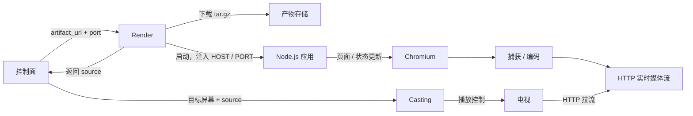

# Render 服务设计

> 状态：Proposal（设计约定，尚未实现）
> 日期：2026-10-24

Render 接收应用包下载地址和运行端口，下载并启动 Node.js 应用，用 Chromium 持续渲染页面，再将画面编码为可通过 HTTP 拉取的实时媒体流。控制面将该流交给独立的 Casting 服务播放。

应用包结构、`launch.json` 和构建要求见[应用包设计](app-artifact.md)；投屏控制接口见 [Casting 服务](casting.md)。本文定义 Render 的职责、接口及运行生命周期。

## 1. 职责与边界

| 组件 | 职责 |
| --- | --- |
| 控制面 | 选择 Render、确定应用端口、维护应用与实例映射，调用 Casting 将流投放到指定屏幕 |
| Render | 下载和校验应用包、管理应用进程、健康检查、Chromium 页面、捕获编码及媒体流服务 |
| 应用 | 提供 `/` 页面、`/health` 和 OpenAPI 描述的业务操作，维护业务状态 |
| Casting | 发现屏幕、建立和停止投屏会话，让屏幕拉取 Render 提供的媒体流 |

一期仅支持 Node.js。Render 不安装应用依赖、不编译 JSX、不执行构建任务，也不处理声纹、业务意图或游戏规则。Node.js、Chromium 和捕获编码所需组件由运行环境预先提供。

Render 启动请求不包含 `screen_id`、`target_id` 或投屏协议。Render 准备好媒体流后，由控制面选择屏幕并调用 Casting。



## 2. 启动应用

```http
POST /v1/apps
Content-Type: application/json
```

```json
{
  "artifact_url": "https://example.com/artifacts/quiz.tar.gz",
  "port": 39101
}
```

| 字段 | 必填 | 说明 |
| --- | --- | --- |
| `artifact_url` | 是 | Render 能直接下载的 HTTP(S) 应用包 URL，格式为 tar.gz；不是本地路径或页面地址 |
| `port` | 是 | 本次部署的应用监听端口，1–65535 的整数，由控制面确定并传入 |

一期固定这两个输入，不提供省略端口后的自动分配。URL 可以是带有效期的下载地址，有效期须覆盖下载过程。包内不包含部署端口，Render 也不修改 `launch.json`。

### 2.1 端口与实例

- 控制面可以先用 `GET /v1/ports` 查看已占用端口，再用 `GET /v1/ports/{port}` 检查候选端口，最后把选定的端口传入启动请求，详见 2.4。
- Render 为每次接受的启动请求分配 `instance_id`，用于查询和停止；控制面维护 `app_id → Render / instance_id` 的映射。
- Render 校验并预留自己管理的端口，防止并发启动重复使用。已有活动实例占用该端口时返回 `409 PORT_IN_USE`。
- 控制面之前观察到端口空闲，不代表进程启动时仍然空闲。最终以应用绑定端口是否成功为准；绑定失败不得把该端口上其他服务的健康响应当作本次启动成功。
- Render 不自动换端口。控制面收到冲突后可以选择其他端口，重新发起启动。
- 相同包允许启动多个独立实例，实例之间不共享内存状态。创建操作不按 URL 幂等；请求结果不明时，不应直接换端口重复创建。

### 2.2 启动步骤

1. 校验输入、预留端口、创建实例记录和独立工作目录。
2. 下载并解压应用包，确认 artifact 根目录直接包含 `launch.json`、`openapi.yaml` 和 `app/`。下载、解压有大小和时间限制；归档条目不得逃逸工作目录。
3. 校验启动契约和 OpenAPI，仅接受 `runtimeExecutable: "node"`；入口文件必须在包内。
4. 以 artifact 根目录为 cwd，按 `runtimeArgs` 参数数组启动 Node.js，注入 `HOST=0.0.0.0` 和请求中的 `PORT`。通过进程 API 执行，不拼接 shell 命令或 `--port` 参数。
5. 等待 `http://127.0.0.1:<port>/health` 返回 HTTP `200` 和 JSON `{"status":"ok"}`，并确认本次应用进程持续存活。就绪超时使用 `launch.json` 的 `readyTimeoutMs`，默认 10000 毫秒；运行端可设置上限。
6. 使用独立 Chromium 页面打开 `http://127.0.0.1:<port>/`，等待页面成功加载并取得可捕获的画面。不能用持续网络空闲作为唯一就绪条件，因为页面可能使用 SSE 或轮询。
7. 持续捕获页面、编码并提供 HTTP 媒体流。确认输出已经产生可用媒体数据后，实例进入 `ready`，启动请求返回成功。

下载、页面加载和媒体准备分别有运行端配置的超时，启动请求还受总超时约束；`readyTimeoutMs` 仅约束应用就绪检查。任一步失败都终止启动，并清理已创建的资源。

### 2.3 成功响应

启动请求同步等待 Render 准备完成，成功返回 `201 Created`，并设置 `Location: /v1/apps/<instance_id>`：

```json
{
  "instance_id": "instance-quiz-001",
  "state": "ready",
  "port": 39101,
  "app_base_url": "http://192.168.31.203:39101",
  "source": {
    "type": "stream",
    "url": "http://192.168.31.203:8765/streams/instance-quiz-001/live.ts",
    "format": "mpegts",
    "video_codec": "h264",
    "audio_codec": ""
  }
}
```

- `app_base_url` 是控制面可访问的应用 HTTP 地址，用于调用 `/api/*`；远程控制面不能使用 Render 自己的 `127.0.0.1`。部署环境必须提供可达地址及网络路径。
- `source.url` 是电视可访问的实时媒体地址，不是 UI URL，也不是应用包下载地址。
- 应用端口与媒体服务端口独立。示例中的 `8765` 是 Render 自身的媒体服务配置，不是创建应用时的第三个参数。
- `source` 可直接作为 Casting 创建投屏会话的 `source`。示例为纯视频，`audio_codec` 为空字符串；仅在实际包含 AAC 音轨时声明 `aac`。
- Render 的 `ready` 表示应用、页面和媒体输出已就绪，不表示电视已播放。控制面仍须等 Casting 确认 `playing`，才能对灵矽返回整体应用 `running`。

### 2.4 端口查询

两个接口查询的是 Render 所在主机上的 **TCP 端口**，以应用绑定 `0.0.0.0:<port>` 时是否冲突为判断范围，不是查询 HTTP 路由是否存在。需要同时考虑 Render 的实例预留记录和操作系统中的端口占用；不能只检查应用注册表。

**检查指定端口：**

```http
GET /v1/ports/39101
```

端口空闲时返回 `200`：

```json
{
  "port": 39101,
  "occupied": false,
  "owner": null
}
```

已被 Render 管理的应用预留或使用时，同样返回 `200`：

```json
{
  "port": 39101,
  "occupied": true,
  "owner": "app",
  "instance_id": "instance-quiz-001"
}
```

`owner` 取值为 `app`（Render 管理的应用实例）、`render`（Render 自身的 API 或媒体服务）、`external`（其他程序）或空闲时的 `null`。只有 `app` 返回 `instance_id`；不暴露其他程序的进程详情。

**列出当前占用端口：**

```http
GET /v1/ports
```

返回 `200`，列表按端口升序排列，仅包含已占用项：

```json
{
  "ports": [
    {
      "port": 8765,
      "occupied": true,
      "owner": "render"
    },
    {
      "port": 39101,
      "occupied": true,
      "owner": "app",
      "instance_id": "instance-quiz-001"
    },
    {
      "port": 39102,
      "occupied": true,
      "owner": "external"
    }
  ]
}
```

列表合并 Render 的预留记录和系统中可检测到的 TCP 占用，按端口去重。应用尚在启动、正在停止或清理失败但资源未释放时，预留端口也属于 `occupied: true`。不能因为尚未监听或进程刚退出就提前将它标为空闲。

操作系统占用枚举需要适配部署平台；若检查失败或权限不足，返回 `503 PORT_INSPECTION_FAILED`，不能用空列表或 `occupied: false` 代替未知结果。系统枚举仍可能存在时差或漏掉尚未监听的绑定，因此列表用于筛选，指定端口查询还须结合实际绑定探测；探测失败且无法确认为占用时也返回检查错误。

查询不预留端口，也不保证随后启动成功。控制面选好端口后仍通过 `POST /v1/apps` 提交；Render 在启动时处理并发预留及实际绑定，冲突返回 `409 PORT_IN_USE`。控制面不应终止其他程序以抢占端口。

## 3. 状态查询与停止

服务接口汇总：

| 方法 | 路径 | 作用 |
| --- | --- | --- |
| `GET` | `/v1/ports` | 列出当前已占用的 TCP 端口，包括预留端口和其他程序占用 |
| `GET` | `/v1/ports/{port}` | 检查指定 TCP 端口是否被占用及占用来源 |
| `POST` | `/v1/apps` | 下载应用包并启动应用、页面和媒体输出 |
| `GET` | `/v1/apps/{instance_id}` | 查询实例当前状态 |
| `DELETE` | `/v1/apps/{instance_id}` | 停止实例并清理资源 |
| `GET` | `/healthz` | Render 服务自身健康检查；与应用的 `/health` 区分 |

实例状态属于 Render 内部运行契约，不改变架构文档中面向灵矽的应用状态：

| 状态 | 含义 |
| --- | --- |
| `starting` | 下载、应用启动、页面加载或媒体准备中 |
| `ready` | 应用健康，页面与媒体输出正常 |
| `error` | 启动或持续运行失败，携带结构化错误 |
| `stopping` | 正在关闭资源，端口尚未释放 |
| `stopped` | 所有实例资源已释放 |

`GET` 返回 `200`；`ready` 响应与启动成功的实例结构一致。`starting`、`stopping` 和 `stopped` 返回 `instance_id`、`state`、`port`，不提供可用 `source`。失败示例：

```json
{
  "instance_id": "instance-quiz-001",
  "state": "error",
  "port": 39101,
  "error": {
    "stage": "running",
    "code": "APP_EXITED",
    "message": "应用进程已退出"
  }
}
```

Render 持续监测应用进程、应用健康、浏览器和媒体输出。确认失效后标记 `error`，撤下可用流并清理该实例的资源；一期不自动重启，以免在用户不知情时重置应用内存状态。控制面查询到运行错误后，更新整体应用状态并停止关联的投屏会话。

`DELETE` 等待清理完成后返回 `200`：

```json
{
  "instance_id": "instance-quiz-001",
  "state": "stopped",
  "port": 39101
}
```

停止流程关闭媒体输出和浏览器页面，向应用发送 `SIGTERM`；超过退出宽限期后强制结束进程。确认进程、连接和媒体任务结束后，释放端口与临时工作目录。清理失败时保留记录及资源占用，返回错误，允许重试 `DELETE`。

对已知的 `stopped` 实例重复停止返回相同结果；未知实例返回 `404`。一期实例记录保存在内存中，服务重启后不承诺恢复，正常关闭服务时应清理所有子进程和媒体任务。

Render 停止不会自动调用 Casting。控制面正常停止应用时应先停止关联投屏，再停止 Render 实例，避免电视持续拉取已关闭的流。

## 4. 错误约定

错误响应统一包含 `error.stage`、`error.code` 和 `error.message`；已分配实例时附带顶层 `instance_id`，便于查询和清理。阶段沿用 `starting`、`running`，不增加 `projection` 阶段。

端口查询尚未进入应用生命周期，其错误仅包含 `error.code` 和 `error.message`，不附带 `stage`。端口参数必须为 1–65535 的整数；非法参数返回 `400 INVALID_REQUEST`。

| 场景 | HTTP 状态 | code 示例 |
| --- | --- | --- |
| URL、端口或 JSON 输入非法 | `400` | `INVALID_REQUEST` |
| 查询或停止未知实例 | `404` | `INSTANCE_NOT_FOUND` |
| 端口已占用 | `409` | `PORT_IN_USE` |
| 端口查询或系统占用枚举失败 | `503` | `PORT_INSPECTION_FAILED` |
| 产物结构、OpenAPI 或运行时不符合约定 | `422` | `INVALID_ARTIFACT` |
| 应用下载失败 | `502` | `ARTIFACT_DOWNLOAD_FAILED` |
| 进程启动、健康检查或页面加载失败 | `502` | `APP_START_FAILED`、`APP_HEALTH_FAILED`、`PAGE_LOAD_FAILED` |
| 捕获或编码启动失败 | `502` | `STREAM_START_FAILED` |
| 下载、应用就绪或媒体准备超时 | `504` | `START_TIMEOUT` |
| 停止时资源清理失败 | `500` | `STOP_FAILED` |

持续运行中的 `APP_EXITED`、`APP_UNHEALTHY`、`BROWSER_EXITED`、`STREAM_FAILED` 通过实例的 `error` 状态表达。查询成功仍返回 `200`，由响应中的实例状态说明业务失败。

## 5. 页面与媒体输出

Chromium 负责运行页面，捕获编码组件负责把画面转换为 MPEG-TS/H.264；仅打开 Chromium 并不会自动得到视频流。分辨率、帧率、编码器和媒体监听地址是 Render 部署配置，一期不加入启动请求。

运行端需选定并验证目标系统可用的捕获方案，例如独立浏览器窗口配合屏幕捕获和 FFmpeg。具体捕获实现尚待验证；不能把页面截图接口视为已经支持稳定音视频串流。若捕获窗口，必须确保采集目标是应用页面，不是整个用户桌面。

媒体地址须支持电视持续拉取以及播放过程中重新连接。新连接需要得到可解码的流起点，编码输出应包含周期性关键帧和必要的 MPEG-TS 信息。启动时即使还没有电视连接，Render 也应能够确认媒体输出已准备好。

一期可先提供纯视频；需要页面声音时，额外实现音频捕获、AAC 编码和音画同步后再声明 AAC。实际电视的编码兼容性、缓冲延迟和播放恢复需要实机验证。

业务状态更新仍通过应用的 HTTP API 完成：控制面调用应用，应用用 SSE 或轮询更新页面，Chromium 呈现新画面，媒体流持续输出。Render 无须理解“答题”“加分”等操作。

## 6. 验收场景

1. 提供符合应用包契约的 Node.js tar.gz URL 和空闲端口，Render 返回 `ready`、应用地址及可拉取媒体流。
2. 外部 HTTP 客户端调用应用业务操作，Chromium 中已打开的页面自动更新，投屏画面能观察到变化。
3. 缺失 `/health`、入口文件或合法 OpenAPI 时启动失败，不能返回 `ready`。
4. 同端口并发启动只有一个实例能占用；端口已被其他程序占用时，不把其他程序误认成新应用。
5. 应用退出、浏览器退出或编码中断后，实例进入 `error`；控制面能够据此处理整体应用失败。
6. 停止后相关进程、流连接和端口被释放；重复停止已知实例成功；清理失败可以重试。
7. 将返回的 `source` 交给现有 Casting 服务，使用真实屏幕验证拉流和播放；Render 的 `ready` 与 Casting 的 `playing` 分别检查。
8. 端口查询和列表能够区分空闲、应用预留、Render 自身服务及其他程序占用；清理完成后应用预留从列表消失，检查失败时返回错误而非误报空闲。
9. 查询空闲后被其他程序抢先绑定，启动仍返回端口冲突，控制面可另选端口重试。

本文定义预期行为，不代表 Render、Chromium 捕获或上述接口已经实现。
