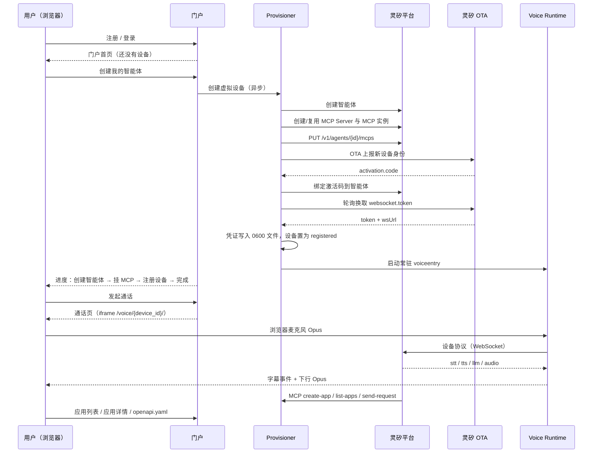
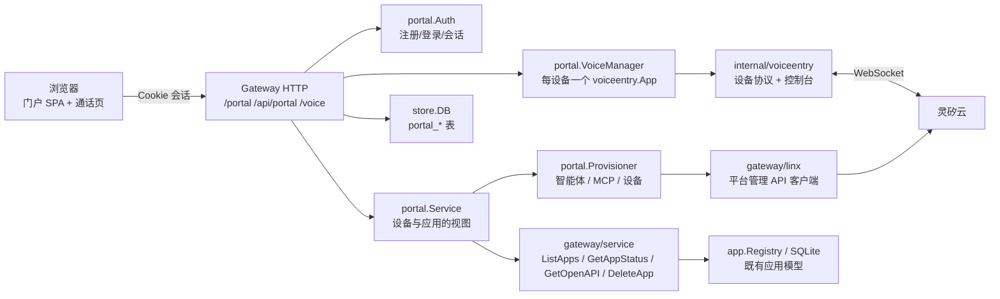

# 用户管理端设计

> 状态：Proposal（供评审）
> 版本：v0.1
> 日期：2026-10-25
> 相关文档：[架构设计](architecture.md)、[控制面数据库设计](gateway-database.md)、[现场语音入口](voice-entry.md)、[应用管理 MCP](app-management-mcp.md)

## 1. 背景与目标

现在的控制面只对灵矽云暴露 MCP。用户要使用产品，必须先在一台真实或模拟的灵矽设备上完成 OTA、拿激活码、到灵矽控制台绑定智能体，再手工给智能体挂载做应用的 MCP。设备、智能体和 MCP 的创建与绑定都发生在产品之外，用户看不到自己做过哪些应用，也无法在网页上直接和智能体通话。

本期增加一个与 Gateway 同进程的用户管理端（下称“门户”），把这段准备工作和日常使用收进产品：

- 用户注册、登录后，点一次「创建我的智能体」，平台自动完成：创建灵矽智能体 → 挂载应用管理 MCP → 生成虚拟设备身份 → OTA 上报 → 自动绑定激活码 → 取得设备凭证。
- 绑定完成后，用户直接在门户页面里发起通话：麦克风、扬声器由浏览器 WebCodecs 承担，Gateway 进程内为该用户运行一个 `voiceentry` 实例。
- 门户展示该用户所有设备与智能体下的应用，包括构建进度、操作列表和每个应用的 `openapi.yaml`。
- 应用仍然按 `(device_id, agent_id)` 隔离；本期默认一个用户一台虚拟设备，数据模型按一对多设计，为真实硬件预留。

### 1.1 目标

1. 用户零输入完成智能体与设备开通，不需要接触灵矽控制台、API Key 或激活码。
2. 用户在自己的页面里完成“创建智能体 → 发起通话 → 说话创建应用 → 查看应用”的闭环。
3. 不同用户的应用、设备凭证、通话会话严格隔离。
4. 门户与 Gateway 同进程、同端口、同 SQLite，部署只多一份配置，不多一个服务。
5. 复用现有 `service`、`app.Registry`、`artifact.Store`、MCP 工具和 `internal/voiceentry`，不另起一套应用模型。

### 1.2 非目标

- 计费、套餐、配额、应用市场。
- 管理员后台、用户列表、跨用户排障界面。
- 应用启动/停止按钮（本期只做列表、进度、OpenAPI 与删除；启动仍由灵矽语音侧调用 MCP 完成）。
- 真实灵矽硬件的完整接入（本期实现虚拟设备，保留 `kind=physical` 与绑定接口）。
- 多副本部署；一个 SQLite 仍然只对应一个 Gateway 进程。
- 账号注销与资源回收（作为后续项，见 12.4）。

## 2. 角色与术语

| 术语 | 含义 |
| --- | --- |
| 门户用户 | 在门户注册的自然人账号，用用户名 + 密码登录 |
| 平台账号 | 产品在灵矽平台上的统一账号；Gateway 配置一个管理端 API Key，用它创建智能体和 MCP |
| 虚拟设备 | 由 Gateway 生成 MAC 与 Client-Id、通过 OTA 自动注册的软件设备；凭证只保存在服务端 |
| 真实设备 | 用户手里的灵矽硬件；本期只预留数据模型与绑定入口 |
| 灵矽智能体 | 平台账号下的 Agent，创建后绑定平台 MCP 与一台设备 |
| MCP 实例 | 平台账号下订阅的“应用管理 MCP”，指向 Gateway 的 SSE 端点 |
| 应用 | Agent 通过 `create-app` 构建出的 Web 应用，归属由 `(MAC, agent_id)` 决定 |
| 通话 | 虚拟设备与灵矽云的 WebSocket 会话 + 浏览器的 Opus 上下行 |

## 3. 用户交互流程

### 3.1 首次使用



### 3.2 门户页面状态

| 状态 | 页面 | 用户可做 |
| --- | --- | --- |
| 未登录 | 登录/注册 | 登录、注册 |
| 已登录、无设备 | 首页引导 | 「创建我的智能体」 |
| 设备 provisioning | 首页进度卡 | 查看步骤；失败后可重试 |
| 设备 registered | 首页 | 「发起通话」、应用列表 |
| 设备 error | 首页错误卡 | 查看原因、重试；必要时联系维护者 |
| 应用 building | 应用列表/详情 | 查看构建进度，不能删除 |
| 应用 idle/error | 应用列表/详情 | 查看详情、OpenAPI、删除 |
| 应用 running | 应用列表/详情 | 查看详情、OpenAPI；不可删除 |

### 3.3 失败态

| 失败点 | 表现 | 处理 |
| --- | --- | --- |
| 平台 API 未配置或鉴权失败 | 设备停在 provisioning，错误码 `LINX_AUTH` | 管理员修配置；用户可以重试 |
| 创建智能体失败 | `step=create_agent`，展示平台 `msg` | 重试；已创建的智能体会被复用（若已落库）或留下孤儿（见 12.2） |
| MCP 挂载失败 | `step=attach_mcp` | 重试；MCP 实例在平台账号下复用，不会重复创建 |
| OTA 没有返回激活码 | `step=ota` | 重试；同一设备身份会被复用 |
| 绑定失败（非 409） | `step=bind` | 展示原因并重试；激活码过期时重新 OTA |
| 轮询 token 超时 | `step=token`，设备 `error` | 重试会重新上报；平台侧已绑定则直接拿到 token |
| 语音连接断开 | `voice.connected=false` | `voiceentry` 自动退避重连；页面显示“重连中” |

## 4. 总体架构



### 4.1 新增模块

| 模块 | 位置（计划） | 职责 |
| --- | --- | --- |
| 门户 HTTP 与页面 | `internal/gateway/portal` | 路由、鉴权中间件、单页 HTML、JSON API |
| 账号与会话 | `internal/gateway/portal/auth.go` | PBKDF2 密码、Cookie 会话、登录限流 |
| 资源编排 | `internal/gateway/portal/provision.go` | 创建智能体、MCP、虚拟设备与绑定 |
| 平台客户端 | `internal/gateway/linx` | 带 Bearer 的平台管理 API、OTA 上报与 token 轮询 |
| 语音运行时管理 | `internal/gateway/portal/voice.go` | 每台虚拟设备的 `voiceentry.App` 生命周期 |
| 门户持久化 | `internal/gateway/store/portal.go` | `portal_users` / `portal_sessions` / `portal_devices` / `portal_settings` |

### 4.2 复用与改造

| 现有能力 | 复用方式 |
| --- | --- |
| `service.ListApps` | 按每台设备的 `(MAC, agent_id)` 列出应用（`history.go:47`） |
| `service.GetAppStatus` / `GetAppOperations` / `GetOpenAPI` | 应用详情与 OpenAPI 文档（`service.go:322/333/1027`） |
| `app.Identity.SameOwner` | 所有应用与通知的归属判断 |
| `app.Registry`、`artifact.Store`、SQLite | 删除应用时调用 `Registry.Remove` 与 `ArtifactStore.Remove` |
| `internal/voiceentry` | 进程内运行，新增挂载点与 `Register` 导出方法 |
| `mcp.Server` 的 `X-Linx-*` 身份 | 虚拟设备的 MAC 与智能体 ID 正好是应用归属键 |
| 配置解析 | 追加 `portal.*` 与 `linx.*`，沿用 flag > env > YAML > 默认值 |

## 5. 数据模型

### 5.1 表结构（schemaVersion 2）

门户表全部是新增表，不修改 `apps` 与 `artifacts`。`store.Open` 继续使用 `CREATE ... IF NOT EXISTS`，把 `PRAGMA user_version` 从 1 升到 2。实现 Phase A 时必须同步更新 [控制面数据库设计](gateway-database.md) 的第 15 节与版本说明，最终以代码为准。

```sql
CREATE TABLE IF NOT EXISTS portal_users (
    id            TEXT PRIMARY KEY,
    username      TEXT NOT NULL UNIQUE,
    password_hash TEXT NOT NULL,
    created_at    TEXT NOT NULL,
    updated_at    TEXT NOT NULL
);

CREATE TABLE IF NOT EXISTS portal_sessions (
    token_hash   TEXT PRIMARY KEY,
    user_id      TEXT NOT NULL,
    created_at   TEXT NOT NULL,
    expires_at   TEXT NOT NULL,
    last_seen_at TEXT NOT NULL,
    user_agent   TEXT NOT NULL DEFAULT '',
    FOREIGN KEY (user_id) REFERENCES portal_users(id) ON DELETE CASCADE
);
CREATE INDEX IF NOT EXISTS portal_sessions_user ON portal_sessions(user_id);

CREATE TABLE IF NOT EXISTS portal_devices (
    id              TEXT PRIMARY KEY,
    user_id         TEXT NOT NULL,
    kind            TEXT NOT NULL,             -- virtual | physical
    mac             TEXT NOT NULL UNIQUE,
    client_id       TEXT NOT NULL,
    linx_agent_id   TEXT NOT NULL DEFAULT '',
    agent_name      TEXT NOT NULL DEFAULT '',
    state           TEXT NOT NULL,             -- provisioning | registered | error | disabled
    step            TEXT NOT NULL DEFAULT '',  -- create_agent | attach_mcp | ota | bind | token | done
    error           TEXT NOT NULL DEFAULT '',
    credential_path TEXT NOT NULL DEFAULT '',
    created_at      TEXT NOT NULL,
    updated_at      TEXT NOT NULL,
    registered_at   TEXT,
    FOREIGN KEY (user_id) REFERENCES portal_users(id) ON DELETE CASCADE
);
CREATE INDEX IF NOT EXISTS portal_devices_user ON portal_devices(user_id, created_at);

CREATE TABLE IF NOT EXISTS portal_settings (
    key        TEXT PRIMARY KEY,
    value      TEXT NOT NULL,
    updated_at TEXT NOT NULL
);
```

要点：

- `portal_devices.mac` 唯一。生成时使用本地管理位单播 MAC（`02:` 开头），碰撞概率可忽略，数据库唯一约束兜底。
- `linx_agent_id` 一旦写入就不再改变；重试复用同一个智能体。
- `credential_path` 是相对 `portal.data_dir` 的文件名，不是 token 本身。凭证文件权限 `0600`，目录 `0700`。
- `state` 与 `step` 分开：`state` 面向页面，`step` 面向重试与排障。
- 真实设备使用同一张表，`kind=physical`、`credential_path` 为空；不使用服务端语音运行时。

### 5.2 应用归属

应用表保持不变：`apps` 的 `owner_device_id` 存 MAC，`owner_agent_id` 仍在 `data` JSON 里，没有独立列。门户不需要新的查询路径：

1. 取当前用户的全部 `portal_devices`；
2. 对每台设备构造 `app.Identity{DeviceID: mac, AgentID: linx_agent_id}`；
3. 调用 `service.ListApps`，按 `BuiltAt` 归并排序。

这样与灵矽 MCP 侧的归属判断完全一致，不需要改 `apps` 表，也不存在“门户能看见但灵矽看不见”的应用。

## 6. 灵矽资源编排

### 6.1 平台统一账号

Gateway 配置一个平台账号的 API Key。所有创建智能体、创建 MCP、绑定设备的请求都使用它：

```http
Authorization: Bearer <linx.api_key>
```

API Key 只从配置读取，不写入数据库、不返回门户、不打印日志。平台业务错误通常是 HTTP 200 + `code != 0`，客户端必须同时检查 HTTP 状态与 `code`。

### 6.2 MCP 的创建与复用

应用管理 MCP 对整个平台账号只需要一个 Server 和一个实例。首次需要时执行：

1. `GET /v1/mcp-store/servers`，按名称 `linx.mcp_name` 与 `config_schema.sse.url == linx.public_mcp_url` 查找。
2. 不存在则 `POST /v1/mcp-store/servers`：

```json
{
  "name": "Open Anywhere",
  "is_private": true,
  "desc": "Open Anywhere 应用管理 MCP",
  "config_schema": {
    "types": ["sse"],
    "sse": {
      "type": 0,
      "url": "https://<gateway>/sse",
      "shared_key": false,
      "params": {},
      "header": {"Authorization": "Bearer <mcp_token>"},
      "reset_header_default_value": []
    }
  }
}
```

3. `GET /v1/mcps`，按 `mcp_id` 查找已有实例；不存在则 `POST /v1/mcps`，`config` 与上一步的 `sse` 相同。
4. 把 `server_id` 与 `mcp_instance_id` 写入 `portal_settings`（`linx.mcp_server_id`、`linx.mcp_instance_id`）。

并发保护：同一个 Provisioner 内用互斥锁串行执行；两个请求同时触发时，第二次先查到已写入的 settings 或平台返回的“同名已存在”（`code=614`）后重新列出。

`linx.public_mcp_url` 必须能被灵矽云访问。SSE 端点使用现有的 `GET /sse` + `POST /mcp/message`；`mcp_token` 同时作为 Bearer 校验与 MCP 配置头。

### 6.3 创建智能体

```http
POST /xiaozhi/agent
```

```json
{
  "agentName": "Open Anywhere · <username>",
  "assistantName": "小灵",
  "systemPrompt": "<docs/agent-system-prompts/open-anywhere-host.txt>",
  "llmModelId": "f3626c105383d71654a57f2bb8a973f3",
  "memModelId": "Memory_nomem",
  "intentModelId": "Intent_function_call"
}
```

响应 `data` 是 32 位智能体 ID。拿到后立即写入 `portal_devices.linx_agent_id`，再进入下一步。`systemPrompt` 通过 `//go:embed` 打进二进制，避免部署时依赖仓库路径；配置项 `linx.system_prompt_file` 可覆盖。

### 6.4 挂载 MCP

```http
PUT /v1/agents/{agent_id}/mcps
```

```json
{"mcp_ids": ["<linx.mcp_instance_id>"]}
```

这是全量替换。新建智能体只有这一个 MCP，直接写入即可；将来若增加其他 MCP，需要先读取现有列表再合并。

### 6.5 虚拟设备注册

设备身份在进入 OTA 之前生成并持久化，保证重试复用同一身份：

1. 生成 `mac`（`02:XX:...`）与 `client_id`（UUID v4），写入 `portal_devices`。
2. OTA 上报：

```http
POST <linx.ota_url>
Device-Id: <mac>
Client-Id: <client_id>
Activation-Version: 1
Content-Type: application/json
```

请求体沿用 `internal/voiceentry/linx` 的格式（`version`、`uuid`、`application`、`board`、`mac_address`、`chip_model_name`）。响应二选一：

```json
{"activation": {"code": "123456"}}
```

```json
{"websocket": {"url": "ws://...", "token": "..."}}
```

3. 未绑定且拿到激活码时，绑定到智能体：

```http
POST /xiaozhi/device/bind/{agent_id}/{code}
Authorization: Bearer <linx.api_key>
```

`409 设备已被绑定` 视为成功，继续轮询。其他错误按 11.3 处理。

4. 轮询 OTA（默认每 2 秒、最多 10 次）直到响应带 `websocket.token`。把 `mac/clientId/wsUrl/token` 写入 `<portal.data_dir>/devices/<device_id>.json`：先写临时文件，`fsync` 后 `rename`，权限 `0600`。
5. 更新设备为 `state=registered`、`step=done`，记录 `registered_at`，启动该设备的语音运行时。

### 6.6 幂等与恢复

| 步骤 | 重试行为 |
| --- | --- |
| 创建智能体 | `linx_agent_id` 已有则跳过；没有则重新创建（存在留下孤儿的窗口，见 12.2） |
| 创建 MCP Server/实例 | 先查 settings，再查平台列表；`code=614` 视为已存在并重新查找 |
| 挂载 MCP | 全量替换，天然幂等 |
| 生成身份 | 已有 MAC/Client-Id 则复用 |
| OTA 上报 | 同一身份重复上报安全；已绑定会直接返回 token |
| 绑定激活码 | `409` 视为已绑定；激活码失效则重新 OTA 取新码 |
| 保存凭证 | 写入临时文件后原子替换；文件已存在且可解析时可直接进入已注册 |

Gateway 启动时扫描 `portal_devices`：`registered` 且凭证文件可读的设备直接启动语音运行时；`provisioning` / `error` 的设备保持原状，只由用户点击「重试」触发一次编排，不做后台自动重试，避免平台侧故障时形成重试风暴。

### 6.7 真实硬件路径（预留给下一期）

数据模型已经支持 `kind=physical`，设备绑定只差一个入口：

- 用户在门户输入设备屏幕上的 6 位激活码，或输入已绑定设备的 MAC；
- Gateway 调用 `POST /xiaozhi/device/bind/{agent_id}/{code}`，不进行 OTA，也不保存 token（token 由硬件自己持有）；
- 语音运行时跳过该设备，通话由硬件自身完成；
- 应用归属仍是 `(MAC, agent_id)`，门户可以直接列出该设备的应用。

本期不实现该入口，只保证表结构、归属查询与页面不假设“设备一定是虚拟的”。

## 7. 虚拟设备与通话

### 7.1 voiceentry 成为 Gateway 的一部分

`internal/voiceentry` 仍是同一个包，`cmd/voiceentry` 保留为本地调试二进制；Gateway 直接把它当库使用，不再需要单独启动一个进程或端口。

需要的少量改造：

| 改造 | 目的 |
| --- | --- |
| 从 `Run` 中拆出 `setupServe()` | 只初始化 Web Audio、注册处理器和连接控制，不强制监听端口 |
| `Config.NoListen` | 由 Gateway 直接挂载 Handler，不占 TCP 端口 |
| 导出 `Handler() http.Handler` | 返回 `controlapi.Server.Handler()`，交给网关路由 |
| 导出 `Register(ctx, register.Request)` | 编排完成后在进程内触发注册，不必绕 HTTP |
| 导出 `Status()` | 门户读取 `state/connected/session_id`，不暴露 token |

### 7.2 生命周期

- **启动时机**：设备注册完成后立即启动；Gateway 重启后为所有 `registered` 设备重建。常驻，与真实硬件“一直在线”的语义一致。
- **并发**：Manager 以 `device_id` 为键，一台设备最多一个 `*voiceentry.App`；重复启动返回已有实例。
- **停止**：只在 Gateway 退出时统一取消 context。标签页关闭、用户登出都不停设备，避免灵矽侧反复上下线。
- **失败**：`App.Run` 返回错误时记录日志并把设备标记为 `voice_unavailable`（内存态，不写数据库）；下次访问或定时器可再次启动。连接层自身的退避重连继续由 `voiceentry` 负责。
- **资源**：每设备一个 WebSocket、若干 goroutine 和浏览器连接，量级与真实设备相同；本期不设上限，部署时按内存评估。

### 7.3 路由与鉴权

```text
GET  /portal/                         门户单页
GET  /api/portal/...                  门户 JSON API（Cookie 会话）
*    /voice/{device_id}/...           该设备的控制台、SSE、HTTP、WebSocket
```

`/voice/{device_id}/` 的处理链：

1. `portal.Auth` 校验会话 Cookie；
2. 查 `portal_devices`，要求 `user_id == 当前用户`、`kind == virtual`、`state == registered`；
3. `http.StripPrefix("/voice/"+deviceID, app.Handler())`。

控制 API 自带的 `sameOriginOnly` 在网关内挂载后仍然有效：浏览器的 `Origin` 与 `r.Host` 都是门户域名。WebSocket 握手同样携带 Cookie，因此不需要额外的 token。

### 7.4 浏览器音频

- 上行：`WebCodecs AudioEncoder` 编 Opus（16 kHz、单声道、60 ms），通过 `WS /voice/{id}/audio?codec=opus` 发给设备会话。
- 下行：设备收到的 Opus 原样通过 `WS /voice/{id}/playback` 推给浏览器，`AudioDecoder` 解码播放。
- 麦克风要求安全上下文：`https://` 或 `http://localhost`。局域网 IP 的 `http://192.168.x.x` 无法调用 `getUserMedia`，部署时必须用 HTTPS 或本机访问。
- iframe 需要 `allow="microphone; autoplay"`；控制台里的麦克风按钮同时是浏览器要求的用户手势。
- 控制台页面改为从 `location.pathname` 推导 base（`const BASE = location.pathname.replace(/\/+$/, '')`），所有 `fetch`、`EventSource`、WebSocket 都拼接 `BASE`。独立运行在 `/` 时 `BASE` 为空，行为不变。

### 7.5 通话页交互

门户的「发起通话」进入通话视图，内嵌 `<iframe src="/voice/{device_id}/">`。控制台保留现有的事件流、暂停/继续、打断、断开重连；门户只负责入口、设备状态和返回应用列表。

为了让嵌入不显得突兀，控制台增加 `?embed=1`：隐藏顶部标题与时钟、缩小内边距；其余功能不变。此项不影响 `cmd/voiceentry` 的独立使用。

## 8. 门户页面与 API

### 8.1 页面

单文件 `portal.html`，`//go:embed` 进二进制，内联 CSS/JS，不引第三方前端依赖；用 hash 路由在四个视图间切换：

| 路由 | 视图 |
| --- | --- |
| `#/login` | 登录/注册 |
| `#/` | 首页：设备卡片、通话入口、应用网格 |
| `#/apps/{app_id}` | 应用详情：状态、构建进度、操作、OpenAPI、删除 |
| `#/call` | 通话页（iframe） |

视觉沿用 `controlapi/console.html` 的深色面板风格，但使用门户自己的配色与文案，避免把调试台当成产品界面。

### 8.2 JSON API

所有 `/api/portal/*` 除注册/登录外都要求会话 Cookie。写请求要求 `Content-Type: application/json` 并通过同源检查；响应统一 `application/json`，错误体为 `{"error":{"code":"...","message":"..."}}`。

| 方法 | 路径 | 说明 |
| --- | --- | --- |
| `POST` | `/api/portal/register` | `{username,password}`，成功即登录 |
| `POST` | `/api/portal/login` | `{username,password}` |
| `POST` | `/api/portal/logout` | 删除会话与 Cookie |
| `GET` | `/api/portal/me` | 当前用户与设备列表 |
| `POST` | `/api/portal/devices` | 创建虚拟设备并启动编排，返回 `202` |
| `GET` | `/api/portal/devices/{id}` | 设备状态、步骤、语音连接状态 |
| `POST` | `/api/portal/devices/{id}/retry` | 从当前步骤继续编排 |
| `GET` | `/api/portal/apps` | 当前用户全部应用（跨设备归并） |
| `GET` | `/api/portal/apps/{id}` | 应用详情与操作列表 |
| `GET` | `/api/portal/apps/{id}/openapi.yaml` | OpenAPI 文档，`text/yaml` |
| `DELETE` | `/api/portal/apps/{id}` | 删除应用与产物 |

示例：创建设备返回 `202`：

```json
{
  "device": {
    "id": "dev_...",
    "kind": "virtual",
    "mac": "02:4F:41:A2:F1:66",
    "agent_id": "",
    "state": "provisioning",
    "step": "create_agent",
    "error": ""
  }
}
```

示例：设备完成：

```json
{
  "device": {
    "id": "dev_...",
    "kind": "virtual",
    "mac": "02:4F:41:A2:F1:66",
    "agent_id": "6f99512f6b55429f8d2e3ddd0bcbe23f",
    "agent_name": "Open Anywhere · alice",
    "state": "registered",
    "step": "done",
    "registered_at": "2026-10-25T10:00:00Z",
    "voice": {"state": "listening", "connected": true}
  }
}
```

设备状态接口永远不返回 `token` 与凭证文件路径；`client_id` 可以展示，便于排障。

### 8.3 轮询

- 设备处于 `provisioning`：页面每 2 秒 `GET /api/portal/devices/{id}`，直到 `registered` 或 `error`。
- 应用列表中有 `building`：每 5 秒 `GET /api/portal/apps`，直到全部结束。
- 通话页不轮询应用；切换回首页时刷新一次。

本期不引入门户 SSE。轮询逻辑简单、可断线重试，足够覆盖构建与注册两个短周期状态。

## 9. 应用视图

### 9.1 列表

对每台已注册设备调用 `service.ListApps(ctx, app.Identity{DeviceID: mac, AgentID: agentID})`，把结果加上 `device_id` 后按 `built_at` 倒序归并。

`AppSummary` 增加一个字段，供列表展示构建进度：

```go
Progress string `json:"progress,omitempty"` // 来自 app.App.LastProgress / LastAgentMessage
```

列表项包含：`app_id`、`name`、`title`、`summary`、`state`、`progress`、`built_at`、`build_duration_seconds`、`operation_count`、`error`、`device_id`。构建中的条目展示已用时间与最近一条进度；失败的条目展示 `error.stage` 与用户能理解的原因。

### 9.2 详情与 OpenAPI

详情复用 `GetAppStatus` 与 `GetAppOperations`；OpenAPI 使用 `GetOpenAPI` 返回的已保存文档。

`openapi.yaml` 的展示方式：

- 构建时 `artifact.Validate` 只保留解析后的文档（JSON），原始 YAML 的缩进、注释和键顺序不会保存。
- 门户接口读取 `GetOpenAPI` 的 `map[string]any`，用 `gopkg.in/yaml.v3` 重新序列化为 YAML，作为 `text/yaml` 返回，并保留「查看原文」与「下载 `openapi.yaml`」两个入口。
- 页面上明确标注“由已保存的规范重新生成”，避免用户以为注释被丢失是 bug。
- 渲染使用 `textContent`，不使用 `innerHTML`，防止应用作者在文档里注入 HTML。

### 9.3 删除

新增 `Service.DeleteApp(ctx, owner app.Identity, appID string) error`：

1. 通过现有 `owned(owner, appID)` 查找；不存在或不属于该用户 → `APP_NOT_FOUND`。
2. 拒绝 `building`、`running`，以及仍有 `PendingRuntime` / `PendingProjection` / `CleanupPending` 的应用 → `APP_BUSY`，提示“应用正在构建或屏幕上运行，暂时不能删除”。
3. 在 `lifecycle` 锁内执行：`Registry.Remove`（内部删除 `apps` 行）→ `ArtifactStore.Remove`（删除压缩包与 `artifacts` 行）→ 记录日志。
4. 与历史裁剪相同的删除顺序和失败容忍：先删记录，再删产物；产物删除失败只记日志，不把应用复活。

门户只提供删除，不提供启动/停止；启动仍由语音侧 `start-app` 完成。删除成功后首页刷新列表。

### 9.4 历史上限

`HistoryLimit` 仍为 10，但裁剪从“全局最新 10 个”改为“每个 `(device_id, agent_id)` 最新 10 个”：

- 按 `DeviceID + "\x00" + AgentID` 分组；
- 组内按现有 `sortNewestFirst` 排序；
- 跳过 `building`、`running` 和仍持有下游资源的应用；
- 超出的可删除项沿用现有删除流程。

这样既维持用户确认的“保留 10 个”，又不会因为其他用户创建应用而挤掉自己的历史。没有 `agent_id` 的旧应用按设备形成一个独立分组。

## 10. 配置与部署

```yaml
portal:
  enabled: true
  data_dir: "portal-data"      # 凭证文件与运行时数据，目录 0700
  session_ttl: "720h"          # 30 天
  cookie_secure: false         # 生产 HTTPS 置为 true

linx:
  api_base: "https://xrobo.qiniu.com"
  ota_url: "https://xrobo.qiniuapi.com/v1/ota/"
  api_key: "<平台账号 API Key>"
  public_mcp_url: "https://<gateway 公网地址>/sse"
  mcp_name: "Open Anywhere"
  assistant_name: "小灵"
  llm_model_id: "f3626c105383d71654a57f2bb8a973f3"
  mem_model_id: "Memory_nomem"
  intent_model_id: "Intent_function_call"
  system_prompt_file: ""       # 留空使用内置提示词
  provision_timeout: "60s"
  token_poll_interval: "2s"
  token_poll_attempts: 10
```

环境变量：`PORTAL_ENABLED`、`PORTAL_DATA_DIR`、`LINX_API_KEY`、`LINX_PUBLIC_MCP_URL`；其余走 YAML。门户关闭时，Gateway 行为与现在完全一致。

校验规则：

- `portal.enabled=true` 时，`linx.api_key`、`linx.public_mcp_url` 必填；
- `public_mcp_url` 必须是绝对 URL，生产环境应为 HTTPS；
- 若配置了 `mcp_token`，MCP 的 `header.Authorization` 必须使用同一个值；
- `data_dir` 创建为 `0700`，凭证文件 `0600`；
- 平台 API Key 与 `mcp_token` 不得出现在日志、API 响应或页面上。

部署注意：

1. 灵矽云必须能访问 `public_mcp_url`。局域网地址（如 `http://192.168.x.x:8090`）不可达，需要公网部署或隧道。
2. 浏览器麦克风要求 HTTPS 或 `localhost`；用局域网 IP 直接访问时通话页只能收字幕、无法开麦。
3. 单进程、单 SQLite；不要启动两个 Gateway 指向同一个数据库或同一个平台账号。
4. 门户只应部署在可信网络或 HTTPS 之后；本期没有邀请码与验证码。

## 11. 安全与隐私

### 11.1 账号与会话

- 密码使用 PBKDF2-SHA256：16 字节随机盐、600,000 次迭代、32 字节输出，编码为 `pbkdf2-sha256$600000$<salt>$<hash>`；比较使用常量时间。
- 用户名在写入前做 `strings.ToLower` 规范化，长度 3–32，仅允许字母、数字、下划线、连字符和点；密码长度 8–128。
- 会话 token 使用 `crypto/rand.Text()`；数据库只存 SHA-256(token)，不存明文。
- Cookie：`oa_portal=<token>`，`HttpOnly`、`SameSite=Lax`、`Path=/`、`Max-Age=session_ttl`；`cookie_secure=true` 时带 `Secure`。
- 登录失败按“用户名 + 客户端 IP”限流：10 分钟内最多 5 次，之后指数退避；限流状态只在内存，重启清空。
- 登录失败统一返回 `INVALID_CREDENTIALS`，不区分“用户不存在”和“密码错误”。

### 11.2 请求与数据

- 所有写接口要求 JSON `Content-Type` 并检查 `Origin` 与 `Host` 同源；读接口只接受 GET。
- SQL 全部使用参数绑定；用户名与密码先校验再入库。
- 门户 API 不返回设备 token、`linx.api_key`、`mcp_token`、凭证文件路径。
- 语音控制接口在 Gateway 层做会话与设备归属校验；`voiceentry` 自带的同源检查继续保留，形成两层防护。
- OpenAPI 内容用 `textContent` 渲染；应用名、标题等用户内容同样不拼 HTML。
- 应用与设备的每次操作都先验证归属，不能只凭 `app_id` 或 `device_id`。

### 11.3 凭证与日志

- 虚拟设备凭证文件是敏感数据：目录 `0700`、文件 `0600`、原子写入；不进数据库、不进备份脚本的默认范围。
- 平台 API Key、MCP token、设备 token 在错误信息中统一替换为 `***` 后再记录。
- 日志可以记录设备 ID、智能体 ID、步骤与平台错误码，不记录完整请求头。

## 12. 失败恢复与运维

### 12.1 启动顺序

1. `store.Open`：建表，`user_version` 升到 2。
2. 读取 `portal_settings`；MCP 资源不阻塞启动，首次创建设备时再确保。
3. 读取 `portal_devices`：
   - `registered` 且凭证文件可读 → 启动语音运行时；
   - 凭证文件缺失或损坏 → 置为 `error`、`step=token`，等待重试；
   - `provisioning` / `error` → 保持原状，不自动重试。
4. 清理过期会话（`expires_at < now`）。
5. 启动 HTTP 服务。

### 12.2 崩溃窗口

| 窗口 | 结果 | 处理 |
| --- | --- | --- |
| 创建智能体成功、写库前崩溃 | 平台留下一个无主智能体 | 记录日志；后续提供管理脚本按名称清理（本期人工） |
| 写库成功、挂 MCP 前崩溃 | 设备停在 `attach_mcp` | 点击重试，复用智能体 |
| 绑定成功、保存凭证前崩溃 | OTA 再次上报会返回 token | 重试即可恢复 |
| 凭证写入成功、置 `registered` 前崩溃 | 下次启动读到凭证文件 | 自动置为 `registered` 并启动语音 |

### 12.3 平台错误映射

| 平台表现 | 门户错误码 | 页面提示 |
| --- | --- | --- |
| HTTP 401 / `code=401` | `LINX_AUTH` | 平台鉴权失败，请联系维护者 |
| `code=614`（同名资源已存在） | 不报错 | 重新列出并复用 |
| 绑定 `409` | 不报错 | 视为已绑定，继续轮询 token |
| 绑定 `400/404` | `LINX_BIND` | 激活码或智能体无效，重新注册 |
| 轮询超时 | `LINX_TOKEN_TIMEOUT` | 设备注册超时，可重试 |
| 网络错误 / 5xx | `LINX_UNAVAILABLE` | 平台暂时不可用，稍后重试 |

### 12.4 已知缺口

- 账号注销、设备解绑、智能体删除没有产品入口；需要时按“先停语音 → 解绑设备 → 删除智能体 → 删除凭证 → 删库”手工执行。
- 无主智能体没有自动回收；平台没有按名称幂等创建的接口。
- 门户没有审计日志；登录、创建设备、删除应用只写进程日志。
- 多个 Gateway 副本会各自维护语音运行时，本期明确不支持。

## 13. 分期与验收

### Phase 1：虚拟设备 + 门户 + 通话（本期）

| 能力 | 验收 |
| --- | --- |
| 注册/登录/登出 | Cookie 会话有效，错误密码限流，越权 API 返回 401/404 |
| 自动开通 | 一次点击后平台出现智能体、MCP 绑定与设备；门户显示每一步 |
| 自动绑定 | 无用户输入；凭证文件 0600；重启后设备仍为 registered |
| 发起通话 | 页面内可开麦、听到回复、看到字幕；断开后自动重连 |
| 应用列表 | 只显示当前用户设备 + 智能体的应用 |
| OpenAPI | 详情页可查看并下载 `openapi.yaml` |
| 删除 | idle/error 可删；running/building 拒绝并说明原因 |
| 历史 | 每个 `(device, agent)` 保留 10 个，互不挤占 |

### Phase 2：真实硬件（下一期）

- 门户输入激活码或 MAC，绑定真实设备到已创建的智能体；
- 设备列表支持多台，首页按设备分组；
- 真实设备不启动服务端语音运行时，通话由硬件完成；
- 设备解绑与重新绑定。

## 14. 测试策略

| 层 | 方式 |
| --- | --- |
| 存储 | `store/portal_test.go`：建表、唯一约束、会话过期、设备状态流转 |
| 密码与会话 | `portal/auth_test.go`、`portal/auth_adversarial_test.go`：哈希参数、错误密码、过期/伪造 Cookie、限流 |
| 平台客户端 | `linx/client_test.go`：`httptest` 假平台，覆盖 `code != 0`、409、614、5xx、超时、响应缺字段 |
| 编排 | `portal/provision_test.go`：fake 客户端，覆盖首次成功、每步失败重试、凭证已存在、token 超时 |
| 语音管理 | `portal/voice_test.go`：重复启动、越权访问、Gateway 关闭时取消、凭证缺失 |
| HTTP | `portal/http_test.go`：注册/登录、未登录拦截、跨用户取应用、CSRF、删除语义、OpenAPI 输出 |
| 服务 | `service/history_test.go`：按 owner 分组裁剪；`DeleteApp` 的 busy/缺失/成功路径 |
| 回归 | `go test ./... -race`、`go vet ./...` |

端到端手工清单（需要真实平台与可被灵矽访问的 `public_mcp_url`）：

1. 新用户注册 → 创建智能体 → 观察平台上的智能体、MCP 绑定与设备状态。
2. 打开通话页 → 说话 → 让智能体创建一个简单应用 → 首页出现构建进度。
3. 构建完成后打开详情 → 查看操作与 `openapi.yaml`。
4. 删除一个 idle 应用；验证 running 应用被拒绝。
5. 重启 Gateway → 设备自动上线，应用与 OpenAPI 仍在。

## 15. 待确认与默认值

| 项 | 本期默认 | 说明 |
| --- | --- | --- |
| `public_mcp_url` 的演示地址 | 由部署配置决定，本地需隧道 | 文档与示例填占位符，不写死局域网 IP |
| 单用户设备数 | 1 台（UI 只展示一台） | 表结构与查询已按一对多设计 |
| 智能体提示词 | 内置 `open-anywhere-host.txt` | 可用 `linx.system_prompt_file` 覆盖 |
| 语音运行时启动时机 | 注册完成即常驻 | 不做空闲回收；后续可按连接数回收 |
| 应用通知方式 | 页面轮询 | 后续可加门户 SSE |
