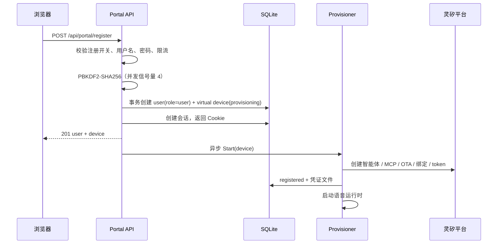

# 多租户用户 Portal 设计

> 相关文档：[架构设计](architecture.md)、[控制面数据库设计](gateway-database.md)、[应用管理 MCP](app-management-mcp.md)、[控制面与 Render 接口](gateway-render-interface.md)、[现场语音入口](voice-entry.md)

## 1. 定位与范围

Gateway 以厂商托管的在线 Portal（SaaS 形态）运行：管理员先登录管理后台，配置平台级 AgentAPI、Linx 与可选的默认 Render/Casting 服务；普通用户自助注册，系统自动用平台 Linx Key 创建一个智能体（对应一台虚拟 Linx 设备），用户登录后即可查看自己的智能体与应用、绑定服务并直接语音对话。

Portal 与 Gateway 同进程、同端口、同 SQLite：

- 管理员与普通用户使用同一个登录入口，按角色进入 `/admin` 或 `/portal`。
- 注册时自动创建一台虚拟智能体；之后用户可以再添加虚拟设备（各自创建一个智能体），也可以用激活码把硬件设备绑定到已有智能体，最多 10 台。应用归属仍是 `(MAC, AgentID)`，与灵矽 MCP 侧的判断一致。
- Render/Casting 按用户解析：平台默认服务（managed）或用户自己的公网服务（custom）。
- 本期不处理局域网穿透、连接器与计费；Render/Casting 假定已作为公网服务暴露。

数据库从单账号 schema v2 平滑升级到 v3：已有账号保留并默认为 `role=user`；配置的引导账号由 `EnsureAdmin` 提升为管理员，已有设备、应用与凭据保持不变。

## 2. 角色与入口

| 角色 | 创建方式 | 入口 | 权限 |
| --- | --- | --- | --- |
| 管理员 | `gateway.yaml` 中的 `portal.username` / `portal.password` 引导账号；启动时创建或提升为 `role=admin`、`status=active` | `/login` → `/admin`，也可进入 `/portal` | 用户/智能体/全局应用/平台设置；不能查看屏幕内容、用户服务地址或 token、提示词正文 |
| 普通用户 | `/register` 自助注册，`role=user` | `/login` → `/portal` | 自己的智能体、应用、屏幕、服务绑定、语音与设置 |
| 未登录访客 | — | `/`、`/login`、`/register` | Home、登录、注册（注册开关打开时） |

前端路由与守卫：

```text
/                       Home（产品介绍、注册/登录入口）
/login                  登录（管理员与用户同一入口）
/register               注册
/portal                 用户控制台（requireAuth）
  /portal/agents        智能体
  /portal/apps          应用
  /portal/apps/{id}     应用详情
  /portal/screens       屏幕
  /portal/services      服务绑定
  /portal/activity      活动
  /portal/settings      设置
  旧设备页               重定向到 /portal/agents
/portal/call            全屏语音通话页（requireAuth）
/admin                  管理后台（requireAdmin）
  /admin                 概览
  /admin/users          用户
  /admin/users/{id}     用户详情
  /admin/agents         智能体
  /admin/apps           全局应用
  /admin/settings       平台设置
/portal/console        重定向到 /portal（兼容旧链接）
/console                重定向到 /portal（兼容旧链接）
```

- 登录成功后：有站内 `redirect` 参数则回到该地址；否则 `admin → /admin`，`user → /portal`。
- `requireAdmin` 在 `role !== 'admin'` 时跳回 `/portal`；普通用户看不到管理入口。
- 管理员仍可访问 `/portal`，其引导账号原本拥有的设备与应用继续可用；还没有虚拟设备的账号可在智能体页通过“添加设备”创建。
- 配置账号在每次启动时都会被 `EnsureAdmin` 提升为管理员并激活；如果密码变化，会更新哈希并撤销该账号的全部会话。

## 3. 注册与自动开通

### 3.1 注册开关

- 注册由平台设置 `registration.open` 控制，默认关闭。
- 仅当 `registration.open` 尚无值时，配置 `portal.allow_registration: true` 才会把它 seed 为 `true`；此后以数据库为准，管理员可在 `/admin/settings` 修改。
- 关闭时 `POST /api/portal/register` 返回 `403 REGISTRATION_CLOSED`。
- 上线顺序：先完成租户隔离（MCP、屏幕、Service 全链路按 owner 校验）验证，再打开注册；否则新用户可能看到或停掉其他用户的应用。

### 3.2 注册流程



规则：

- 用户名先转小写并去除首尾空白，长度 3–32，仅允许字母、数字、下划线、连字符和点；密码长度 8–128。
- 用户名重复返回 `409 USERNAME_TAKEN`；用户与虚拟设备通过 `CreatePortalUserWithDevice` 在同一事务写入，不会出现“有用户没有智能体”。
- 注册成功后直接创建会话并设置 `oa_portal` Cookie，不需要再次登录。
- 注册限流：按客户端 IP 每 5 次/小时、最多 20 次/天，全局限 100 次/小时；超限返回 `429 REGISTRATION_RATE_LIMITED`。
- 密码哈希为 PBKDF2-SHA256：16 字节随机盐、600,000 次迭代、32 字节输出；同时进行的哈希计算最多 4 个，避免注册洪峰打满 CPU。
- 注册后立即返回，开通在后台异步执行，不阻塞注册响应。

### 3.3 自动开通步骤

| 步骤 | 动作 | 结果 |
| --- | --- | --- |
| `create_agent` | 用平台 Linx API Key 创建智能体 | 写入 `linx_agent_id` |
| `attach_mcp` | 创建/复用 MCP Server 与实例，挂载到智能体 | `portal_settings` 缓存 `linx.mcp_server_id` / `linx.mcp_instance_id` |
| `ota` | 用虚拟设备 MAC / Client-Id 上报 OTA | 获得激活码，或直接获得 `websocket.token` |
| `bind` | 把激活码绑定到智能体 | 绑定成功；409 视为已绑定 |
| `token` | 轮询 OTA 直到返回设备 token | 凭证写入 `{portal.data_dir}/devices/{device_id}.json`（`0600`） |
| `done` | 设备置为 `registered` | 启动该设备的语音运行时 |

幂等与恢复：

- 已有 `linx_agent_id` 时跳过创建智能体；MCP 先查缓存与平台列表，已存在则复用；OTA 与绑定可安全重试。
- Linx 平台未配置（缺少 `linx.api_base` / `linx.api_key`）时，设备进入 `error`，`error_code` 为 `PLATFORM_NOT_CONFIGURED`，页面显示“平台尚未配置，请联系维护者”；管理员在后台配置后，用户可在智能体页重试，不需要重新注册。
- 开通并发上限为 4。Gateway 重启后：
  - `registered` 且凭证可读的设备恢复语音运行时；
  - 停在 `provisioning` 且没有凭证的设备自动重新入队；
  - 有可读凭证但状态停在 `provisioning` / `error` 的设备修复为 `registered`；
  - 没有凭证的 `error` 设备只由用户或管理员显式重试。
- 平台侧故障时不会形成自动重试风暴；重试由用户或管理员触发。

## 4. 用户能力

### 4.1 概览与智能体

- **概览**：智能体开通状态/步骤、语音状态、服务绑定是否可用、应用与屏幕统计、最近应用；未绑定可用服务时提示去服务页。
- **智能体**（原设备页）：一张智能体卡片展示名称、状态、开通步骤、MAC、注册时间与语音状态；下方列出该智能体的应用；提供“重新开通”和“发起通话”。
- 注册已自动创建第一台虚拟设备。智能体页的“添加设备”可以继续添加两种设备，每个账号最多 10 台（`DEVICE_LIMIT`）：
  - **虚拟设备**：`kind=virtual`，新建一个独立的 Linx 智能体并走完整开通流程，在浏览器里用麦克风和扬声器对话。可选 `name` 用于区分。
  - **硬件设备**：`kind=physical`。硬件联网后会播报或显示激活码，用户把它填入 `activation_code`；网关调用 Linx `POST /xiaozhi/device/bind/{agentId}/{code}` 把硬件绑到所选智能体（`agent_device_id`，默认第一台已有智能体的设备），并用平台返回的 `macAddress` 记录设备，使该硬件发来的 MCP 请求按 `(MAC, AgentID)` 归到这个用户。硬件自己连接灵矽，没有浏览器语音运行时，也不会在网关重启时被恢复。一个智能体可以绑多台硬件，它们各自的应用互相独立。
- 移除设备：`DELETE /api/portal/devices/{id}`。至少保留一台；设备名下还有应用返回 `APP_BUSY`；仍有硬件绑在某个智能体上时不能移除该智能体的设备（`DEVICE_HAS_HARDWARE`）。移除硬件会先向灵矽解绑，解绑失败返回 `UNBIND_FAILED`，确认已在灵矽侧处理后可加 `?force=true` 强制移除。移除虚拟设备会停止其语音运行时并删除凭证文件，灵矽上的智能体本身不删除。
- 灵矽返回的硬件 MAC 按原样保存并精确匹配 MCP 的 `X-Linx-Device-Id`，不做大小写归一；接入新批次硬件后需用真实设备确认两边格式一致。
- 设备视图不返回 token 与凭证文件路径；`client_id` 可以展示，便于排障。

### 4.2 应用

- 应用列表按当前用户的智能体 `(MAC, AgentID)` 查询并归并，只显示自己的应用。
- 应用状态：`building`、`idle`、`running`、`error`；列表展示构建进度、生命周期时间、操作数与所在 `screen_id`。
- 应用详情复用 `get-app-status` / `get-app-operations` 语义，展示操作列表、运行时间与 OpenAPI 是否可用。
- `openapi.yaml` 由已保存的规范重新序列化为 YAML，以 `text/yaml` 返回，支持查看与下载；页面按文本渲染，不注入 HTML。
- 删除只允许 `idle` / 可清理的 `error`；`building`、`running` 或仍有待清理资源时返回 `APP_BUSY`。启动仍由灵矽语音侧的 `start-app` 完成，Portal 不提供手动投屏。

### 4.3 屏幕

- 屏幕来自当前用户绑定的 Casting 服务；`managed` 时使用平台默认 Casting，并可把部署配置的 `screens` catalog 作为屏幕别名；`custom` 时直接使用 Casting 发现的 target ID。
- 返回 `screen_id`、`name`、`online`、`status`、`current_app`（可选），不返回 `target_id`、`active_session_id`、`projection_session_id`、`endpoint_id` 或 `instance_id`。
- `status` 取 `free`、`showing_app`、`external`、`unavailable`；只有自己的应用会填 `current_app`，其他租户占用显示为 `external`。
- “停止投屏”只停止当前用户自己的应用并释放屏幕；没有自有应用时返回 `404 SCREEN_APP_NOT_FOUND`。
- 屏幕 ID 按用户作用域：两个用户即使使用相同的 `screen_id`，在各自 Casting 上也互不影响。

### 4.4 服务绑定

每个用户可以为自己的账号选择 Render 与 Casting：

| 模式 | 行为 |
| --- | --- |
| `managed`（默认） | 使用管理员配置的平台默认 Render/Casting；读取绑定本身返回 `managed.available`，真正访问屏幕或启动应用时若平台未配置则返回 `SERVICE_NOT_CONFIGURED` |
| `custom` | 用户填写两个公网地址：Render URL 与 Casting URL；可分别设置访问令牌 |

约束与行为：

- `custom` 必须同时有 Render URL 和 Casting URL，否则 `409 SERVICE_NOT_CONFIGURED`。
- 可选令牌保存后只返回 `render_token_configured` / `casting_token_configured`，不回显明文；再次保存时省略或传空表示保留，`clear_render_token` / `clear_casting_token` 才显式清除。
- 切换到 `managed` 会保留已保存的自定义地址与密文 token，方便切回；显式清除标记仍然生效。
- 保存前检查该用户是否有运行中或待清理的应用；有则 `409 APPS_RUNNING`，要求先在屏幕页停止，避免旧实例失去清理地址。
- 保存/测试的地址必须通过出站策略：只接受 `http`/`https`，拒绝 userinfo、fragment、非法端口，默认拒绝回环、私网、link-local、组播与 CGNAT 地址（本地调试可用 `services.allow_private_targets=true` 放行）。
- 测试连接按用户限流 10 次/分钟（`429 SERVICE_TEST_RATE_LIMITED`）；省略 token 时使用已保存的密文。返回 Render/Casting 是否可达与屏幕数量，不返回屏幕详情。
- 平台默认 Render/Casting 地址由管理员配置；管理员修改默认服务前，如果仍有依赖平台托管服务（`managed` 或无绑定记录）的应用处于运行中或待清理状态，返回 `409 APPS_RUNNING`，要求先停止。只使用自有服务的用户不受此限制。

### 4.5 语音与实时字幕

- 每台虚拟设备对应一个内嵌 `voiceentry.App`；注册完成即启动，Gateway 重启后恢复。
- 通话页 `/portal/call?device={id}` 使用浏览器麦克风与扬声器，复用 `/voice/{device_id}/status|events|audio|playback|pause|resume|abort`。
- 实时字幕来自 voiceentry 的 `stt` / `tts` 事件流；不提供文字输入框，也不新增文字发送接口。
- `/voice/{device_id}/...` 先校验会话 Cookie 与设备归属，要求 `kind=virtual`、`state=registered`，只放行通话页需要的端点。
- 用户被停用时停止其语音运行时；重新启用后恢复登录，语音需在智能体页重试（已注册设备会重启语音）或由管理员重试启动。

### 4.6 活动与设置

- **活动**：从设备与应用时间戳派生的时间线（注册、构建开始/完成、启动/停止）以及进行中的任务；没有逐条操作审计表，页面明确说明这一点。
- **设置**：账号角色与创建时间、服务绑定入口、外观主题、退出登录。

## 5. 管理能力

管理入口常驻左侧导航：管理员在用户控制台中直接看到「管理」分组（管理概览、用户、全部智能体、全部应用、平台设置），不需要先进入设置页；普通用户不渲染这些入口。`/admin/*` 路由仍由前端 `requireAdmin` 与后端 `withAdmin` 双重校验，隐藏入口不替代权限检查。

| 页面 | 能力 |
| --- | --- |
| 概览 | 用户（总数/active/disabled/管理员数）、智能体（按状态计数）、应用（按状态计数）、平台配置是否就绪（AgentAPI/Linx/默认服务）与注册开关 |
| 用户 | 用户名搜索、状态筛选、分页（默认 50，上限 100）；查看用户、智能体与不含屏幕字段的应用摘要；停用/启用 |
| 用户详情 | 用户信息、设备/智能体列表、应用摘要；不返回用户的服务绑定地址或 token |
| 智能体 | 全部设备及开通状态、步骤、错误、所属用户；重试开通 |
| 全局应用 | 全局应用列表（状态/关键词过滤，默认 100 条、上限 200）；显示所属用户/智能体、状态、构建时间、操作数；只读 |
| 平台设置 | AgentAPI、Linx、默认 Render/Casting、注册开关；秘密字段只显示是否已配置与更新时间/修改人，不回显值；测试连接 |

管理端边界：

- 不提供 `/api/admin/screens`，管理端应用视图不包含 `screen_id`、`target_id`、`projection_session_id`，也不展示来自 prompt 的 `summary`。
- 管理员不能查看屏幕内容、用户服务地址/token、提示词正文或任何密钥。
- 禁用用户时：撤销全部会话、停止该用户语音运行时，并 best-effort 停止其应用（使用用户自己的绑定）；停止失败只记日志，不阻塞禁用。启用只恢复登录，不自动重跑开通。
- 不能停用自己（`409 CANNOT_DISABLE_SELF`），也不能停用最后一个 active 管理员（`409 LAST_ADMIN`）。配置引导账号如果被其他管理员停用，下一次启动会被 `EnsureAdmin` 重新激活。
- 平台设置保存时，秘密字段省略或空表示保留，`clear: true` 才清除；Linx `api_base` 或 `api_key` 变化会清空缓存的 MCP Server/实例 ID，下一次开通重新创建。

## 6. API 清单与错误码

所有 `/api/portal/*` 与 `/api/admin/*` 响应为 JSON；错误体统一为 `{"error":{"code":"...","message":"..."}}`。写请求要求同源并带 `Content-Type: application/json`，否则 403 / 415。

### 6.1 公开与用户接口

| 方法 | 路径 | 说明 |
| --- | --- | --- |
| `POST` | `/api/portal/register` | 注册并登录，返回 `201` user + device，设置 Cookie |
| `POST` | `/api/portal/login` | 登录；管理员与用户同一入口 |
| `POST` | `/api/portal/logout` | 删除会话与 Cookie，返回 `204` |
| `GET` | `/api/portal/me` | 当前用户（含 role/status）与设备列表 |
| `GET` | `/api/portal/devices` | 当前用户的智能体设备列表 |
| `POST` | `/api/portal/devices` | 添加设备：`{kind: virtual\|physical, name?, activation_code?, agent_device_id?}`；虚拟设备返回 `202`，硬件返回 `201` |
| `GET` | `/api/portal/agent-options` | 用户可选项：音色、语言、公开大模型、记忆模式，以及新智能体默认的角色介绍 `default_system_prompt` |
| `GET` | `/api/portal/devices/{id}/agent` | 读取设备所属智能体的名称与音色 |
| `PUT` | `/api/portal/devices/{id}/agent` | 修改智能体：`assistant_name`（1–20 字符）、`system_prompt`（完整角色介绍，1–6000 字符）、`tts_voice_id`、`lang_code`、`llm_model_id`、`mem_model_id`、`chat_history`（聊天保存：0 不记录、1 仅文本、2 文本加语音）、`voice_volume`（0–100）、`voice_speed`（0.5–2.0）、`llm_temperature`（0–1.9）、`llm_max_tokens`（1–8192）、`idle_timeout_seconds`（60–3600）、`disable_greeting`。只提交变化的字段；音色、语言、模型必须在可选项里，私有模型不开放。意图识别模型不开放，它决定智能体能否调用工具。角色介绍可以整段修改，界面提供“恢复平台默认”；改动它可能让智能体无法正确制作或控制应用 |
| `GET` | `/api/portal/devices/{id}/mcps` | 智能体的 MCP 服务：`required`（网关自己的服务，始终启用）和 `available`（管理员开放的服务，带 `selected`）。不返回任何连接地址或 token |
| `PUT` | `/api/portal/devices/{id}/mcps` | `{ids}` 整体替换可选服务。只能选管理员开放的；网关自己的服务始终保留；它尚未创建时返回 409 `MCP_NOT_READY` |
| `DELETE` | `/api/portal/devices/{id}` | 移除设备，`?force=true` 在灵矽解绑失败时仍移除；返回 `204` |
| `GET` | `/api/portal/devices/{id}` | 设备开通详情与语音状态 |
| `POST` | `/api/portal/devices/{id}/retry` | 重试开通；已注册设备则重启语音 |
| `POST` | `/api/portal/devices/{id}/disconnect` | 断开已注册设备与灵矽的连接；设备保持离线，凭证与注册不变，直到重新连接或网关重启 |
| `POST` | `/api/portal/devices/{id}/reconnect` | 重建连接，连接正常时也会替换为新连接；设备未注册返回 `DEVICE_NOT_READY` |
| `GET` | `/api/portal/services` | 当前服务绑定；秘密只返回 `configured` |
| `PUT` | `/api/portal/services` | 保存 managed/custom、地址与可选 token |
| `POST` | `/api/portal/services/test` | 测试当前或待保存绑定；返回 Render/Casting 状态与屏幕数 |
| `GET` | `/api/portal/screens` | 当前用户 Casting 的屏幕 |
| `POST` | `/api/portal/screens/{screen_id}/stop` | 停止自己的应用并释放屏幕 |
| `GET` | `/api/portal/apps` | 当前用户应用 |
| `GET` | `/api/portal/apps/{id}` | 应用详情与操作 |
| `GET` | `/api/portal/apps/{id}/openapi.yaml` | OpenAPI 文档，`text/yaml` |
| `DELETE` | `/api/portal/apps/{id}` | 删除应用与产物，返回 `204` |

语音控制端点（Cookie 鉴权，归属校验后挂载）：

```text
GET  /voice/{device_id}/status
GET  /voice/{device_id}/events
WS   /voice/{device_id}/audio
WS   /voice/{device_id}/playback
POST /voice/{device_id}/playback/pause
POST /voice/{device_id}/playback/resume
POST /voice/{device_id}/abort
```

### 6.2 管理接口

| 方法 | 路径 | 说明 |
| --- | --- | --- |
| `GET` | `/api/admin/overview` | 用户/智能体/应用计数与平台配置状态 |
| `GET` | `/api/admin/users?query=&status=&limit=&offset=` | 用户列表 |
| `GET` | `/api/admin/users/{id}` | 用户、智能体与应用摘要 |
| `POST` | `/api/admin/users/{id}/status` | `{status: active|disabled}` |
| `GET` | `/api/admin/agents?state=&query=` | 全部智能体/设备 |
| `POST` | `/api/admin/agents/{id}/retry` | 重试开通或重启语音 |
| `GET` | `/api/admin/apps?state=&query=&limit=` | 全局应用 |
| `GET` | `/api/admin/settings` | 平台设置（秘密脱敏） |
| `PUT` | `/api/admin/settings` | 保存平台设置；默认服务变更受 `APPS_RUNNING` 保护 |
| `POST` | `/api/admin/settings/test` | 测试 Linx/Render/Casting；限流 20 次/分钟 |
| `GET` | `/api/admin/mcp` | 灵矽账号下全部 MCP 服务，网关自己的排在最前，并标出已开放给用户的 |
| `PUT` | `/api/admin/mcp/shared` | `{ids}` 选择开放给用户的 MCP 服务；未知服务或网关自己的服务返回 400 |
| `POST` | `/api/admin/mcp/sync` | 把当前 MCP 地址与 token 同步到灵矽上网关自己的服务 |

### 6.3 错误码

| code | HTTP | 场景 |
| --- | --- | --- |
| `REGISTRATION_CLOSED` | 403 | 注册开关关闭 |
| `REGISTRATION_RATE_LIMITED` | 429 | 注册超过 IP 或全局限流 |
| `USERNAME_TAKEN` | 409 | 用户名已存在 |
| `INVALID_CREDENTIALS` | 401 | 用户名或密码错误 |
| `UNAUTHORIZED` | 401 | 未登录，或会话已过期/被撤销 |
| `TOO_MANY_ATTEMPTS` | 429 | 登录失败次数过多 |
| `ACCOUNT_DISABLED` | 403 | 账号被停用后尝试登录 |
| `FORBIDDEN` | 403 | 跨站写请求被拒绝 |
| `ADMIN_REQUIRED` | 403 | 普通用户访问 `/api/admin/*` |
| `LAST_ADMIN` | 409 | 停用最后一个 active 管理员 |
| `CANNOT_DISABLE_SELF` | 409 | 管理员停用自己 |
| `USER_NOT_FOUND` / `AGENT_NOT_FOUND` / `APP_NOT_FOUND` | 404 | 管理端目标不存在；用户端跨用户资源同样 404 |
| `APPS_RUNNING` | 409 | 有运行中/待清理应用时修改自己的服务绑定；管理员修改平台默认服务时，仅当仍有使用平台托管服务的应用占用资源才阻止 |
| `SERVICE_NOT_CONFIGURED` | 409 | managed 缺平台默认服务，或 custom 缺地址 |
| `INVALID_TARGET_URL` | 400 | 服务地址格式非法 |
| `PRIVATE_TARGET_FORBIDDEN` | 400 | 服务地址指向回环/私网等受限地址 |
| `TARGET_UNREACHABLE` | 502 | 服务地址无法解析或无法连接 |
| `SERVICE_TEST_RATE_LIMITED` / `SETTINGS_TEST_RATE_LIMITED` | 429 | 连接测试过于频繁 |
| `PLATFORM_NOT_CONFIGURED` | 409（若经用户接口映射） | 平台 AgentAPI 或 Linx 未配置；MCP `create-app` 以工具错误返回，设备开通失败时设备 DTO 带 `error_code=PLATFORM_NOT_CONFIGURED` 与中文文案 |
| `DEVICE_BUSY` / `DEVICE_NOT_READY` | 409 | 设备正在开通，或语音尚未就绪 |
| `DEVICE_LIMIT` | 409 | 设备数量已达每账号 10 台上限 |
| `AGENT_NOT_READY` | 409 | 添加硬件时还没有开通完成的智能体 |
| `ACTIVATION_CODE_INVALID` / `DEVICE_ALREADY_BOUND` / `DEVICE_EXISTS` | 400 / 409 / 409 | 激活码无效或已使用；灵矽上设备已被绑定；该硬件已添加过 |
| `LAST_DEVICE` / `DEVICE_HAS_HARDWARE` | 409 | 至少保留一台设备；智能体上仍绑着硬件 |
| `UNBIND_FAILED` / `PLATFORM_ERROR` / `PLATFORM_UNAVAILABLE` / `PLATFORM_AUTH_FAILED` | 502 | 向灵矽解绑失败；调用灵矽失败、不可用，或平台 API Key 无效 |
| `SCREEN_DISCOVERY_FAILED` | 503 | Casting 不可用，无法发现屏幕 |
| `SCREEN_APP_NOT_FOUND` | 404 | 屏幕上没有当前用户的应用 |
| `APP_BUILDING` / `APP_BUSY` / `APP_IN_ERROR` | 409 | 应用状态不允许删除或停止 |
| `STOP_FAILED` | 502 | 停止投屏失败 |
| `VOICE_UNAVAILABLE` | 503 | 语音运行时未启动或启动失败 |
| `PROVISION_UNAVAILABLE` | 503 | 开通组件不可用（管理端重试智能体） |
| `SETTINGS_UNAVAILABLE` / `SERVICE_UNAVAILABLE` | 503 | 平台设置或服务绑定组件不可用 |
| `INVALID_SETTINGS` / `INVALID_ARGUMENT` | 400 | 设置值或请求参数无效 |
| `INVALID_CONTENT_TYPE` | 415 | 写请求不是 JSON |
| `INTERNAL` | 500 | 未分类内部错误，响应不包含内部细节 |

MCP 连接级错误码（见 [应用管理 MCP](app-management-mcp.md)）：`MISSING_IDENTITY` 400、`IDENTITY_MISMATCH` 403、`OWNER_NOT_FOUND` / `IDENTITY_NOT_REGISTERED` / `USER_DISABLED` 403。Portal 模式下 MCP Token 始终存在：首次启动自动生成，加密保存在平台设置里。

## 7. 数据模型与迁移摘要

当前 `schemaVersion = 4`，按版本有序迁移（详见 [控制面数据库设计](gateway-database.md)）：

| 版本 | 内容 |
| --- | --- |
| v1 | `apps`、`artifacts` |
| v2 | `portal_users`、`portal_sessions`、`portal_devices`、`portal_settings` |
| v3 | 角色/状态、登录时间、唯一约束、服务绑定、平台设置 |
| v4 | 一个账号可有多台设备：去掉“一用户一台虚拟设备”和“一个智能体一台设备”的唯一索引，改为 `(linx_agent_id, mac)` 唯一；`portal_devices.name` |

关键变化：

- `portal_users` 新增 `role`（`admin` / `user`）、`status`（`active` / `disabled`）与 `last_login_at`；旧账号默认 `user`，配置引导账号由 `EnsureAdmin` 提升为管理员。
- v3 的唯一索引（一个用户最多一台虚拟设备、一个 `linx_agent_id` 只能一台设备）在 v4 被替换：设备数量由接口限制（每账号 10 台），唯一性改由 `mac` 全局唯一与 `(linx_agent_id, mac)` 唯一保证，使硬件可以共用用户已有的智能体。
- `portal_service_bindings`：每用户一行，`mode` 为 `managed` / `custom`，保存两个地址与加密后的 Render/Casting token。
- `platform_settings`：平台级键值（AgentAPI、Linx、默认服务、注册开关），记录 `is_secret`、`updated_at`、`updated_by`。
- `apps` 表不变，归属仍通过 `portal_devices` 的 `(mac, linx_agent_id)` 反查。
- 秘密字段使用 AES-256-GCM，密文格式 `enc:v1:<base64(nonce|ciphertext)>`，AAD 绑定上下文：平台设置为 `platform:<key>`，用户 token 为 `binding:<user_id>:<render|casting>`。
- 主密钥来自环境变量 `GATEWAY_SECRET_KEY`（base64 32 字节），否则读取 `<portal.data_dir>/secret.key`；不存在时生成 `0600` 文件。Gateway 启动时会解密校验 `platform_settings` 与 `portal_service_bindings` 中的全部密文，任一密文无法解密（例如主密钥丢失或不匹配）就拒绝启动，并提示恢复 `secret.key` 或设置原 `GATEWAY_SECRET_KEY`；不会静默生成新密钥。密钥丢失后所有密文都无法恢复，必须与数据库一起备份。

## 8. 安全边界

- **RBAC**：`/api/admin/*` 全部经过 `withAdmin`；用户端接口不接受 `user_id` / `role` 参数；管理员操作只按目标 ID。
- **归属**：设备、应用、屏幕、语音都按登录用户或 MCP `(DeviceID, AgentID)` 校验；跨用户访问一律 404，不暴露资源是否存在。
- **MCP 身份**：Portal 模式要求 `X-Linx-Device-Id`、`X-Linx-Agent-Id`、`X-Linx-Session-Id` 三头齐全，每次 POST 都与 SSE 会话精确一致，并查库确认设备存在、已注册、用户 active。MCP Token 在 Portal 模式下由平台生成。
- **SSRF**：用户填写的 Render/Casting 地址、平台默认地址、连接测试、`SendRequest` 与 `AppBaseURL` 都走同一套 netguard 策略；DNS 与重定向在 dial 时复核，禁用环境代理。`services.allow_private_targets` 仅用于本地调试。
- **密钥脱敏**：平台 API Key、用户服务 token、设备 token、`password_hash`、会话 hash、`credential_path`、`target_id`、`projection_session_id` 不出现在 API 响应、页面或日志中；秘密字段只返回是否已配置（平台设置另带更新时间/修改人），不回显明文。
- **管理端 DTO 边界**：管理端用户/应用响应与页面不包含屏幕字段、用户服务绑定地址/token、prompt 正文或任何密钥；管理端没有屏幕接口。
- **请求防护**：沿用同源检查 + JSON Content-Type；SQL 全部参数绑定；登录与注册限流；停用用户立即失效会话并拒绝 MCP。
- **已知取舍**：MCP 仍使用全局 MCP Token；拿到 token 的人若能猜到已知 `(MAC, AgentID)` 仍可能冒充设备，当前没有 per-agent MCP 凭证。

## 9. 非目标

- 计费、配额、套餐、发票。
- 邮箱验证、找回密码、修改密码、删除账号。
- 管理员查看或操作屏幕内容；管理员单独停止/接管用户应用（仅在停用用户时 best-effort 停止）。
- 局域网发现、穿透、连接器；用户自行部署 Render/Casting 的安装流程。
- 文字输入式对话（只做语音 + 实时字幕）。
- 多管理员邀请、细粒度权限、审计表、多地域/多活。
- 应用市场、分享、模板；多副本 Gateway。

## 10. 部署要点

```yaml
portal:
  enabled: true
  data_dir: "portal-data"        # 凭证、secret.key、运行时数据，目录 0700
  web_dir: "portal/dist"         # Vite 构建产物
  web_embedded: false            # true 时用编译进二进制的产物，忽略 web_dir
  username: "admin"              # 管理员引导账号
  password: "<至少 8 个字符>"     # 建议用 PORTAL_PASSWORD 注入
  allow_registration: false      # 仅首次启动 seed 到 registration.open
  cookie_secure: true            # 生产 HTTPS 置为 true

services:
  allow_private_targets: false   # 仅本地调试设为 true

# MCP Token、Linx、AgentAPI、默认 Render/Casting 都在管理后台 /admin/settings 配置，
# 配置文件里不需要再写（旧配置里已有的值只在数据库为空时写入一次）。
```

- 先构建前端：`cd portal && pnpm install && pnpm build`；未构建时 `/` 返回 503。
- 单文件部署：`make build-gateway-embed`（等价于 `go build -tags portalembed`）。`pnpm build` 会把 `portal/dist` 同步到 `internal/gateway/portal/webdist` 供 `go:embed` 使用，运行时把 `portal.web_embedded` 设为 `true`。未带 tag 的二进制配置该项会启动失败，避免误以为前端已内嵌。
- 灵矽云必须能访问管理后台里填写的“公网 MCP 地址”；局域网地址不可达。新建 MCP 使用 Streamable HTTP，地址应以 `/mcp` 结尾；`/sse` 是旧版 Legacy SSE 端点，仅已有服务继续使用。
- 浏览器麦克风要求 HTTPS 或 `localhost`。
- 单进程、单 SQLite；一个数据库只对应一个 Gateway。
- 备份时必须同时保留数据库与 `secret.key`（或 `GATEWAY_SECRET_KEY`）；WAL 模式下数据库用 SQLite `.backup`，不能只拷贝主文件。
- 平台 AgentAPI/Linx（公网 MCP 地址、MCP 名称、助手名称、模型）/默认 Render/Casting 都在管理后台配置，字段下方说明了数据来源；MCP Token 首次启动自动生成，可在后台重新生成并同步到灵矽 MCP。`gateway.yaml` 中的对应值只在设置尚无值时 seed 一次，已有设置不会被覆盖，可以从文件里删除。
